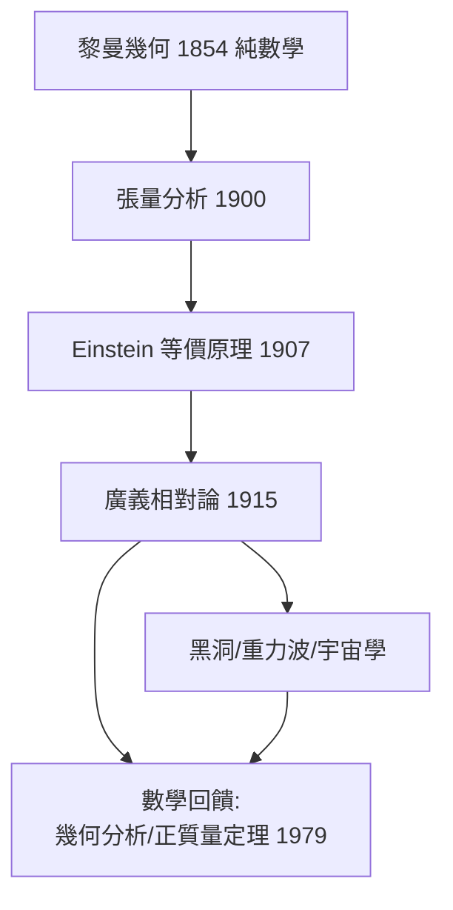

# 3.2 廣義相對論：黎曼幾何成為物理語言（1915）【數學→物理】

## 前因：等價原理逼出彎曲時空

1907 年 Einstein 的「最快樂的想法」：自由落體中感覺不到重力——**重力與加速度局域等價**（等價原理）。含義驚人：重力不是「力」，而是**時空本身的性質**；在彎曲時空中，自由落體沿測地線走。問題：他需要一套在任意彎曲、任意座標下都能寫定律的數學——1912 年他發現自己不會。

## 構造

**數學救援**：Grossmann 介紹 Riemann–Christoffel–Ricci–Levi-Civita 的張量分析（3.1 的遺產）。

**時空幾何**：

$$ds^2 = g_{\mu\nu} dx^\mu dx^\nu, \qquad \text{自由落體：測地線方程 } \ddot x^\mu + \Gamma^\mu_{\alpha\beta}\dot x^\alpha \dot x^\beta = 0$$

**場方程（1915）**：物質決定幾何，幾何決定運動：

$$\mathrm{Ric}_{\mu\nu} - \tfrac12 R g_{\mu\nu} = \frac{8\pi G}{c^4} T_{\mu\nu}$$

左邊純幾何（曲率），右邊純物理（能量動量張量）——**重力 = 時空曲率**。

**三大立即驗證**（皆為數學計算的預言）：

1. 水星近日點進動（每百年 43″，精確吻合）；
2. 光線偏折 $1.75″$（1919 Eddington 日食觀測）；
3. 重力紅移。

## 後果

1. **物理的數學化升級**：物理定律第一次**等同於幾何命題**——這重塑了 20 世紀物理的方法論（規範場論 4.4 沿同一模式）。
2. **數學的反哺**：相對論刺激了整體微分幾何——正質量定理（Schoen–Yau 1979, Witten 1981 用旋量證明）、Penrose 奇點定理（1965，用拓撲+因果結構）、Hawking 輻射。
3. **宇宙學**（3.3）：Friedmann 解使宇宙本身成為動態系統。
4. **本書觀點**：這是「數學→物理」的世紀標本——**1854 年的純思辨在 1915 年成為宇宙的描述**，Wigner 有效性之謎（13.2）最著名的證據。

## 練習與思考

1. 證明弱場極限下測地線方程退化為牛頓 $\ddot x = -\nabla\Phi$。
2. 為什麼場方程兩側都是「二階張量」是必然的（座標不變 + 二階導數 + 能量守恆）？
