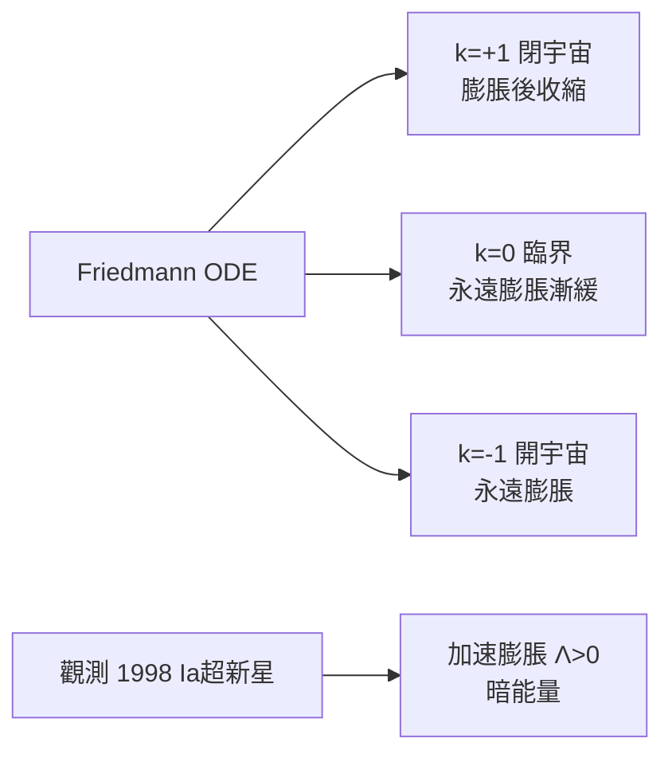

# 3.3 Friedmann 宇宙學：微分方程描繪宇宙命運（1922）【數學→物理】

## 前因：靜態宇宙的尷尬

Einstein 1917 年把廣義相對論用於整個宇宙，為了得到靜態解加入宇宙常數 $\Lambda$——因為當時大家都相信宇宙不變。Alexander Friedmann（1922–24）重新求解，發現**無需 $\Lambda$ 也有動態解：宇宙可以膨脹或收縮**。Einstein 起初反對，後承認錯誤（他稱引入 $\Lambda$ 為「一生最大的失誤」）。

## 構造

**假設**：宇宙在最大尺度均勻且各向同性（Robertson–Walker 度規）：

$$ds^2 = -c^2dt^2 + a(t)^2\left[\frac{dr^2}{1 - kr^2} + r^2 d\Omega^2\right]$$

唯一的動態自由度是**尺度因子** $a(t)$ 與曲率參數 $k \in \{+1, 0, -1\}$。

**Friedmann 方程**（場方程 + 完美流體）：

$$\left(\frac{\dot a}{a}\right)^2 = \frac{8\pi G}{3}\rho - \frac{k c^2}{a^2} + \frac{\Lambda c^2}{3}, \qquad \ddot a = -\frac{4\pi G}{3}\left(\rho + \frac{3p}{c^2}\right)a$$

**三種命運**（純 ODE 分析）：

## 後果

1. **Hubble（1929）**：星系紅移 ∝ 距離——膨脹宇宙被觀測證實，**Friedmann 解早了 7 年**。
2. **大爆炸與宇宙年齡**：把方程倒推，$a(0) = 0$——宇宙有起點（Lemaître 1927/31「原初原子」）。
3. **CMB（1965）**：熱大爆炸的殘光，精確符合 Friedmann 框架下的預言。
4. **數學的持續供給**：微擾宇宙學（密度擾動的譜）、暴脹理論的慢滾動力學、宇宙學常數問題——全部是「場方程 + PDE/ODE 分析」的延續。
5. **本書觀點**：整個現代宇宙學是**一個 ODE 的家族史**——數學不僅供給語言，還供給了「宇宙有歷史」這一世界觀。

## 練習與思考

1. 由 Friedmann 方程證明：$\rho$ 極小時 $k=+1$ 宇宙必將收縮。
2. 為什麼「均勻各向同性」假設能把無窮維的場方程約化為一維 ODE？（對稱性縮減自由度——第 4 章主題的預演。）
