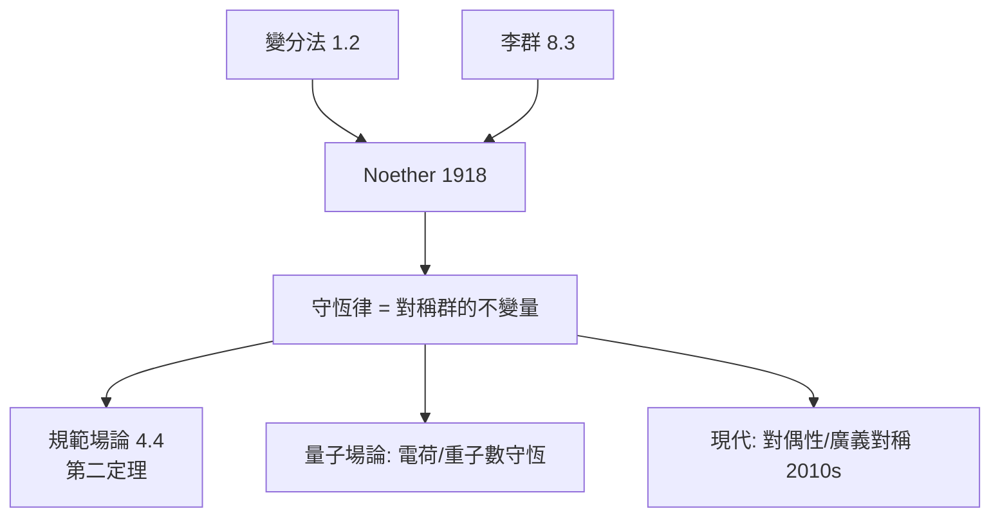

# 4.1 Noether 定理：對稱與守恆的嚴格橋樑（1918）【數學→物理】

## 前因：一場辯論逼出的定理

Einstein 廣義相對論中能量是否守恆引起爭論（Hilbert 與 Klein 求助 Noether）。Emmy Noether 1918 年給出決定性答案：

> **作用量的每一個連續對稱，對應一條守恆律；反之亦然。**

這是數學（變分法 + 李群）對物理基礎的第一次體系化立法。

## 構造

**設定**：作用量 $S = \int L(q, \dot q, t)\, dt$ 。若座標變換 $q \to q + \epsilon\,\delta q$ 使 $L$ 至多改變一個全導數（ $S$ 不變），則

$$Q = \sum_i \frac{\partial L}{\partial \dot q_i}\delta q_i - F \quad \text{守恆} \qquad \left(\frac{dQ}{dt} = 0\right)$$

**四大經典對應**：

| 對稱 | 守恆量 |
|---|---|
| 時間平移 | 能量 |
| 空間平移 | 動量 |
| 旋轉 | 角動量 |
| 規範相位 $\psi \to e^{\mathrm{i}\alpha}\psi$ | 電荷 |

**證明本質**：變分法（1.2）+ 李群無窮小生成元（8.3）——對稱群作用在泛函上，E–L 方程的不變性逼出 $\frac{dQ}{dt}=0$ 。**守恆律從經驗規則升格為群論定理**。

**相對論的重要教訓**：一般時空中「時間平移」不是整體對稱 → 能量守恆需要重新表述（局部 + 規範版本）——Noether 第二定理處理規範對稱，成為規範場論的數學基礎（4.4）。

## 後果

1. **方法論革命**：找新物理 = 找新對稱。粒子物理的每一次分類（4.3）都靠「假設對稱群 → 推守恆律與選擇律」。
2. **規範原理**：局部對稱導出力（4.4）是 Noether 精神的動力學化。
3. **數學內部**：動量映射（moment map）、辛幾何中的守恆量理論——物理直覺回流數學。
4. **本書觀點**：Noether 定理是「雙向螺旋」樞紐——它用純數學證明物理原理，又使物理成為發現數學結構（群、表示）的引擎。

## 練習與思考

1. 用 Noether 定理由 $L$ 的時間平移不變性導出能量守恆。
2. 為什麼規範對稱「不給出新的守恆量」卻給出**約束**（第二定理）？
