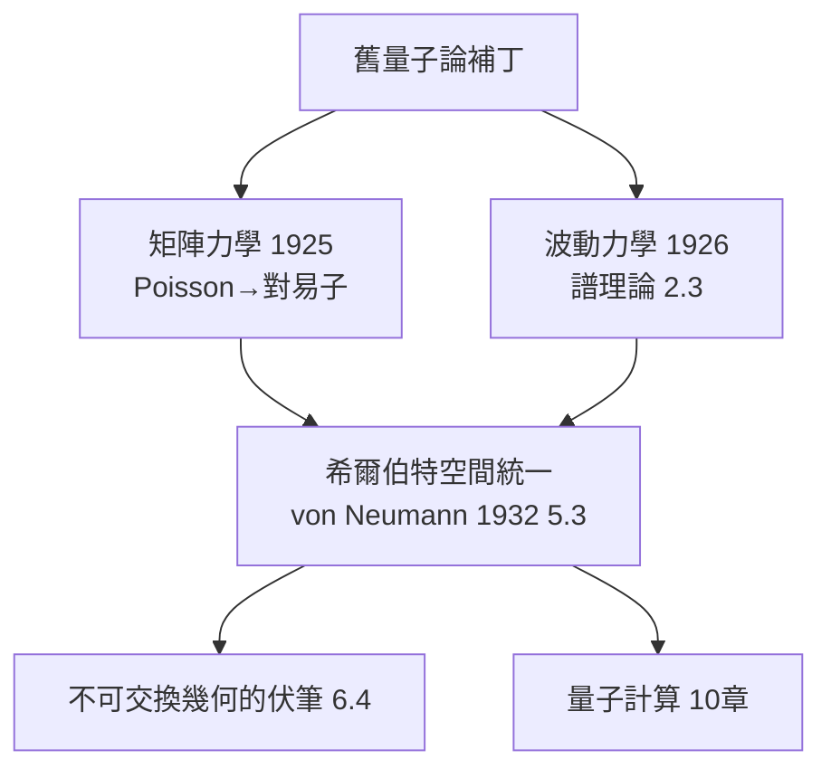

# 4.2 矩陣力學與波動力學：量子論逼出無窮維幾何（1925）【雙向】

## 前因：舊數學裝不下原子

1925 年前的量子論（Planck 1900、Bohr 1913）是「補丁」：能量量子化是外加假設。Heisenberg 主張拋棄不可觀測的軌道，只用躍遷頻率與強度——這些量天然排成**矩陣**（當時物理學家不熟悉的數學！）。Schrödinger 走另一條路：De Broglie 物質波 + Hamilton 力學—波動光學同構（1.2 伏筆）→ 波動方程。

## 構造

**矩陣力學（Heisenberg 1925；Born–Jordan）**：物理量是矩陣，運動方程

$$\frac{d}{dt}[q, p] = [q, H], \qquad [q, p] = \mathrm{i}\hbar\, \mathbf{1}$$

——這正是 Poisson 括號（1.3）的矩陣版：** $\{\,\ ,\,\} \mapsto \frac{1}{\mathrm{i}\hbar}[\,\ ,\,]$ **。對易關係不可交換 → 觀測順序有物理意義 → 不確定性原理（1927）。

**波動力學（Schrödinger 1926）**：

$$\mathrm{i}\hbar\frac{\partial\psi}{\partial t} = \hat H\psi, \qquad \hat H = -\frac{\hbar^2}{2m}\Delta + V$$

氫原子能階離散——譜理論（2.3）自動給出「量子化」。

**數學統一（Dirac、von Neumann 1932）**：兩者都是希爾伯特空間上的自伴算子理論：

| 物理 | 數學 |
|---|---|
| 態 | $H$ 的單位向量 / 射線 |
| 可觀測量 | 自伴算子 |
| 測量值 | 譜點 |
| 機率 | $\|\mathrm{proj}_{\psi}\|^2$ （Born 規則） |
| 相位干涉 | 內積的複數性 |

## 後果

1. **物理→數學**：量子力學使無窮維希爾伯特空間、無界自伴算子（von Neumann 的理論）成為必要——泛函分析被物理「加冕」。
2. **數學→物理**：表示論、群論成為原子/分子光譜的工具（Wigner 1931）。
3. **哲學震盪**：非交換性、機率詮釋——物理第一次需要「非直觀的數學結構」才能自洽。
4. **本書觀點**：量子力學是雙螺旋史上最緊密的一圈：物理需要矩陣（當時是數學邊角），數學的譜定理立即成為物理的律法。

## 練習與思考

1. 由 $[x, p] = \mathrm{i}\hbar$ 導出能量-時間式的不確定性。
2. 為什麼 Heisenberg 的「只談可觀測量」原則自動導出矩陣？
