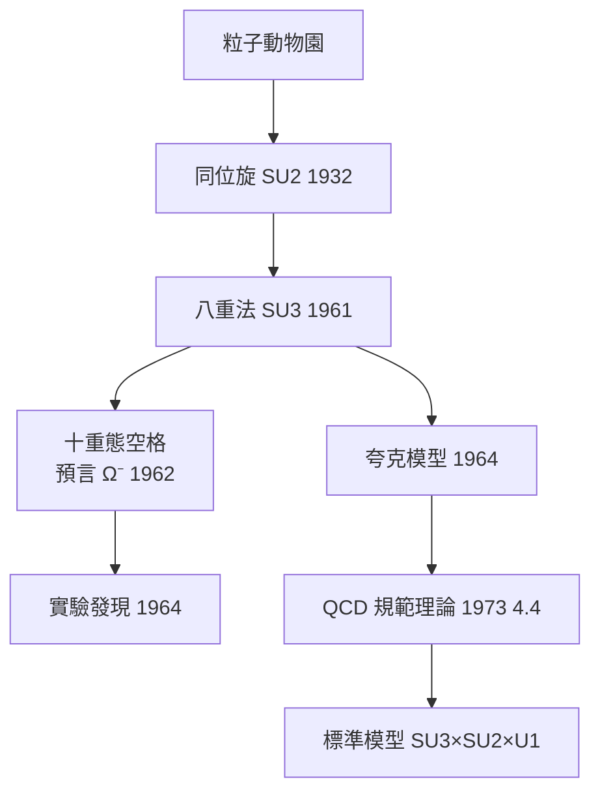

# 4.3 群論與粒子物理：八重法預言 Ω⁻（1962）【數學→物理】

## 前因：粒子動物園需要分類法

1950 年代加速器產生上百種「基本」粒子，混亂如化學元素週期表之前。物理學家轉向數學尋找分類原則：**對稱群**。

## 構造

**同位旋 $\mathrm{SU}(2)$ **（Heisenberg 1932）：質子與中子在核力下近似的「雙重態」——粒子按 $\mathrm{SU}(2)$ 表示分類。

**八重法（Gell-Mann、Ne'eman, 1961）**：強子按 $\mathrm{SU}(3)$ 的表示排列——介子八重態、重子八重態與**十重態**。 $\mathrm{SU}(3)$ 的權圖（李代數 8.3 的分類工具）把粒子排成規整的幾何圖案。

**世紀預言**：1962 年十重態中缺一角——一個電荷 $-1$ 、質量約 $1680\ \mathrm{MeV}$ 的粒子。Gell-Mann 依表示論算出其性質，命名 $\Omega^-$ 。**1964 年 Brookhaven 發現之，質量誤差 <1%**。

$$\text{李代數 } \mathfrak{su}(3)\text{ 的權圖} \quad \Longrightarrow \quad \text{粒子表格的空格} \quad \Longrightarrow \quad \text{實驗找到它}$$

**再進一步**：為何是 $\mathrm{SU}(3)$ ？夸克模型（1964）：三味夸克，強子 = 表示的張量積分解。之後蓋爾曼以 $\mathrm{SU}(3)$ 規範理論（QCD, 1973）統一強作用——分類群升格為規範群（4.4）。

## 後果

1. **表示論成為粒子物理的母語**：Wigner 的群論遺產（1931）全面勝利；對稱性破缺（1960s）引入希格斯機制。
2. **標準模型**： $\mathrm{SU}(3)\times\mathrm{SU}(2)\times\mathrm{U}(1)$ ——三代粒子的全部選擇律來自群的表示與其破缺。
3. **數學回饋**：粒子物理的問題刺激了表示論（Kazhdan–Lusztig、幾何表示論）與規範理論數學（6.2）。
4. **本書觀點**：這是「數學→物理」預言力的巔峰——**一張權圖上的空格，比任何望遠鏡都準確**。

## 練習與思考

1. $\mathfrak{su}(3)$ 的基本表示是 3 維；驗證 $3 \otimes \bar 3 = 1 \oplus 8$ （介子八重態的來源）。
2. 為什麼「分類成功」會指向「更深的對稱」（夸克）？
