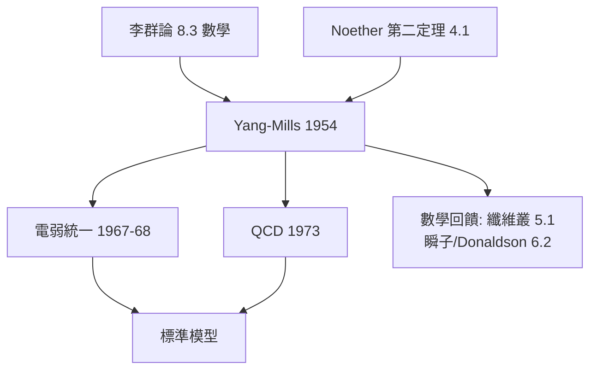

# 4.4 規範場論：局部對稱即相互作用（1954）【數學→物理】

## 前因：從全局對稱到局部對稱

Noether（4.1）說全局對稱給守恆律。Weyl（1929）與 Yang–Mills（1954）再推一步：**把對稱局部化（逐點不同），補償的「聯絡場」就是基本相互作用**。Yang 與 Mills 採用的數學是李群論——當時物理界視為純數學。

## 構造

**電動力學版本**：要求 Dirac 方程在局部相位 $\psi(x) \to e^{\mathrm{i}e\theta(x)}\psi(x)$ 下不變，被迫引入

$$D_\mu = \partial_\mu + \mathrm{i}e A_\mu(x), \qquad F_{\mu\nu} = \partial_\mu A_\nu - \partial_\nu A_\mu$$

$A_\mu$ = 電磁場， $F_{\mu\nu}$ = 場強——Maxwell 方程自動重現。

**Yang–Mills（1954）**：把 $\mathrm{U}(1)$ 換成非交換群 $G$ （如 $\mathrm{SU}(2)$ ）：

$$D_\mu = \partial_\mu + A_\mu, \qquad F_{\mu\nu} = \partial_\mu A_\nu - \partial_\nu A_\mu + [A_\mu, A_\nu]$$

**數學結構**（本書姊妹篇 8.4）： $A$ = 主叢上的**聯絡**， $F$ = **曲率**，Bianchi 恆等式 $DF = 0$ = 齊次 Maxwell 方程。李群 8.3 的理論直接成為力的理論。

**標準模型**：

| 規範群 | 相互作用 |
|---|---|
| $\mathrm{U}(1)$ | 電磁 |
| $\mathrm{SU}(2)\times\mathrm{U}(1)$ | 弱電（Glashow–Weinberg–Salam 1967–68） |
| $\mathrm{SU}(3)$ | 強（QCD 1973） |

## 後果

1. **物理**：標準模型——人類最精確的物質理論（電子磁矩預言精確到 $10^{-10}$ ）。
2. **數學**：規範場論成為幾何的引擎——瞬子（6.2）、Donaldson 理論、Seiberg–Witten（9.1）全部由物理問題驅動。
3. **哲學**：物理定律從「方程 + 對稱」進化為「**由對稱生成**」——Erlangen 精神的物理完成（姊妹篇 8.4）。
4. **本書觀點**：這是「數學→物理」最大規模的單次輸送：一整門李群/叢理論成為物質世界的操作手冊。

## 練習與思考

1. 驗證 $F_{\mu\nu}$ 在規範變換下的協變性，並說明非交換項 $[A_\mu, A_\nu]$ 的物理意義（膠子自作用）。
2. 為什麼「局部化對稱」需要「傳遞對稱性資訊的場」？
