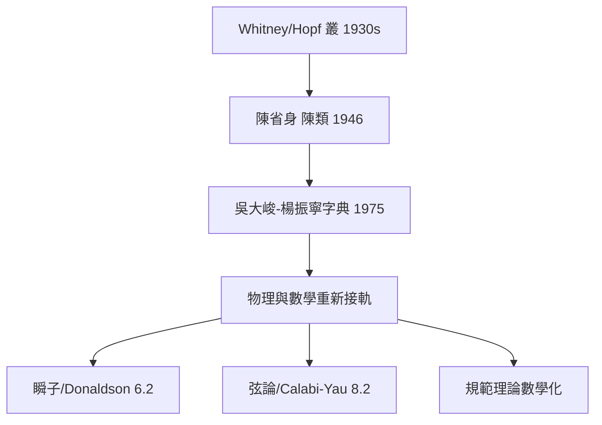

# 5.1 纖維叢：規範理論的幾何身分【數學→物理】

## 前因：物理學家不認識自己說的話

Yang–Mills 理論（4.4）發表後，數學家與物理學家各自發展了同一套東西卻互不相識。1975 年 Yang 訪問 Chern 時感慨：

> 「規範場就是纖維叢上的聯絡，而這些數學家並不知道物理。」

**Wu–Yang 字典（1975）**公開了對應表——兩門學科自此合流。

## 構造：Wu–Yang 字典

| 物理 | 數學（微分幾何） |
|---|---|
| 規範群 $G$ | 結構群 |
| 場（波函數的相位自由度） | 主 $G$ -叢 $P \to M$ |
| 規範勢 $A_\mu$ | 聯絡形式 |
| 場強 $F_{\mu\nu}$ | 曲率 2-形式 |
| 規範變換 | 叢的自同構 / 局部座標更換 |
| 平行輸運（Wilson 迴路） | 和樂 holonomy |
| 磁單極/瞬子 | 非平凡叢（陳類 ≠ 0） |
| 費曼路徑積分 | 叢上的構造 |

**核心觀念**：物質場（電子等）是叢的**截面**——「在每個時空點附著一個內部空間（相位/同位旋），且相鄰點之間的座標系可以不同」。聯絡回答「如何比較不同點的內部座標」——這正是「力」的幾何本質。

**為什麼必須是非平凡叢**：磁單極周圍的勢 $A$ 無法全域定義（需兩張圖冊、轉移函數 $e^{\mathrm{i}n\phi}$ ）——叢的拓撲不平凡。物理的「磁荷量子化」= 數學的「陳類是整數」（6.1）。

## 後果

1. **物理受益**：規範理論獲得嚴格的整體描述；拓撲缺陷、瞬子數、AB 相位皆有幾何解釋。
2. **數學受益更大**：物理問題提供「該研究哪些叢」——瞬子模空間、向量叢模空間成為代數幾何核心（6.2、8.2）。
3. **陳省身**：微分幾何的叢革命由華人數學家奠基，其學生（Simons、Yau）成為物理—數學橋樑的建造者（Simons 是 Yang–Mills 論文的聽眾之一）。
4. **本書觀點**：Wu–Yang 字典是本書「對偶」精神的物理版——**兩套術語、一個結構**；字典的發布使工具雙向流通。

## 練習與思考

1. 解釋為什麼平凡叢上的規範場「看不到拓撲」，而磁單極需要非平凡叢。
2. 「截面」與「場」的對應中，規範變換扮演什麼角色（為什麼物理量必須規範不變）？
