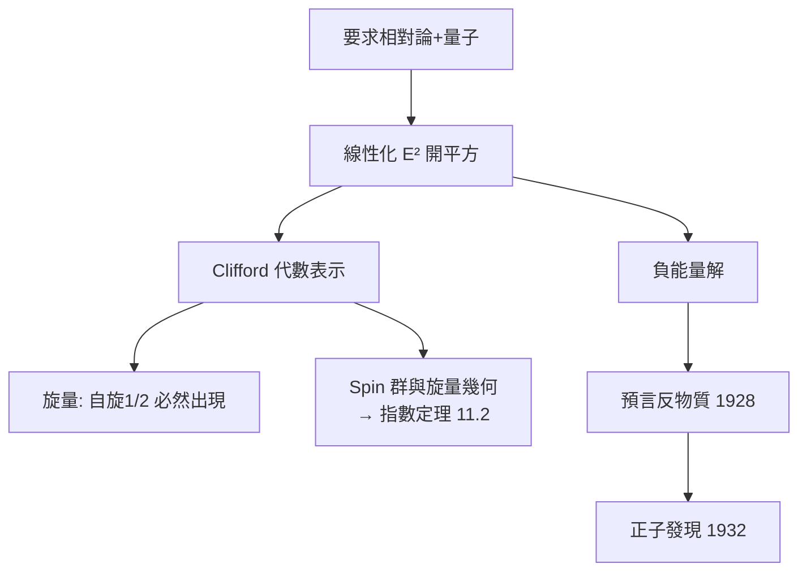

# 5.2 Dirac 方程與旋量：表示論預言反物質（1928）【數學→物理】

## 前因：Schrödinger 方程的兩個缺陷

Schrödinger 方程（4.2）不滿足相對論（無限傳播速度、不是 Lorentz 不變）。Dirac 1928 年追求「既量子又相對論」的電子方程：要求能量動量關係 $E^2 = c^2p^2 + m^2c^4$ 的**開方**線性化——數學問題：找一組矩陣 $\alpha, \beta$ 使

$$(\alpha\cdot p + \beta m)^2 = p^2 + m^2$$

## 構造

**解**： $4\times 4$ 矩陣（Pauli 矩陣的擴張），方程：

$$\left(\mathrm{i}\hbar\gamma^\mu\partial_\mu - mc\right)\psi = 0$$

**三層數學結構**：

1. ** $\gamma$ 矩陣 = Clifford 代數**的表示——「開平方」的代數解。
2. **旋量（spinor）**： $\psi$ 不是向量、不是純量，而是 $\mathrm{Spin}(3,1)$ 群的表示——**表示論強迫一種新幾何量登場**：旋量在 360° 旋轉下變號，720° 才還原（電子的自旋 $1/2$ 由此而來！）。自旋不是加進去的假設，是數學結構的必然。
3. **負能量解**：方程有 $E = \pm\sqrt{\cdot}$ 兩支。Dirac 大膽詮釋：負能量海中的「洞」= 帶正電的新粒子——**反電子（正子）**。

**驗證（1932）**：Anderson 在宇宙線中發現正子——數學結構預言新物質，四年兌現。

## 後果

1. **物理**：反物質成為標準模型基石（每種費米子皆有反粒子）；QED 由此開端。
2. **數學**：Spin 群、旋量叢、Clifford 代數成為微分幾何核心——Atiyah–Singer 指標定理（姊妹篇 11.2）以 Dirac 算子為中心；Witten 1981 用旋量證正質量定理（3.2）。
3. **旋量進入弦論**：超對稱的生成元是旋量——超弦（8.1）的「超」字來自 Dirac 的遺產。
4. **本書觀點**：最強的「數學→物理」預言案例之一——**不是從實驗歸納，而是從代數（開平方）推出新粒子**。

## 練習與思考

1. 驗證 Pauli 矩陣滿足 $(\sigma\cdot a)(\sigma\cdot b) = a\cdot b\,\mathbf{1} + \mathrm{i}(\sigma\times\sigma)\cdot(a\times b)$ 。
2. 為什麼「自旋」在非相對論量子力學中是假設、在 Dirac 方程中是定理？
