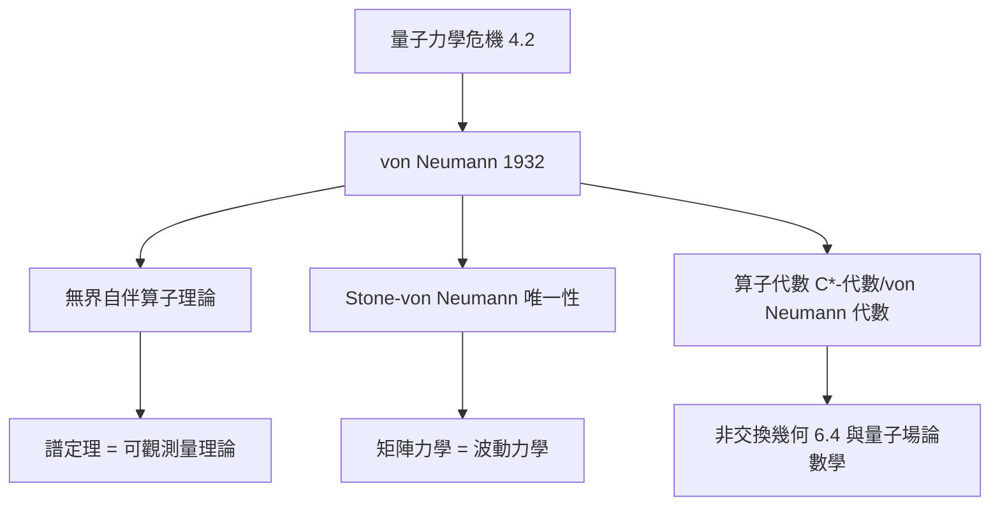

# 5.3 von Neumann：量子力學的數學基礎（1932）【物理→數學】

## 前因：物理急需「無界算子」的理論

量子力學（4.2）上場後，數學危機立刻浮現：位置算子 $\hat x$ 與動量算子 $\hat p$ 是**無界**的（譜無上界），它們的「對易關係」在何處成立？希爾伯特本人與 Schmidt 的積分方程理論只處理有界算子。物理的需求逼出 von Neumann《量子力學的數學基礎》（1932）——無界自伴算子理論誕生。

## 構造

**希爾伯特空間公理化**：$\ell^2$、$L^2$ 的共同抽象（本書姊妹篇 5.3）。

**無界算子的新數學**：

1. **定義域**：無界算子不能全域定義，$D(T)$ 是 $H$ 的稠密子空間——「算子」成為「（$D(T)$, $T$）二元組」。
2. **對稱 vs 自伴**：$T \subseteq T^*$（對稱）弱於 $T = T^*$（自伴）。**自伴性 = 物理可觀測量**，因為只有自伴算子有完整的譜定理與單參數么正群：

$$\hat H \text{ 自伴} \iff U(t) = e^{-\mathrm{i}t\hat H/\hbar} \text{ 是么正演化群（Stone 定理）}$$

3. **Stone–von Neumann 定理**：滿足 $[q,p] = \mathrm{i}\hbar$ 的不可約表示**在同構意義下唯一**——矩陣力學與波動力學等價的嚴格證明（4.2 的數學完結篇）。
4. **測量理論**：投影值測度 $E_\lambda$ 給出「測量 = 譜分解投影」的嚴格語言。

## 後果

1. **量子力學獲得無懈可擊的數學**：任何量子理論的「合法性檢查」即「是否自伴、是否酉」。
2. **數學獨立成長**：von Neumann 代數（1930s）→ 算子代數 → $C^*$-代數 → 非交換幾何（6.4）與代數量子場論（Haag）。
3. **數學物理成形**：一門以「嚴格證明物理理論之一致性」為業的學科（例：存在相互作用 QED 嚴格構造至今未決——數學的誠實）。
4. **本書觀點**：這是「物理→數學」的高級形式——物理不僅提出問題，還**規定了數學理論的成功標準**（自伴性、唯一性、測度）。

## 練習與思考

1. 說明 $-\mathrm{i}\,d/dx$ 在 $C_c^\infty(0,1)$ 上為什麼對稱但不自伴（邊界條件的自由度！）。
2. Stone–von Neumann 唯一性為何在無窮自由度（量子場論）失效？這暗示了什麼？
