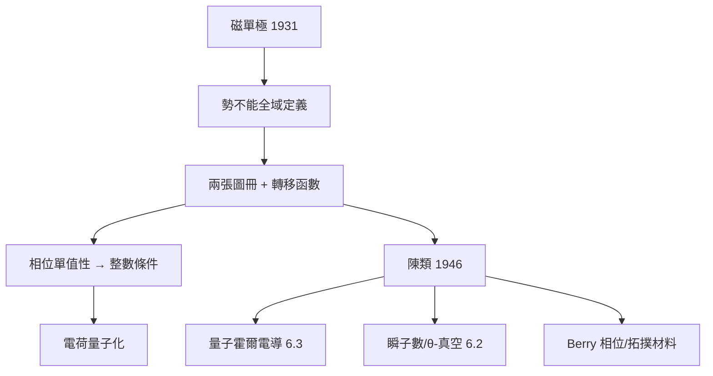

# 6.1 Dirac 磁單極與陳類：拓撲量子化（1931）【雙向】

## 前因：電荷為何量子化？

實驗事實：所有電荷都是 $e$ 的整數倍。為什麼？Dirac（1931）給出驚人答案：**只要宇宙中存在一個磁單極，電荷量子化就是數學必然**。

## 構造

**磁單極**：磁場 $\mathbf{B} = g\,\mathbf{r}/r^3$ （點源）。Maxwell 方程 $\nabla\cdot\mathbf{B} = 0$ 被破壞——除原點外。向量勢 $A$ 無法全域定義：北半球用 $A_N$ 、南半球用 $A_S$ ，赤道上

$$A_N - A_S = \nabla\Lambda, \qquad \Lambda = 2g\phi$$

**量子化**：波函數在赤道圈上的相位必須單值：

$$e^{\mathrm{i}e\Lambda/\hbar} = 1 \quad \Longrightarrow \quad \boxed{\frac{eg}{\hbar} = \frac{n}{2}, \quad n \in \mathbb{Z}}$$

**數學身分**：這正是**陳類（Chern class）的整數性**—— $F/2\pi$ 是閉 2-形式，其在球面上的積分

$$\frac{1}{2\pi\hbar}\int_{S^2} F = \frac{n}{2} \in \frac{\mathbb{Z}}{2}$$

是叢的第一陳類——**拓撲不變量強迫物理量取整數**。Chern（1946）的高維理論之後成為規範理論的標準工具（5.1）。

## 後果

1. **物理**：拓撲量子化模式反覆出現——量子霍爾電導（6.3）、磁通量子化、Josephson 常數；Aharonov–Bohm 效應（1959）證明「勢的拓撲」有物理效應。
2. **數學**：示性類理論被物理「激活」：陳–Simons 理論（1974）成為拓撲量子場論的基石（Witten 1989 算出 Jones 多項式）。
3. **Berry 相位（1984）**：量子絕熱演化的幾何相位 = 叢上的和樂——冷原子與拓撲材料的實驗工具。
4. **本書觀點**：這是「雙向」小而美的典範——物理難題（量子化）由拓撲（整數類）解答，拓撲又因物理應用而繁榮。

## 練習與思考

1. 驗證 $A_N - A_S = \nabla(2g\phi)$ 在赤道圈上的積分給出 $4\pi g$ 。
2. 為什麼「單值性」是拓撲條件而「規範不變性」是代數條件？
