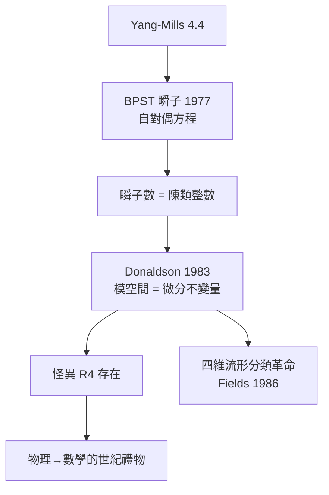

# 6.2 瞬子與 Donaldson 理論：物理重寫四維流形分類（1977–1983）【物理→數學】

## 前因：數學家啃不動的四維

三維以上的高維流形分類在 20 世紀中期有豐富工具；**四維**卻異常頑固——直到物理學家送來 Yang–Mills 方程的特解。

**BPST 瞬子（1975–77）**： $\mathcal{N}=4$ 情形下 Yang–Mills 作用量的極小解

$$S = \frac{1}{4}\int \mathrm{tr}(F\wedge *F) \ge \frac{8\pi^2|k|}{g^2}, \qquad k = \frac{1}{8\pi^2}\int \mathrm{tr}(F\wedge F) \in \mathbb{Z}$$

瞬子數 $k$ 是整數（陳類！6.1），取等條件 $F = \pm *F$ （自對偶方程）。**瞬子數 = 真空的拓撲標籤**（θ-真空，1976）。

## 構造：Donaldson 的翻譯

**Simon Donaldson（1983，博士論文！）** 的洞察：把瞬子的**模空間**（給定流形上所有自對偶聯絡的空間）當作四維流形 $M$ 的**新不變量**。

$$M_D(M) = \{\text{SDU}(2)\text{-聯絡}\}/\mathcal{G} \quad (\text{瞬子模空間})$$

模空間是 5 維流形，其端點對應「可約聯絡」——由 $M$ 上的交錯形式 $\omega$ 標定。Donaldson 證明一個純拓撲的**對角化定理**： $M$ 的交錯形式若為正定，必等價於單位矩陣。

**震撼**：這證明了**不存在與標準 $\mathbb{R}^4$ 微分同胚的「怪異 $\mathbb{R}^4$ 」的反面——怪異 $\mathbb{R}^4$ 存在**（1982–87，Freedman+Donaldson）！四維是唯一存在怪異歐氏空間的維度（ $n\ne 4$ 時 $\mathbb{R}^n$ 的光滑結構唯一）。

## 後果

1. **數學**：Donaldson 理論（Fields 1986）——光滑四維流形的分類出現「由物理方程定義」的不變量；四維成為「最特殊的維度」的定理化。
2. **物理→數學的確立**：物理學家（Witten 1994）用 Seiberg–Witten（9.1）把 Donaldson 理論**大幅簡化**——物理不僅送來工具，還來「優化」它們。
3. **技術回流**：瞬子方程成為微分幾何的標準工具（Floer 同調、Taubes 定理、Symplectic 場論）。
4. **本書觀點**：這是「物理→數學」最戲劇性的案例——**一個物理方程的解空間，回答了拓撲學家幾十年的問題**。

## 練習與思考

1. 由陳–Weil 理論解釋為什麼 $k = \frac{1}{8\pi^2}\int\mathrm{tr}(F\wedge F)$ 是整數。
2. 為什麼「模空間的端點」能編碼交錯形式？（提示：可約聯絡 ↔ 分裂 $E = L\oplus L^*$ 。）
