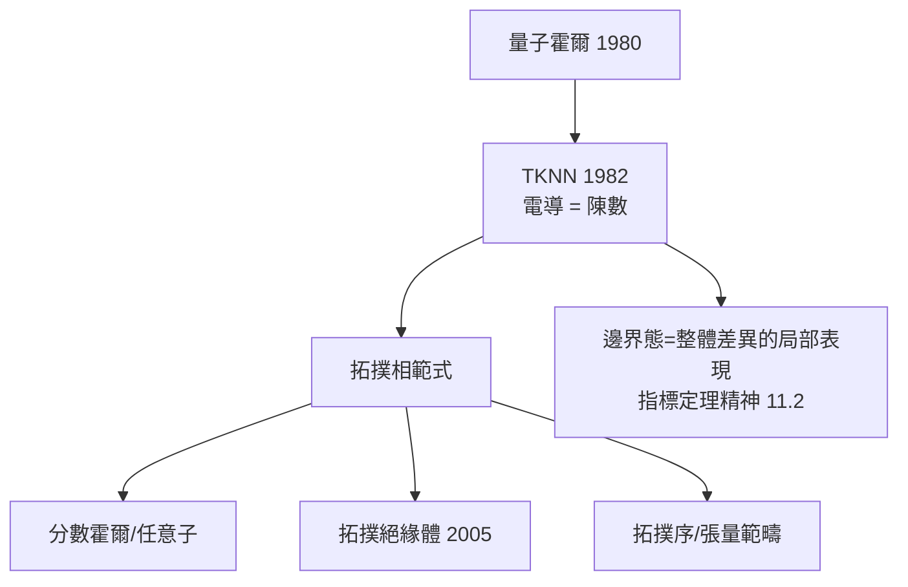

# 6.3 量子霍爾效應與拓撲相（1980）【雙向】

## 前因：一個精確到小數點後九位的「意外」

1980 年 von Klitzing 在半導體異質結構中發現：低溫強磁場下，霍爾電導

$$\sigma_{xy} = \nu\frac{e^2}{h}, \qquad \nu \in \mathbb{Z} \ \text{（精確！）}$$

**為何是整數、為何如此精確**（現為電阻的計量標準）？答案是純數學的：**陳類**。

## 構造

**TKNN 公式（1982）**：Thouless、Kohmoto、Nightingale、den Nijs 證明

$$\sigma_{xy} = \frac{e^2}{h}\,\frac{1}{2\pi}\int_{\mathrm{BZ}} F_{12}\, d^2k = \frac{e^2}{h}\, c_1(E)$$

電子在 Bloch 波向量空間（布里淵區，一個環面 $T^2$ ）上的能帶構成向量叢 $E$ ；霍爾電導 = 第一陳數 $c_1(E)$ ——**與 6.1 磁單極同一個數學**。整數性與精確性皆來自拓撲（陳數對微擾不變）。

**拓撲相（分類物質的新方式）**：物質相不再由對稱破壞（Landau 範式）分類，而由**能帶叢的拓撲**分類：

- **整數量子霍爾**： $\nu \in \mathbb{Z}$ （陳類，1980）；
- **分數量子霍爾**（1982）： $\nu = 1/3, 5/2\ldots$ 強關聯——Laguerre 多項式、Laughlin 波函數、任意子（非交換幾何模型，6.4 姊妹篇）；
- **拓撲絕緣體/超導體**（2005–）： $\mathbb{Z}_2$ 不變量，週期表分類（Kitaev 十重道，用 Clifford 代數表示論！）；
- **拓撲序**（Wen）：基態的**長程糾纏**由模張量範疇（一種範疇論物件！）分類（10.3 伏筆）。

## 後果

1. **物理**：凝聚態理論數學化；Majorana 費米子、量子電腦的拓撲方案（10.3）。
2. **數學**：陳類、K-理論（分類序的語言）、模範疇成為凝聚態的日常工具；「bulk-edge 對應」= 物理版的指標定理。
3. **計量**： $e^2/h$ 成為電阻標準——**數學定理成為度量衡**。
4. **本書觀點**：這是 20 世紀末最大的「數學→物理」滲透：拓撲學從抽象課堂走進了材料實驗室與晶片。

## 練習與思考

1. 解釋為什麼陳數（拓撲不變量）使 $\sigma_{xy}$ 對樣本細節完全不敏感。
2. 「邊界必有態」如何從「整體 = 邊界」的指標定理精神理解？
