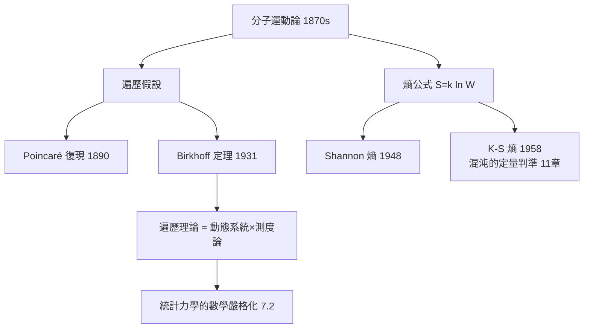

# 7.1 玻茲曼與遍歷理論（1870s）【物理→數學】

## 前因：宏觀量如何從微觀撞擊中湧現

氣體壓力 = 無數分子撞牆的平均。Boltzmann 的綱領：**宏觀熱力學量 = 微觀力學量的時間平均/系綜平均**。但「為什麼時間平均等於相空間平均」需要數學：**遍歷假設**。

## 構造

**相空間與劉維爾定理**： $N$ 粒子系統的態是相空間 $(q, p) \in \mathbb{R}^{6N}$ 的點；Hamilton 流保持相體積（1.3 的辛結構）。

**遍歷假設**：軌道稠密地掃過等能面 → 時間平均 = 空間平均：

$$\overline{f}^{time} = \int f\, d\mu_{\text{microcanonical}}$$

**數學化（20 世紀）**：

1. **Poincaré 復現（1890）**：有限相體積的束縛系統幾乎必然回到任意接近初始態——「熱寂矛盾」的數學澄清。
2. **Birkhoff 遍歷定理（1931）**：對保測變換，時間平均 a.e. 存在且在遍歷時等於空間平均——**遍歷理論誕生**，成為「測度論 + 動態系統」的交叉學科（本書姊妹篇 4.1 之親戚）。
3. **熵的數學化**：Boltzmann $S = k\ln W$ → Shannon 熵（1948）→ Kolmogorov–Sinai 熵（1958）——**同一公式橫跨熱力學、資訊論、混沌**。

## 後果

1. **數學**：遍歷理論、混合性、動態系統的測度論分類——純數學的新大陸。
2. **物理**：統計力學的基礎鞏固；「各態歷經」成為模擬（分子動力學）的合法性依據。
3. **資訊時代**：熵的多重身分（熱力學/資訊/動態）預示了 20 世紀末資訊物理的統一（10 章）。
4. **本書觀點**：Boltzmann 提出的問題使「機率 + 力學」結婚——機率論自此不只是賭桌數學，而是自然法則的語言。

## 練習與思考

1. 解釋 Poincaré 復現定理為什麼不與熱力學第二定律矛盾（時間尺度！ $\sim e^N$ ）。
2. K-S 熵為何能區分「可預測」與「混沌」系統？
