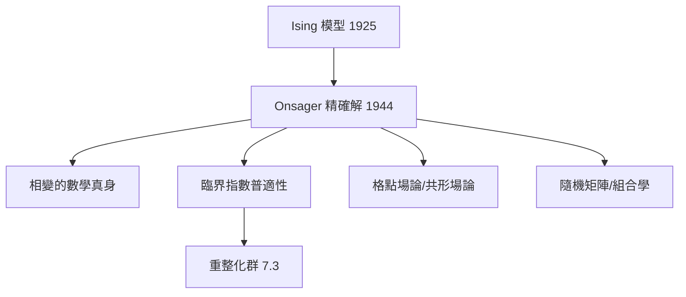

# 7.2 Onsager 與 Ising 模型：組合數學的勝利（1944）【雙向】

## 前因：磁鐵為何有相變？

Ising 模型（Lenz–Ising, 1925）：格子上的自旋 $s_i = \pm 1$ ，能量 $H = -J\sum_{\langle ij\rangle} s_i s_j - h\sum s_i$ 。一維無相變（Ising 論文）；**二維有相變嗎**？Peierls（1936）論證有；精確解是硬仗。

## 構造

**Onsager（1944）**：零場二維 Ising 配分函數的**精確解**：

$$-\frac{f}{kT} = \ln 2 + \frac{1}{2\pi}\int_0^\pi \ln\!\left[\cosh 2K + \sqrt{1 - \sin^2 2K \,\sin^2\theta}\right] d\theta, \quad K = \frac{J}{kT}$$

**技術**：把自旋配置的計數化為**組合數學 + 交接代數**（後由 Kaufman 化為 Clifford 代數表示論）；臨界溫度 $\sinh 2K_c = 1$ 處比熱呈對數發散——**相變被精確捕捉**。

**數學奇觀**：

1. **自由費米子**：二維 Ising = 2D 格點上的費米子場——統計力學與量子場論同構的首次展示。
2. **臨界指數**： $\alpha = 0, \beta = 1/8, \gamma = 7/4$ ——普適、與細節無關（7.3 重整化群的實驗素材）。
3. **組合學回饋**：Onsager 解推動了矩陣恆等式、自由機率（Voiculescu 的源頭之一）、隨機矩陣理論。

## 後果

1. **物理**：相變有了嚴格樣本；Wilson 的重整化群（7.3）以 Ising 為試金石；共形場論（1984 BPZ）承繼「二維臨界點 = 共形不變」。
2. **數學**：楊輝三角之外的組合幾何、SLE（Schramm–Loewner Evolution, 2000s——臨界介面的嚴格理論，Fields 2010）。
3. **本書觀點**：一個「玩具模型」的精確解成為**兩大學科的公共財**——精確可解模型是物理與數學之間最可靠的橋樑。

## 練習與思考

1. 驗證一維 Ising（週期邊界）的配分函數 $Z = 2^n\cosh^n K$ ，並確認 $T>0$ 時無相變。
2. 為什麼二維能精確解、三維不能？這對「可解性」的數學本質有何啟示？
