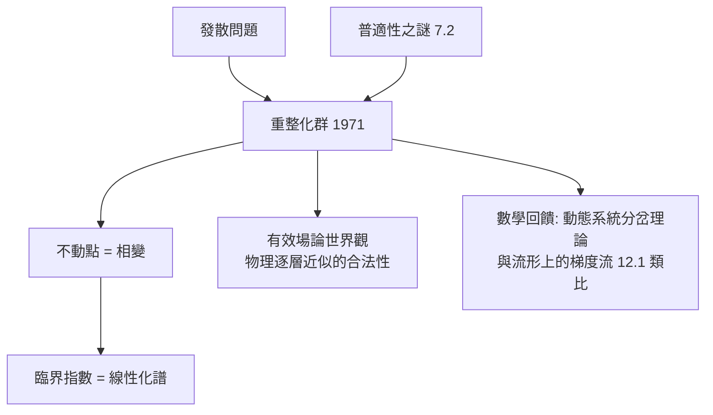

# 7.3 Wilson 重整化群：尺度變換即李群（1971）【數學→物理】

## 前因：發散與普適性的雙重謎

量子場論的積分發散（紫外災難）；相變的臨界指數為何**普適**（不同材料同一組指數，7.2）？Kadanoff（1966）的「方塊自旋」直覺 + Wilson（1971）的系統化給出答案：**把理論按尺度逐層改寫，並研究其不動點**。

## 構造

**重整化群（RG）**：變換 $\mathcal{R}_b$：粗粒化（縮小 $b$ 倍）+ 重標定。有效耦合常數 $g_i$ 的流：

$$\frac{dg_i}{d\ln b} = \beta_i(\{g\})$$

**核心數學思想**：

1. **RG 是（半）群**：尺度變換的合成——李群思想（8.3）在「尺度空間」上的應用；不動點 $= \beta = 0$。
2. **不動點分類物理**：不動點 = 相變；線性化特徵值 = **臨界指數**（普適性的來源：指數只依賴不動點的類型，不依賴微觀！）。
3. **重整化 = 沿流走**：紫外發散的處理成為「在有效理論之間移動」的幾何行為——QED 的可重整性 = 高斯不動點的穩定性。

**戰果**：Wilson 用 $\epsilon = 4 - d$ 展開算出 Ising 臨界指數，與 7.2 精確解吻合；諾貝爾獎（1982）。

## 後果

1. **物理**：有效場論成為範式（從 QCD 到廣義相對論皆「有效理論」）；臨界現象、混沌、湍流的統一視角。
2. **數學**：不動點與分岔理論獲得物理滋養；「renormalization group flow」成為幾何（如 RG flow 與 Ricci flow 的類比，12.1）與表示論（RG 界）的工具。
3. **本書觀點**：重整化群展示了**李群思想在「尺度維度」上的再發明**——數學結構（群、不動點、線性化）成為跨領域的通用文法。

## 練習與思考

1. 對一維映射 $x \mapsto rx$ 說明「不動點穩定性 = 特徵值 <1」如何對應相變的相關長度發散。
2. 為什麼普適性「否定」了微觀細節的重要性？這與有效場論的哲學一致嗎？
