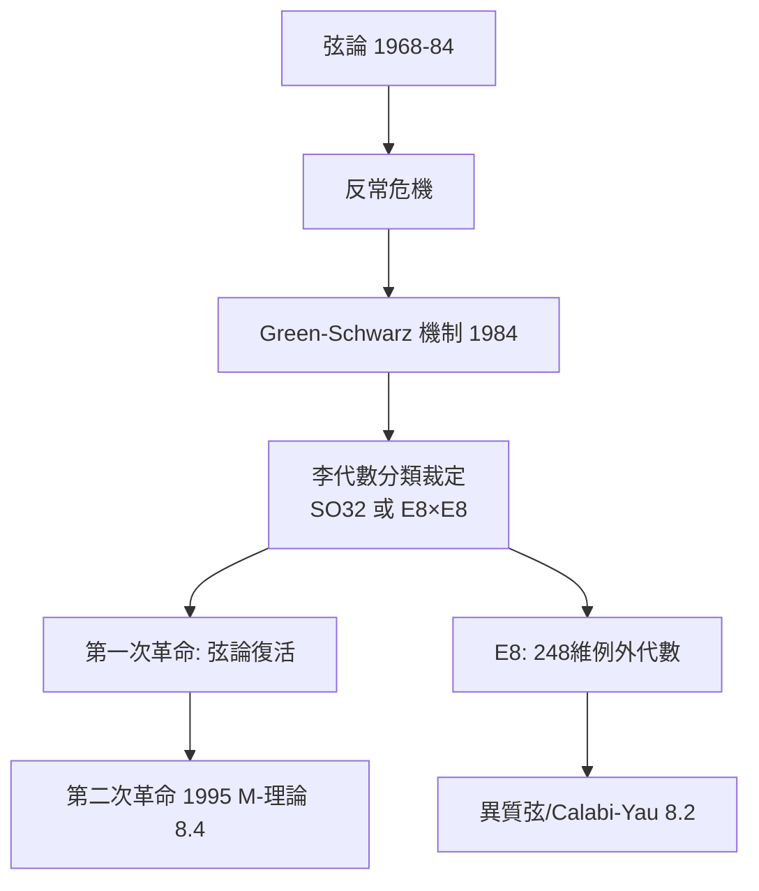

# 8.1 弦論第一次革命：反常消解與李代數 $E_8$（1984）【數學→物理】

## 前因：弦論的生死關頭

弦論（1968–）：基本粒子不是點而是一維弦，振動模式 = 粒子譜。問題：把弦論放進四維時空，量子一致性（反常）使其崩壞。1984 年，Green–Schwarz 用**李代數分類**拯救了它——數學最深的分類定理決定物理的命運。

## 構造

**反常**：量子化破壞了經典的規範對稱——理論不自洽。反常係數是特徵類的多項式；Green–Schwarz 發現一個**奇蹟般的關係式**（GS 機制）可抵消反常，但只對特定規範群成立。

**數學裁定**：關係式成立的群，在 Killing–Cartan 的李代數分類（本書姊妹篇 8.3）中只有：

$$\mathrm{SO}(32), \qquad E_8 \times E_8$$

**$E_8$**：最大的例外李代數（248 維），Dynkin 圖無法納入任何無窮系列。弦論的一致性**只允許這兩種宇宙**——純數學的分類直接限定物理的可能性。

**異質弦（1985）**：左移模式 = 玻色弦（26 維），右移 = 超弦（10 維），16 維差 = $\mathrm{Spin}(16)/\mathbb{Z}_2 \cong E_8\times E_8$ 的根格——**李群格幾何直接成為宇宙的縫紉線**。

## 後果

1. **物理**：弦論從邊緣變成「萬物理論」候選；超對稱、額外維成為主流假設。
2. **數學**：$E_8$ 表示論、Leech 格、模形式（自守形式）進入物理核心；反過來物理推動了頂點算子代數（9.3）。
3. **方法論**：物理開始**依賴數學分類定理作為選項過濾器**——「數學可能性 = 物理可能性」的弱形式。
4. **本書觀點**：1984 年是雙螺旋的「捆綁點」：Killing 1890 年的分類，在 94 年後裁定哪個宇宙可以存在。

## 練習與思考

1. 查 Dynkin 圖：$E_8$ 與 $D_8$、$E_7$ 的關係；為什麼例外群「最特別」？
2. 「反常消解」選出兩個群——這是物理推導還是數學必然？兩者的界線在哪裡？
