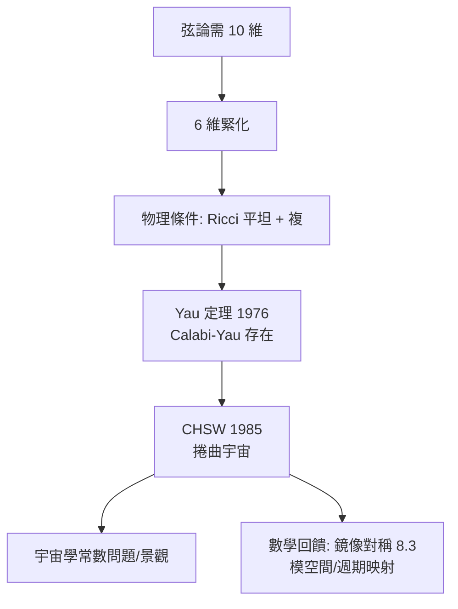

# 8.2 Calabi–Yau：物理選中的代數幾何（1985）【數學→物理】

## 前因：多餘的六個維度

弦論需要十維（8.1）；觀測是四維。Kaluza–Klein 式方案：六維捲起來（compactification）。**捲成什麼形狀**決定四維宇宙的全部物理（粒子數、代、耦合常數）。

## 構造

**條件清單**（物理要求）：

1. 超對稱保持 → 需要複流形 + 內蘊 $\mathrm{SU}(3)$ 結構；
2. 零宇宙常數 → **Ricci 平坦**（ $\mathrm{Ric} = 0$ ）。

**Yau 定理（1976）**（本書姊妹篇 12.2）：第一陳類為零的緊 Kähler 流形上存在唯一 Ricci 平坦度量——**Calabi–Yau 流形存在且成千上萬**。

**Candelas–Horowitz–Strominger–Witten（1985）**：把弦論捲在 Calabi–Yau 三重流形上——

- 四維世界的代數 = CY 的拓撲（Euler 數）決定代；
- 粒子質量與耦合 = CY 幾何的週期積分。

**本書觀點的重點**：這是純數學（Yau 為 Calabi 猜想，1976）在 9 年後成為「我們宇宙可能形狀」的目錄。物理沒有發明它——**物理挑選了它**。

## 後果

1. **代數幾何的新熱點**：CY 分類、模空間、週期積分成為核心領域；Hodge 猜想的試驗場。
2. **景觀問題**： $10^{500}$ 個緊化方案——「數學豐富性」反噬物理的可預測性（13 章的哲學素材）。
3. **F 理論**：把 $\mathrm{E}_8$ （8.1）與 CY 融合——例外李代數成為幾何的對稱。
4. **本書觀點**：8.2 是「數學→物理」的縮影：**物理像顧客走進數學的博物館，指著 1976 年的展品說：這就是宇宙的內部**。

## 練習與思考

1. 為什麼 $\mathrm{Ric} = 0$ 對應「零宇宙常數」（提示：Einstein 方程 3.2 的真空情形）？
2. 五次三重流形（quintic）的 Euler 數 $-200$ 如何影響代數？
