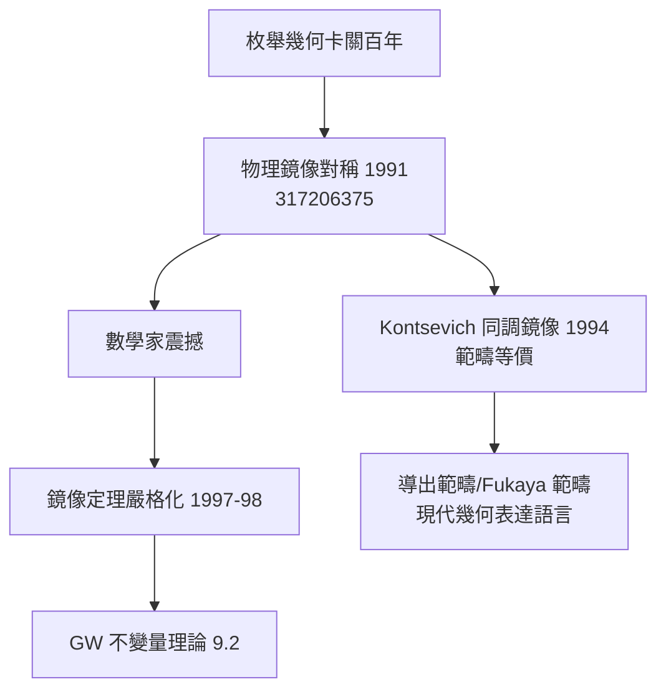

# 8.3 鏡像對稱：物理計算震撼代數幾何（1990）【雙向】

## 前因：物理學家算出了數學家算不出的數

代數幾何的古典問題：數一條曲線上的有理曲線。五次三重流形（quintic）上三次有理曲線的個數，德國學派 19 世紀算到 3 次（2875）、4 次（609250）；**5 次以上卡住一百多年**。

1991 年，Candelas–de la Ossa–Green–Parkes 用**鏡像對稱**（物理）算出 5 次曲線數 = **317206375**。

## 構造

**鏡像對稱**：CY 流形成對 $(X, \hat X)$ ：

$$\underbrace{X\text{ 的 A-模型（辛幾何: Gromov–Witten 計數）}}_{\text{難}} \;\cong\; \underbrace{\hat X\text{ 的 B-模型（複幾何: 變形理論）}}_{\text{易}}$$

**技術核心**：Yukawa 耦合的變分法（Picard–Fuchs 方程的解）通過**鏡像映射**轉譯為 GW 計數；物理的「世界面瞬子」修正是問題的關鍵。

**數學家的回應**：

1. **鏡像定理（Givental；Lian–Liu–Yau, 1997–98）**：嚴格證明 Candelas 公式——**物理計算全部正確**；
2. **GW 不變量理論誕生**（9.2）：枚舉幾何復興為母子的、嚴格的理論；
3. **同調鏡像對稱（Kontsevich 1994）**：對應升級為**範疇等價**（導出範疇 $\mathcal{F}(X) \simeq D^b\mathrm{Coh}(\hat X)$ ）——朗蘭茲式的「範疇化」精神（10.3 姊妹篇）。

## 後果

1. **數學**：枚舉幾何、導出範疇、同倫論成為主流；多個百年問題（quintic 全序列）解決。
2. **物理**：鏡像對稱成為弦論自我檢驗的核心對偶。
3. **文化**：「物理預言數學」的模式制度化——數學家開始系統性閱讀物理文獻。
4. **本書觀點**：8.3 是「物理→數學」的當代旗艦——**物理不僅供給證明思路，還供給了正確答案**；數學的工作是解釋「為什麼物理會對」。

## 練習與思考

1. 為什麼 A-模型（計數）與 B-模型（變形）在鏡像對下「難易互換」？
2. Kontsevich 的範疇化升級與 Langlands 的範疇化（幾何朗蘭茲）有何結構相似性？
