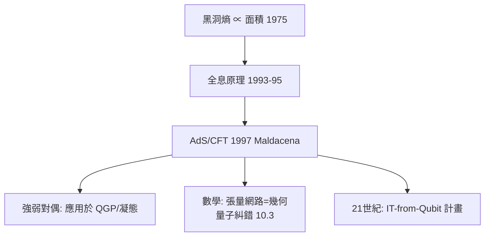

# 8.4 AdS/CFT：全息原理與範疇對偶（1997）【雙向】

## 前因：黑洞熵的資訊悖論

Bekenstein–Hawking（1973–75）：黑洞熵 $S = A/4G$——**正比於表面積而非體積**！含義驚人：一個區域的物理自由度可能全編碼在其邊界上（'t Hooft、Susskind 的全息原理，1993–95）。

Maldacena（1997）給出精確實現：

$$\mathcal{N}=4\ \text{超對稱 Yang–Mills（四維）} \;\longleftrightarrow\; \mathrm{AdS}_5 \times S^5\ \text{上的弦論（十維）}$$

## 構造

**對應的三層結構**：

| 層 | 對應 |
|---|---|
| 場論量 | 重力理論量 |
| 局部算子 $\mathcal{O}$ | 邊界上的場 $\phi|_{\partial}$ |
| 耦合常數 $g_{YM}^2, N$ | 曲率半徑、弦長 |
| 強耦合（難算） | 經典重力（易算）！ |

**威力**：弱/強對偶——場論最難的強耦合區，在重力端是**經典的**。應用：Quark–膠子電漿的黏滯係數（RHIC 實驗數量級吻合）、凝態強關聯系統。

**數學結構**：

1. **Radon 類變換**：邊界與體的資訊等價——積分幾何的物理版；
2. **範疇視角**：邊界 CFT 的算子代數/熵與體的幾何——張量網路（MERA）把 AdS 幾何解釋為**量子糾錯碼的圖**（10.3 呼應）；
3. **互為鏡像的數學成果**：積分幾何、熵面積定理、乃至數學家從 AdS/CFT 中提取的恆等式（如某些積分恆等式被「物理證明」後由數學家嚴格化）。

## 後果

1. **物理**：重力與場論的深層等價成為量子重力最有希望的突破口。
2. **數學**：範疇論、熵與資訊幾何進入重力；「體–邊界對偶」成為新的對偶原型（與 12 章的 S-對偶並列）。
3. **本書觀點**：AdS/CFT 把本書的主題推向極致——**整個空間的物理 = 邊界的資訊**，對偶不再是「兩個理論之間」而是「空間與其邊界之間」。

## 練習與思考

1. 為什麼「熵 ∝ 面積」暗示全息而「熵 ∝ 體積」不會？
2. 張量網路 = 量子糾錯碼 = 雙曲幾何——這一三重對應如何呼應 6.3 的拓撲序？
