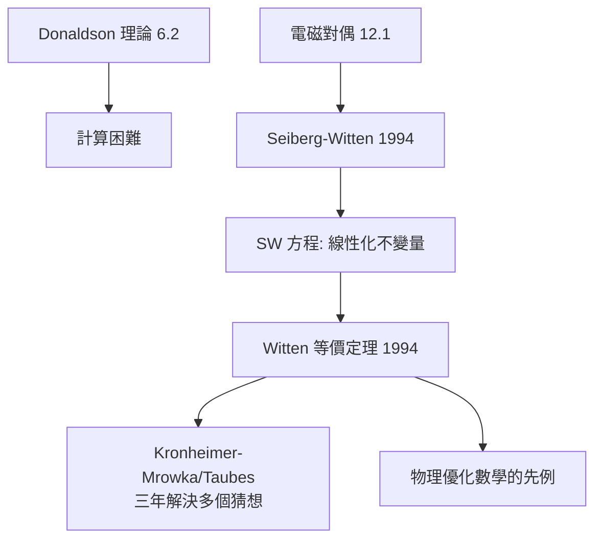

# 9.1 Seiberg–Witten：四維流形不變量革命（1994）【物理→數學】

## 前因：Donaldson 不變量太難算

Donaldson 理論（6.2）威力巨大但計算極難（非線性自對偶方程的模空間）。1994 年 Seiberg–Witten 在研究 $\mathcal{N}=2$ 規範理論時，用電磁對偶（12.1）把理論在單極點重寫——得到一個**線性得多**的方程組。

## 構造

**SW 方程**（未知量： $\mathrm{U}(1)$ 聯絡 $A$ + 旋量 $\psi$ ）：

$$F_A^+ = q(\psi), \qquad D_A\psi = 0$$

比 Yang–Mills 自對偶方程簡單得多（moduli 空間緊緻、維數可控）。**Witten（1994）證明**：SW 不變量等價於 Donaldson 不變量——**新工具完整替代舊工具**。

**數學大爆發**（1994–96）：

- Kronheimer–Mrowka：證明湯普森猜想（陪集曲線的相交形式）；
- Taubes：證明 Gromov 不變量 = SW 不變量，辛流形上出現偽全純曲線的計數定理；
- 「簡單類型」猜想：Donaldson 不變量可由有限資料重構。

## 後果

1. **數學**：四維辛拓撲（偽全純曲線）與規範理論合流；SW 理論成為四維的標準武器。
2. **物理→數學的新模式**：不只提供工具，還提供**更優的版本**——「物理簡化數學」自此成為預期。
3. **對偶的方法論地位**：S-對偶（12.1）從物理技術變成數學發明引擎。
4. **本書觀點**：6.2 與 9.1 合起來講了一個完整故事：**物理送來工具（1983），十年後又送來工具的改良版（1994）**——數學家學會了等物理的第二次出貨。

## 練習與思考

1. 對比 BPST 瞬子方程 $F^+ = 0$ 與 SW 方程的 moduli 維數行為，說明為何 SW 更「可算」。
2. 「單極點的對偶描述更簡單」——這與函數體朗蘭茲的「換宇宙更易證」（姊妹篇 10.3）有何同構？
