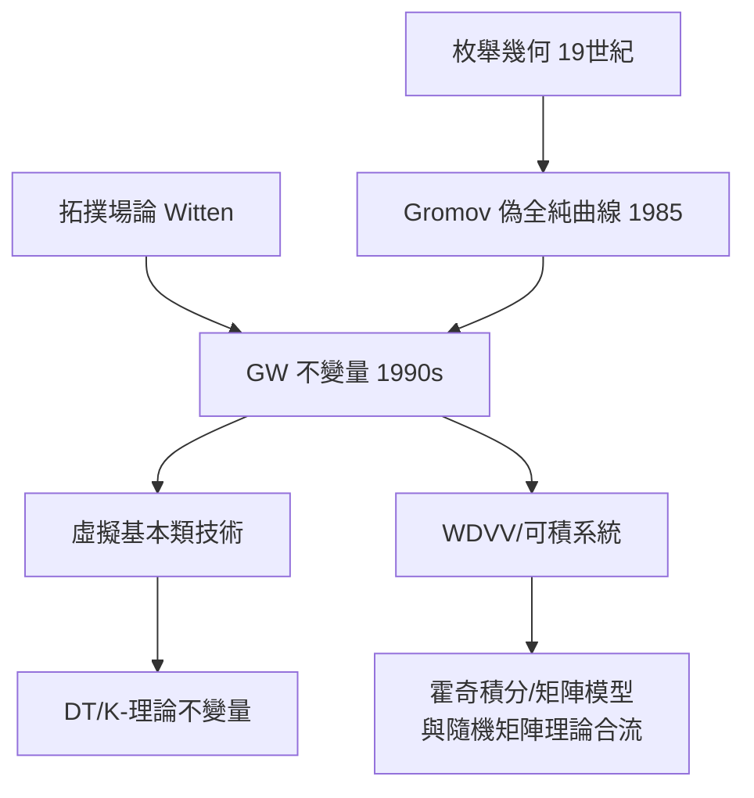

# 9.2 Gromov–Witten 不變量：枚舉幾何復興（1990s）【物理→數學】

## 前因：數曲線的古老學科遇見弦論

枚舉幾何（19 世紀 Schubert 演算）：數滿足交截條件的曲線條數。8.3 已見：物理鏡像對稱算出 quintic 的 317206375。要讓這類數成為「數學不變量」，需要理論化——**Gromov（1985）偽全純曲線** + Witten 的拓撲場論 = **Gromov–Witten 不變量**。

## 構造

**定義**：對辛/射影流形 $X$、類 $\beta \in H_2(X)$，

$$\mathrm{GW}_{g,n}^\beta: H^*(X)^n \to \mathbb{Q}, \qquad \text{計數} \ (g,n)\text{-標記的偽全純曲線（模空間虛擬基本類配對）}$$

**關鍵技術**：模空間有邊界與奇點（氣泡化）——需要**虛擬基本類**（Li–Tian、Behrend–Fantechi）——「數學物理化」的技術創造。

**性質**：

1. **可分解性**（WDVV 方程——物理張量代數！）→ 母勢函數滿足 WDVV；
2. **鏡像定理**：quintic 的母勢有封閉式（8.3）；
3. **與積分幾何/組合的橋**：GW ↔ DT 不變量 ↔ 可積系統（Toda 鏈）。

## 後果

1. **數學**：母勢、Fock 空間、可積系統、霍奇積分——「物理式計算」成為幾何的日常；Okounkov–Pandharipande 等的 Fields 級工作。
2. **物理→數學制度化**：拓撲場論（Witten 1988–89）成為數學結構的穩定供應商——Jones 多項式（9.3 鄰居）、鏡像對稱、GW、DT 全是同一管線產品。
3. **本書觀點**：9.2 展示了「物理→數學」的工業化——不再是單點靈感，而是**持續的結構供應鏈**。

## 練習與思考

1. 為什麼模空間需要「虛擬」基本類而不是普通基本類？
2. WDVV 方程的「結合性」與「物理散射振幅」有何關係？
