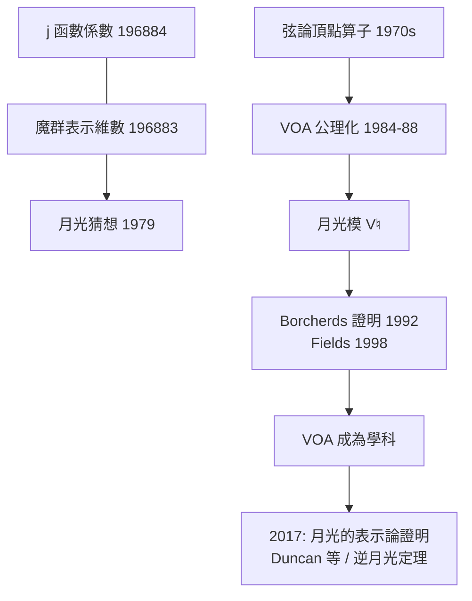

# 9.3 魔群月光與頂點算子代數（1992）【雙向】

## 前因：怪異的係數重合

1978 年，John McKay 注意到：

$$196884 = 196883 + 1, \qquad 21493760 = 1 + 196883 + 21296876$$

左邊是 $j$ 函數（模形式，數論物件）的傅立葉係數；右邊是**魔群 $M$**（最大散在單純群，$|M| \approx 8\times10^{53}$）的最小不可約表示維數。純屬巧合？**月光（moonshine）猜想**（Conway–Norton, 1979）：$j$ 的每一項係數都是 $M$ 表示的維數和。

## 構造

**Frenkel–Lepowsky–Meurman（1984–88）**：構造月光模——一個帶 $\mathbb{Z}/24$ 對稱的頂點算子代數（VOA），其特徵標正是 $j-744$。

**Borcherds（1992）證明月光猜想**（Fields 1998），工具鏈全是數學物理：

1. **頂點算子代數**：源於弦論的頂點算子（1970s）——把「無窮多振動模式」公理化；
2. **Kac–Moody 代數與 affine Lie 代數**：物理對稱的無窮維推廣；
3. **Borcherds 積**：模形式的推廣，來自 Kac–Moody 的 Weyl–Kac 公式。

**嚴格化 VOA 定義（Frenkel–Lepowsky–Meurman；Borcherds 公理）**之後，VOA 成為獨立的數學學科，並被公認為「弦論的數學化身」。

## 後果

1. **數學**：VOA、廣義 Kac–Moody 代數、偽跡公式——數論、群論、物理三方合流。
2. **魔群**從「分類定理的孤兒」變成有幾何/物理身分的物件。
3. **UMT（2015–17）**：月光與 AdS/CFT 式的「pure gravity in $\mathrm{AdS}_3$」聯繫——9.3 的尾巴接上 8.4。
4. **本書觀點**：這是「雙向」的神秘頂點——**一個純巧合的猜測，用弦論的工具證明，最後反哺出新的數學基礎（VOA）**。

## 練習與思考

1. 為什麼 VOA 被稱為「弦論的公理化」？（提示：弦的振動模式 = 極點結構 = OPE。）
2. 月光現象說明「數論—群論—物理」三方的什麼共同底層結構？
