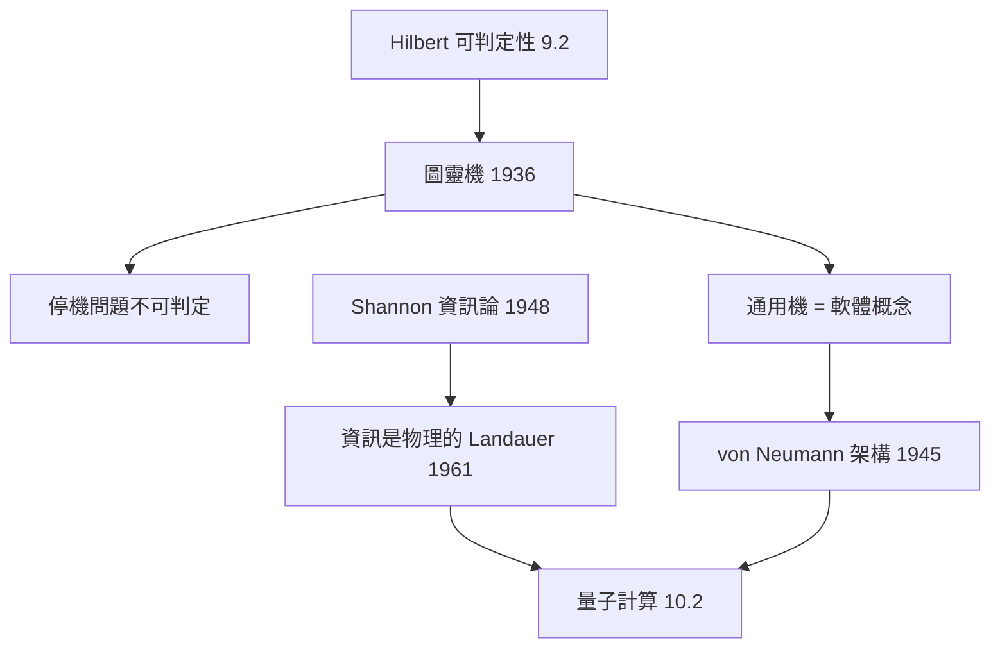

# 10.1 圖靈機：計算的物理化（1936）【數學→物理】

## 前因：Hilbert 的可判定性問題

Hilbert 問（9.2）：是否存在算法判定任何數學命題？Church 與 Turing（1936）各自給出否定答案——但 Turing 的答案附贈了一件改變世界的事物：**一個計算的數學模型**。

## 構造

**圖靈機**：無限紙帶 + 讀寫頭 + 有限狀態 + 規則表。**Church–Turing 論題**：一切「可有效計算」皆為圖靈可計算——把「計算」這個直觀物理活動，變成精確數學物件。

**關鍵定理**：

1. 停機問題不可判定 → 可判定性問題無解（9.2 的完結）；
2. **通用圖靈機**：一台機器模擬所有機器——程式 = 資料，軟體概念誕生。

**物理化**（1945–）：von Neumann 架構把圖靈機變成真實機器；資訊論（Shannon 1948）給出資訊的度量；計算複雜性理論（1960s–）分類「可計算但太難」。

**物理與計算的深層互問**（Landauer 1961）：**資訊是物理的**——擦除一 bit 至少耗散 $kT\ln 2$ 熱量。計算不是抽象遊戲，而是受熱力學約束的物理過程。

## 後果

1. **數學**：可計算性、複雜性、遞歸論——9.2 不完備定理的技術遺產成為新數學。
2. **物理**：計算的物理極限（Bekenstein 界、Landauer 原理）使「宇宙=計算機」的問題合法化；Black hole 資訊悖論（8.4）是其一。
3. **本書觀點**：圖靈機是「數學→物理」中最意外的一筆——**為駁倒 Hilbert 而發明的思想實驗，成為資訊文明的物理藍圖**。

## 練習與思考

1. 說明「通用圖靈機」為何使「程式=資料」成立，及它與 9.2 Gödel 編碼的相似。
2. Landauer 原理如何把熱力學第二定律與計算連接？
