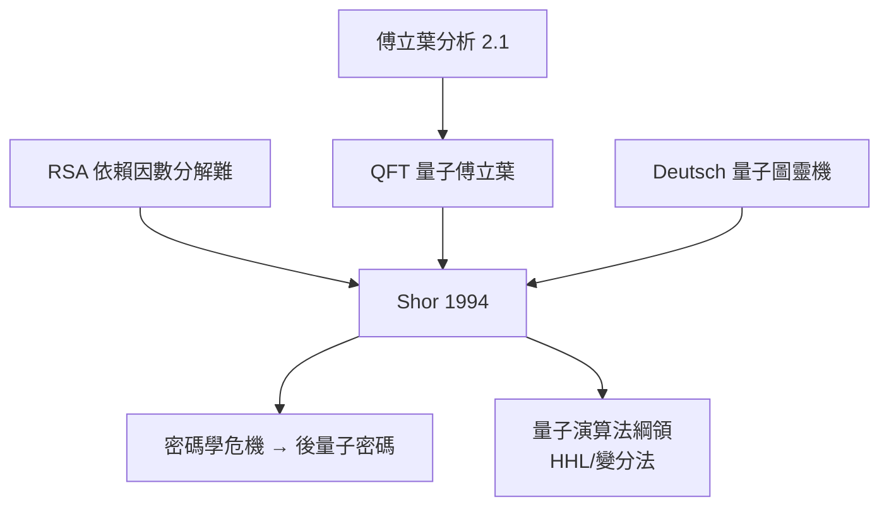

# 10.2 Shor 演算法：因數分解遇上量子干涉（1994）【數學→物理】

## 前因：兩個不相干的堡壘

- **密碼學**：RSA（1977）的安全性建立在「大數因數分解困難」——古典計算的複雜性壁壘。
- **量子力學**： Feynman（1982）指出模擬量子系統需要指數資源的古典計算，提問「量子機器能否突破」；Deutsch（1985）定義量子圖靈機。

1994 年 Peter Shor 把兩者連通。

## 構造

**Shor 演算法**（因數分解 $N = pq$）：

1. 隨機選 $a$，問題化為求函數 $f(x) = a^x \bmod N$ 的**週期** $r$（數論：$\gcd(a^{r/2}\pm 1, N)$）；
2. **量子傅立葉變換（QFT）**：把週期資訊從疊加態的干涉中讀出——$N$ 維 QFT 只用 $O((\log N)^2)$ 個閘；
3. 多次測量收縮機率分佈 → 連分數還原 $r$。

**複雜性**：古典指數時間 $e^{O((\log N)^{1/3})}$（數域篩法）→ 量子多項時間 $O((\log N)^3)$。

**數學核心**：QFT 是傅立葉（2.1）在 $\mathbb{Z}/N$ 群上的版本——**調和分析的量子化**；Shor 的成功證明「隱子群問題」的量子可解性，開啟量子演算法綱領（Hallgren、Kitaev 等推廣到隱子群/晶格問題）。

## 後果

1. **物理**：量子計算從思想實驗變成工程目標（退相干、糾錯成為核心難題→10.3）。
2. **密碼學重構**：後量子密碼（晶格、LWE）興起——**數論的「難題」庫被重新估值**。
3. **數學**：隱子群問題統一了大部分量子演算法；量子資訊理論（熵、通道容量）成為機率與算子代數的新篇。
4. **本書觀點**：10.2 是雙向螺旋的資訊時代版本——**物理（干涉）執行數學（傅立葉+群論），數學（複雜性）重塑物理工程的路線圖**。

## 練習與思考

1. 說明為什麼古典 FFT 的 $O(N\log N)$ 在 $N = 2^n$ 仍指數（相對 $\log N$）。
2. 為什麼 QFT 能「同時對所有 $x$」做傅立葉？（提示：疊加 + 測量。）
