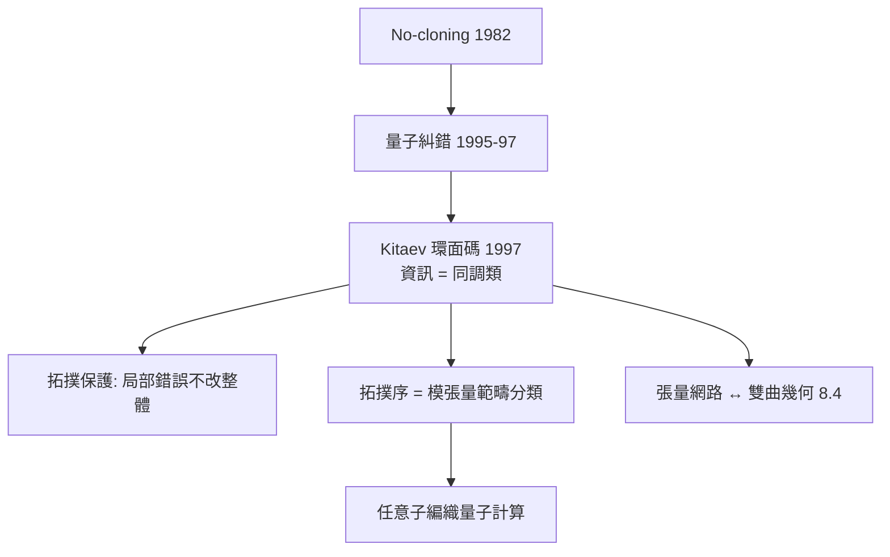

# 10.3 量子糾錯與拓撲序：拓撲學成為容錯之牆（1997）【雙向】

## 前因：量子態脆弱，糾錯似乎不可能

古典糾錯靠「複製」；但量子不可複製定理（no-cloning, 1982）禁止複製未知量子態。1995–97 年，Shor 與 Steane 證明量子糾錯**可能**；Kitaev（1997）給出最美版本：**把資訊藏在拓撲裡**。

## 構造

**環面碼（Kitaev, 1997）**：在環面 $T^2$ 上定義穩定子群（Pauli 算子的乘積），碼空間 = 拓撲简併態：

$$\text{邏輯量子位元} = \text{環面的非平凡循環（同調類！7.2）}$$

**容錯機制**：局部擾動無法改變整體同調類——**拓撲保護**。錯誤偵測 = 測量穩定子（長鏈的端點 = 任意子激發）；解碼 = 同調的計算。

**拓撲序（Wen）**：這類基態的長程糾纏由**模張量範疇**分類——範疇論（9.3 姊妹篇）成為物質相的「週期表」。任意子編織（braiding）實現拓撲量子閘——**表示論執行計算**。

**AdS/CFT 的重逢**（8.4）：糾錯碼的張量網路（MERA）類比雙曲空間——「碼 = 空間」的觀念（Harlow–Hayden、Pastawski 等）。

## 後果

1. **物理**：容錯量子計算的路線圖（表面碼已成為主流工程方案）；分數量子霍爾/馬約拉納平台的拓撲實現（6.3）。
2. **數學**：同調論、範疇論、表示論成為凝聚態與量子資訊的日常；量子糾錯反哺數學（新的碼理論、張量範疇分類）。
3. **本書觀點**：10.3 是「數學→物理」的當代壓軸——**19 世紀的同調論（7.2）在 21 世紀成為保護量子資訊的牆**；且這面牆又把數學家引回物理（糾錯的深層 = 範疇與熵）。

## 練習與思考

1. 解釋為什麼「邏輯算子沿非平凡循環」使局部錯誤無法毀壞資訊。
2. 環面碼與 6.3 拓撲相的關聯：兩者是否是同一個數學（陳類/模範疇）的兩種應用？
