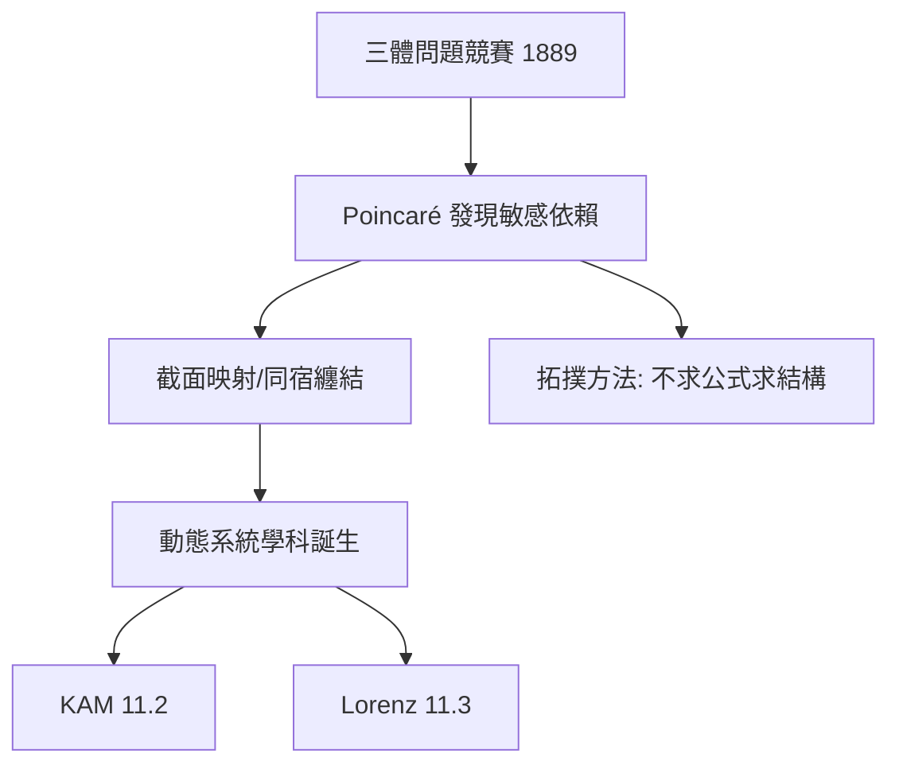

# 11.1 龐加萊三體問題：混沌的發現（1889）【物理→數學】

## 前因：一場競賽逼出混沌

1889 年瑞典國王 Oscar II 懸賞「三體問題是否可解」。Poincaré 原本提交「可積」的證明，隨後發現自己**錯了**：近漢米頓系統中，微小攝動會導致軌道**敏感依賴**——決定論不等於可預測。這是混沌的第一次被明確記載。

## 構造

**三體問題**： $m_i \ddot{\mathbf{r}}_i = G\sum_{j\ne i} m_j \frac{\mathbf{r}_j - \mathbf{r}_i}{|\mathbf{r}_j - \mathbf{r}_i|^3}$ （18 階 ODE；10 個經典積分——不足可積）。

**Poincaré 的新方法**：不求顯式解，研究**解空間的幾何**：

1. **截面映射（Poincaré map）**：把連續流降為離散映射；
2. **同宿纏結**：穩定與不穩定流形橫截相交，形成無窮摺疊——**混沌的幾何指紋**；
3. **不變積分的不存在**：第二個獨立解析積分不存在（Bruns 1887、Poincaré 1890）。

## 後果

1. **數學**：動態系統成為學科（Birkhoff 繼承）；拓撲/幾何方法取代「找公式」——19 世紀分析學的世界觀轉折。
2. **物理**：天體力學的謙遜；統計力學的遍歷假設（7.1）獲得新理解；20 世紀後葉混沌熱（11.3）直接回到 Poincaré。
3. **本書觀點**：這是「物理→數學」的最深刻案例之一——**物理的不可解性創造了數學的新方法論**（研究結構而非公式）。

## 練習與思考

1. 為什麼「兩體可積、三體不可積」？（提示：積分個數 vs 自由度。）
2. 同宿纏結為何蘊含無窮多週期軌道（Smale 馬蹄的前身）？
