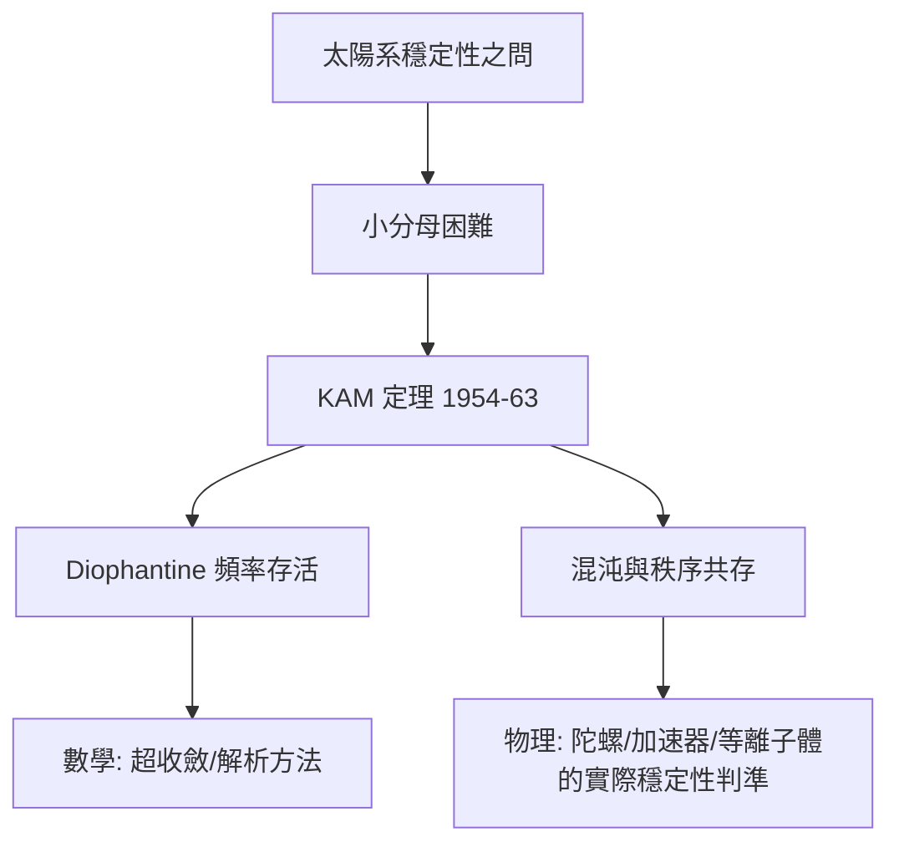

# 11.2 KAM 定理：擾動論的勝利與極限（1954）【數學→物理】

## 前因：太陽系穩定嗎？

Weierstrass 問 Hilbert（1885）：攝動小的近可積系統（太陽系模型），其擬週期解是否存活？Poincaré 的混沌（11.1）暗示悲觀。Kolmogorov（1954）、Arnold（1963）、Moser（1962）給出出人意料的答案：**大部分不變環面存活**。

## 構造

**設定**：近可積漢米頓系統 $H(I, \theta) = H_0(I) + \epsilon H_1(I, \theta)$ （作用量–角度變數， $H_0$ 可積）。

**困難**：微擾展開中的**小分母** $\frac{1}{k\cdot\omega(I)}$ 使級數發散（共振）。

**KAM 定理**：若頻率滿足 Diophantine 條件（足夠「無理」）：

$$|k\cdot\omega| \ge \gamma|k|^{-\tau} \quad \forall k \in \mathbb{Z}^n\setminus 0$$

則對應的不變環面在 $\epsilon$ 小時**變形存活**（準週期運動持續）；其測度隨 $\epsilon \to 0$ 趨於全測度。

**技術核心**：**超收斂 Newton 迭代**（每次迭代誤差平方化）——解析近似的新方法，影響了整個分析學（KAM 是「精確擾動論」的教科書）。

**圖像**：混沌（11.1）與秩序並存——相空間是「存活環面的 Cantor 族 + 之間的混沌海」。

## 後果

1. **數學**：KAM 理論、Nekhoroshev 估計、Aubry–Mather 變分方法——漢米頓系統的幾何化。
2. **物理**：迴旋加速器與托卡馬克的設計原則；太陽系長期穩定性的數值驗證（Laskar）。
3. **本書觀點**：KAM 是「物理問題→數學深度」的典範：一個天文學問題逼出了解析學與數論（Diophantine 逼近）的交匯。

## 練習與思考

1. 解釋為什麼有理頻率比（共振）的環面最先被摧毀。
2. 超收斂（誤差平方化）與牛頓法求根有何同構？
