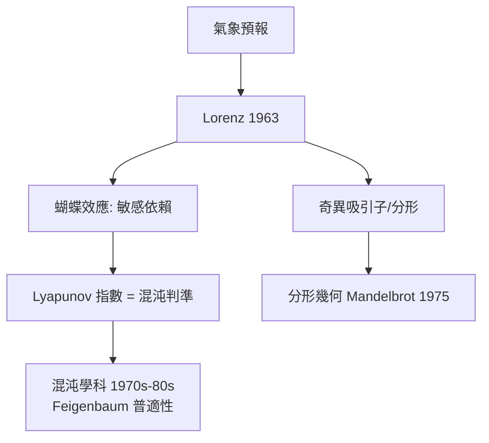

# 11.3 Lorenz：蝴蝶效應與吸引子（1963）【物理→數學】

## 前因：氣象預報的數學化

Lorenz（MIT 氣象學家）把大氣對流簡化為 3 個變數的 ODE（Rayleigh–Bénard 對流的截斷），1961 年偶然重跑時截尾初值（0.506127 → 0.506）——**結果完全分岔**。1963 年論文《Deterministic Nonperiodic Flow》宣告：**決定論系統可以有不可預測的長期行為**。

## 構造

**Lorenz 系統**：

$$\dot x = \sigma(y - x), \qquad \dot y = x(\rho - z) - y, \qquad \dot z = xy - \beta z$$

$\rho = 28$ 時呈現**蝴蝶吸引子**：軌道被吸向一個分形集合，鄰近軌道指數分離：

$$\|\delta(t)\| \approx \|\delta(0)\|\, e^{\lambda_1 t}, \qquad \lambda_1 > 0 \ \text{（正 Lyapunov 指數 = 混沌的定量判準）}$$

**數學結構**：

1. **奇異吸引子**：維數非整數（ $\approx 2.06$ ）——分形幾何進入動態系統；
2. **敏感依賴**（Poincaré 11.1 的定量版）→ 預報極限 $\sim \frac{1}{\lambda_1}\ln\frac{1}{\epsilon}$ ；
3. **可計算性與複雜性的交會**：有限精度計算必然偏離真軌道（10.1 的物理回聲）。

## 後果

1. **數學**：混沌動力學、分形幾何、Feigenbaum 常數（倍週期普適性，1975——重整化群思想 7.3 的映射版）。
2. **物理/工程**：混沌控制（OGY）、密碼學、心電與神經動力學；「預報極限」成為氣候科學的公理。
3. **文化**：「蝴蝶效應」進入大眾語言——數學觀念重塑世界觀。
4. **本書觀點**：11.3 完成了 11 章的弧線：**物理（三體、氣象）→ 數學（動態系統）→ 技術（預報、控制）**；混沌是 20 世紀的「第三次物理革命」之後最深刻的觀念修正。

## 練習與思考

1. 用 $\dot x = 2x$ 說明 Lyapunov 指數的定義；為什麼 $\lambda_1 > 0$ 且吸引子有界時必為混沌？
2. Lorenz 用的是「模型」而非真實大氣——為什麼簡化模型反而更能揭示普適機制？
