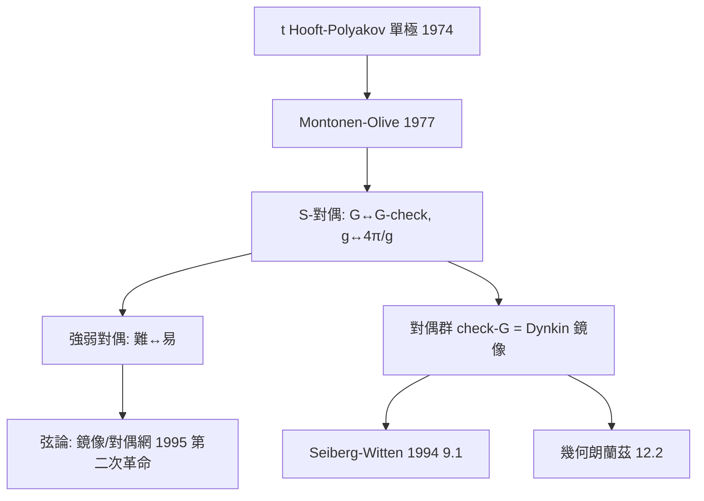

# 12.1 Montonen–Olive S-對偶（1977）【雙向】

## 前因：磁單極在規範理論中的位置

't Hooft–Polyakov（1974）：非阿貝爾規範理論中存在**孤子解 = 磁單極**（6.1 的 Dirac 磁單極成為場方程的解）。問題：弱耦合下單極極重、電荷極輕——兩者地位懸殊。Montonen–Olive（1977）大膽猜想：

> 規範理論可能有一個對偶版本，其中**電與磁互換角色、耦合常數取倒數**。

## 構造

**S-對偶**：理論 $T$ （規範群 $G$ 、耦合 $g$ ） $\leftrightarrow$ 理論 $\check T$ （規範群 $\check G$ ——**Langlands 對偶群**（本書姊妹篇 10.1 的 Dynkin 圖對偶： $\mathrm{SU}(n) \leftrightarrow \mathrm{PSU}(n)$ ）、耦合 $4\pi/g$ ）。

- 電荷 $q$ $\leftrightarrow$ 磁荷 $g_m$ ；
- 弱耦合（好算） $\leftrightarrow$ 強耦合（難算）——**難題被映射到易端**。

**Seiberg–Witten（1994）**：在 $\mathcal{N}=2$ 中精確實現（利用在單極點附近單極成為輕自由度），數學爆發（9.1）。

**數學意義**：對偶群 $\check G$ 是純代數（Dynkin 圖鏡像）；物理給了它「磁變量下的規範群」的身分——**Langlands 綱領的兩端之一獲得物理化身**（12.2 前奏）。

## 後果

1. **物理**：1995 年弦論第二次革命——各種弦論被對偶網統一為 M 理論（8.4 前奏）。
2. **數學**：對偶成為「發明工具」——Langlands 對偶群、鏡像對稱、同調鏡像共享「強弱互換」語法。
3. **本書觀點**：12.1 把本書「對偶」主題接到物理主幹——**對偶的兩端往往難易互補，這使對偶成為認識論機器**。

## 練習與思考

1. 對 $G = \mathrm{SU}(2)$ ，其 Langlands 對偶群為何？（ $\mathrm{PSO}(3) \cong \mathrm{SO}(3)$ 。）
2. 為什麼「對偶群」的發明在數論（Langlands）與物理（Montonen–Olive）幾乎同時、互不知情？
