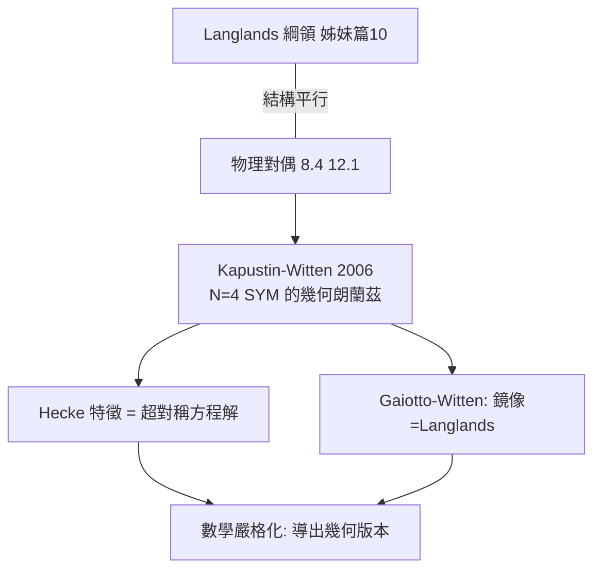

# 12.2 Kapustin–Witten：幾何朗蘭茲的物理化身（2006）【雙向】

## 前因：物理對偶與朗蘭茲的撞臉

1990s 起，數學家注意到：物理 S-對偶（12.1）的結構與朗蘭茲綱領（姊妹篇 10.1）驚人相似——兩者都有「Galois 端 ↔ 自守端」、都涉及 Langlands 對偶群。Witten 提問：**物理對偶是不是朗蘭茲的某種化身？**

## 構造

**Kapustin–Witten（2006）**：在拓撲扭曲的 $\mathcal{N}=4$ 超對稱 Yang–Mills（4 維流形 $S$）中：

1. 定義超對稱方程組（Vortex/堆垛方程），其解的模空間 = $\mathrm{Bun}_G(S)$ 上的某種「Hecke 對應」的解空間；
2. 沿第三維 $S^1$ 捲曲 + 邊界條件（Nahm/Atiyah–Hitchin–Singer 類）= 幾何朗蘭茲的**譜分解**：
3. 「Hecke 特徵」= 方程的解；「譜」= 邊界上的 Wilson 線標籤（= Langlands 參數）。

**數學收穫**：

- Gaiotto–Witten、Frenkel–Witten 把鏡像對稱的 Langlands 式對偶嚴格化於曲線情形；
- 與 Gaitsgory–Raskin 的範疇化證明（姊妹篇 10.3）互相照明——**物理提供直覺地圖，數學提供嚴格道路**。

## 後果

1. **數學**：幾何朗蘭茲獲得「物理百科」；4d 觀點（Witten 的 S-duality 界）催生新的不變量（如 KW 方程的模空間）。
2. **物理**：朗蘭茲的抽象代數獲得場論身分——對偶群 $\check G$ 不再神祕。
3. **本書觀點**：12.2 是本書的頂峰案例：**數學最深的大綱領與物理最深的對偶在結構上同構**——本書「對偶是共同文法」的命題在此獲得最強證據。

## 練習與思考

1. 對比「函數體朗蘭茲換宇宙更易證」與「SW 換對偶端更易算」的結構。
2. 為什麼物理的「對偶」天然是「範疇級」而非「點級」？（提示：量子理論的態空間與算子代數。）
