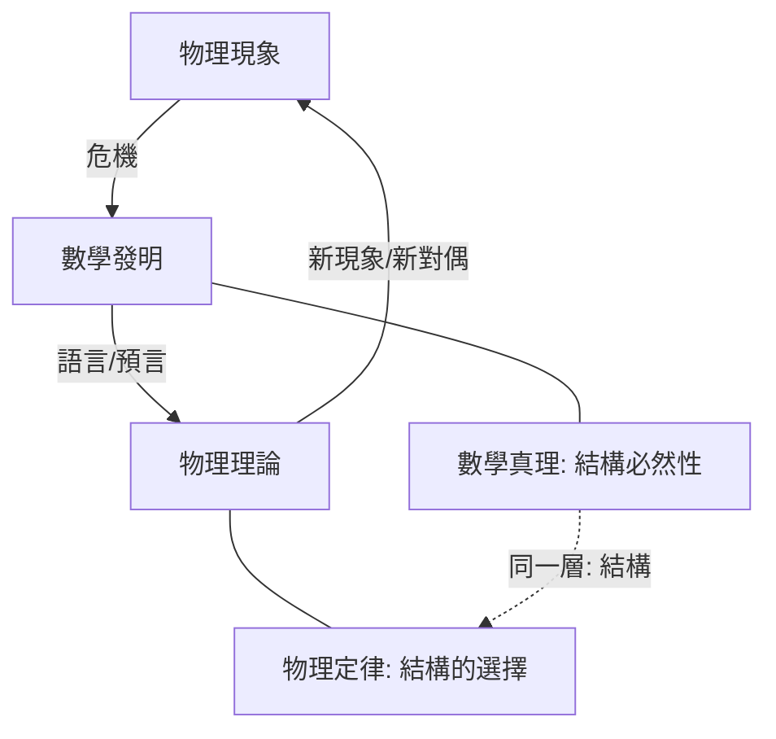

# 13.1 物理定律與數學真理：誰先誰後？

## 前因：四百年的答案變遷

| 時代 | 主導觀點 |
|---|---|
| Galileo/Newton | 數學是自然的語言（上帝用幾何寫宇宙） |
| Kant | 幾何與力學是先天綜合判斷 |
| 19 世紀 | 非歐幾何 + Maxwell → 數學是「可能結構庫」，物理挑選 |
| 20 世紀 | Einstein/Wigner 之謎；規範原理使「對稱先於定律」 |
| 21 世紀 | 全息、It from Qubit——物理與資訊/範疇結構難分先後 |

## 構造：本書證據的總結

**「數學先」的案例**（數學→物理）：

- 黎曼幾何（1854）→ 廣義相對論（1915）；
- 表示論 → 八重法預言 $\Omega^-$；
- Clifford 代數 → 反物質；
- 陳類 → 磁荷量子化、量子霍爾。

**「物理先」的案例**（物理→數學）：

- 力學 → 微積分、變分法；
- 熱 → 傅立葉級數與實分析；
- 三體 → 動態系統與混沌；
- 規範場 → 瞬子、Donaldson、Seiberg–Witten。

**結論性圖像**：

**本書立場**：物理與數學是**同一層結構的兩次閱讀**——數學證明「什麼結構可能」，物理決定「我們的宇宙選了哪個」。兩者的「先後」是歷史偶然而非本體必然。

## 練習與思考

1. 用本書兩個案例（一個數學先、一個物理先）辯論兩側立場。
2. 「物理選擇結構」與「數學窮盡結構」——哪一句更準確？
