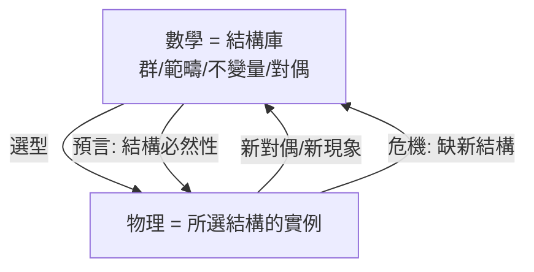

# 13.2 有效性之謎的物理版

## 前因：Wigner 的困惑在物理端重演

Wigner（1960）問：為何數學有效於物理？（姊妹篇 14.2）本書的證據使其更加尖銳——**不僅有效，還互相預言**：

- Dirac 從「開平方」推出反物質；
- 權圖空格推出 $\Omega^-$；
- 陳類整數性成為計量標準（$e^2/h$）；
- 物理計算（鏡像對稱）算出數學算不出的數。

## 構造：四種回應的物理版檢驗

1. **選擇效應**：可解釋部分成功，但難解釋「反向」案例（物理算出 317206375 後數學才證明）。
2. **演化認知**：解釋三維直觀有效，不解釋 $E_8$、模範疇。
3. **結構同一論**（本書立場）：物理定律的骨幹 = 對稱、守恆、對偶、拓撲不變量——**恰是數學的結構層**；物理在結構庫中「選型」，數學是結構庫本身。預言 = 庫中結構的必然關係投射到所選結構。
4. **對偶文法**：當物理對偶與數學對偶同構（12 章），直覺的遷移是合法的——這解釋了為何「有效的預言」集中在結構層而非公式層。

## 後果

1. **方法論**：物理學家應學習「結構目錄」（本書的動機之一）；數學家應監聽物理的「結構訂單」。
2. **未解之處**：為什麼我們的宇宙選擇了這些結構（規範群、三維空間、量子性）——這是物理問題（人擇/更深的理論）而非數學問題。
3. **本書觀點**：有效性之謎的「神秘感」主要來自把數學與物理視為兩個世界；把它們視為**結構的兩次閱讀**，神秘感即轉化為可研究的歷史與方法論。

## 練習與思考

1. 用「結構同一論」重新解釋 13.2 開頭四個預言案例中的兩個。
2. 哪些現象最能威脅「結構同一論」？（提示：尋找無結構解釋的物理巧合。）
