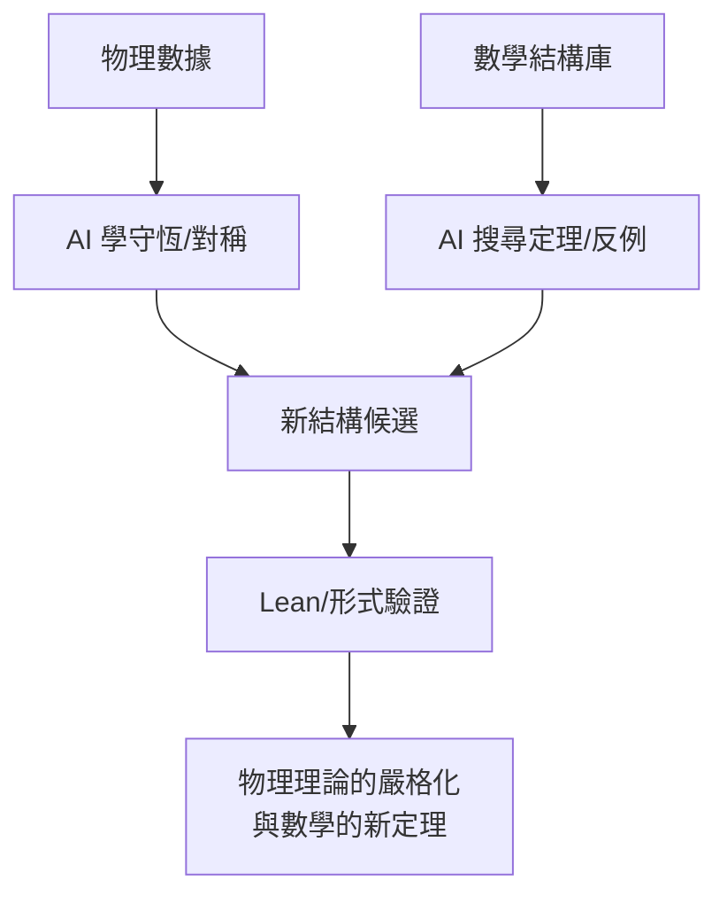

# 13.3 AI 時代物理數學的協作

## 前因：兩條自動化路線的交會

- **數學**：證明助手（Lean）+ 神經引導搜尋（姊妹篇 14.3）——結構與證明的機器化。
- **物理**：資料驅動發現（符號迴歸、神經算子）、AI 猜測守恆律與對稱性（2020s，如從數據學 Lagrangian）。

兩者在「結構發現」上交會：**對稱、守恆、對偶的偵測**正是本書的主題。

## 構造

**三個協作層**：

1. **發現層**：從數據/模擬中學出守恆量、對稱群（Hamiltonian/Conjugate NN、Lagrangian learning）；從 knot 數據發現新不變量相關（2021）。
2. **證明層**：AlphaProof 式的形式搜尋；物理恆等式（如某些超對稱指標）的機器驗證；數學物理的嚴格化管線（物理猜想 → 形式證明）。
3. **結構層**：範疇論作為「可機讀的數學物理」——範疇化的對偶（幾何朗蘭茲、拓撲序的模範疇）天然適合形式語言。

## 後果

1. **工作流變化**：物理猜想的「數學嚴格化」時間軸可望壓縮（例如 SW 類結果的快速形式化）。
2. **教育**：未來的物理數學家需同時讀懂：李群、模範疇、以及「AI 輸出的猜測的置信語言」。
3. **開放問題**：AI 能否發現**綱領**（而非定理）？——本書的「綱領」概念（對偶的大規模化）是 AI 自動化數學的下一個考題。
4. **本書觀點**：四百年雙螺旋的下一圈可能是三方螺旋：**物理—數學—機器**；本書教的是螺旋的「結構文法」，機器是新的執行者。

## 練習與思考

1. 設計一個「從數據學對稱群」的玩具實驗（如振動頻譜中找 $\mathrm{SU}(2)$ 特徵）。
2. 為什麼範疇論特別適合做「AI 可讀的數學物理」？
