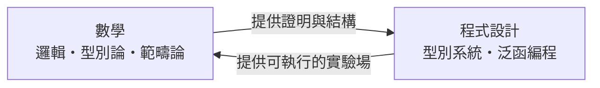

# 前言

## 0.1 雙向鏡的誕生：當程式語言成為數學實驗室

二十世紀中葉，兩條看似平行的研究路線同時展開：一邊是邏輯學家為了給數學「寫規則手冊」（希爾伯特綱領），另一邊是工程師為了造出「會算的機器」（圖靈、馮紐曼）。沒有人預料到，這兩條路線會在 Lambda 演算與型別論的交會處合而為一。

本書稱這個交會為「雙向鏡」：

* **數學 → 程式**：範疇論成為 Haskell 的設計藍圖；型別論成為 Rust、TypeScript 的核心。
* **程式 → 數學**：Lean、Coq 等證明助理讓數學證明成為可以「編譯」「執行」「自動化」的物件。

## 0.2 從「如何計算」到「為什麼正確」：計算與證明的邊界消融

在 1930 年代，Church 與 Turing 分別提出兩套「計算」的精確定義，並證明它們等價（Church–Turing 命題）。1960 年代後，Curry 與 Howard 的發現揭示了一個更深刻的巧合：

> **命題就是型別，證明就是程式。**

一旦這個同構被確立，「證明一個定理」與「寫出一個正確的程式」就成了同一件事的兩種描述。電腦不再只是「算得快」，它可以是**數學裁判**——只要證明的形式化寫成程式，編譯器就能逐行檢查邏輯漏洞。

## 0.3 閱讀地圖：從邏輯基礎到機器輔助數學的全景導覽

本書共五篇、十三章，呈現一條從「邏輯的機械化」到「機器輔助數學」的漸進路線：

| 篇 | 主題 | 核心概念 |
|---|---|---|
| 一 | 邏輯的機械化 | 圖靈機、Lambda 演算、Curry–Howard 同構 |
| 二 | 型別的代數 | 型別系統、ADT、多型、依賴型別 |
| 三 | 範疇論的代碼化 | Functor、Monad、初始代數與共歸納 |
| 四 | 形式化驗證 | 證明助理、Lean、軟體正確性、零知識證明 |
| 五 | 計算數學的深度交叉 | Gröbner 基、密碼學、P vs NP |

**建議閱讀路線**：

* **邏輯／CS 背景讀者**：按章節順序，第一篇是基礎。
* **數學背景讀者**：可先讀第 7–9 章的範疇論，再回頭看型別論如何「實作」這些抽象。
* **只想動手寫 Lean 的讀者**：先看附錄 C，再跳到第 10–12 章。

每一章末尾都提供「下一步」銜接，說明本章內容如何驅動下一章的問題，讀者可藉此理解技術發展的**前因後果**，而不只是名詞堆疊。
