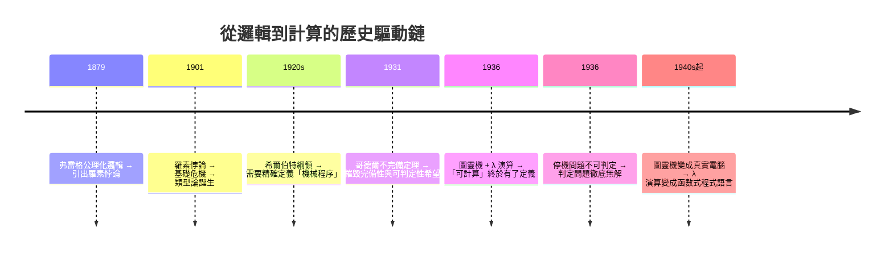

# 01.1 亞里斯多德邏輯與希爾伯特形式主義的侷限

## 導言：為什麼數學家要關心「邏輯」？

數學的歷史，某種意義上就是一部「證明」的歷史。從歐幾里得《幾何原本》以公理與演繹建構幾何開始，數學家就相信：只要起點（公理）正確、每一步推論（演繹規則）嚴格，結論就無可辯駁。但「什麼是嚴格的推論？」這個問題本身，卻花了兩千多年才被說清楚。

本章我們回顧兩條主線：亞里斯多德的三段論邏輯，以及十九世紀末至二十世紀初希爾伯特的形式主義綱領。理解它們的成就與**侷限**，才能真正明白：為什麼哥德爾不完備定理會震撼數學界，為什麼圖靈要發明圖靈機，以及為什麼邱奇要創造 λ 演算。這些看似抽象的歷史，正是「程式與數學」這門學問的前因。

## 亞里斯多德：把推論本身變成研究對象

在亞里斯多德（西元前 384–322）之前，人們會論證，但沒有人系統性地問：「**什麼樣的論證形式是永遠有效的？**」亞里斯多德的洞見是：一個論證的有效性，取決於它的**形式**，而非內容。

### 三段論

亞里斯多德的三段論（syllogism）是最早的「形式邏輯系統」。經典例子：

> 凡人皆有死。（大前提）
> 蘇格拉底是人。（小前提）
> 故蘇格拉底有死。（結論）

注意：把「人」換成任何詞類，只要形式不變，論證依然有效。這就是**形式化**的萌芽——推理的正確性可以脫離具體內容來檢驗。

亞里斯多德將命題分為四種類型，並整理出有效的三段論格式：

| 類型 | 形式 | 記號（傳統） |
|------|------|------|
| 全稱肯定 | 所有 $S$ 是 $P$ | A |
| 全稱否定 | 所有 $S$ 不是 $P$ | E |
| 特稱肯定 | 有些 $S$ 是 $P$ | I |
| 特稱否定 | 有些 $S$ 不是 $P$ | O |

### 亞里斯多德邏輯的侷限

然而，這套邏輯有以下根本限制：

1. **只能處理主謂結構的句子**。「如果下雨，則地會濕；下雨；故地濕」這類假言推理，三段論無法自然表達。
2. **沒有變數與量詞的精確語法**。「所有」與「有些」被當成詞彙處理，而非可以計算的符號。
3. **無法表達關係**。「$x$ 比 $y$ 大」這種二元關係，在三段論框架裡極為笨拙。而關係正是數學的核心：等於、大於、屬於……。
4. **沒有關於「證明」的理論**。亞里斯多德研究的是論證的有效性，但沒有把「證明系統本身」當成數學對象來研究。

萊布尼茨在十七世紀夢想「讓爭論變成計算」（Calculemus!——「讓我們來算吧」），希望發明一套通用語言，使一切推理都化為符號運算。這個夢想埋下了兩百年的種子，直到布爾與弗雷格才發芽。

## 布爾、弗雷格：邏輯的代數化與公理化

1847 年，布爾（George Boole）發現：邏輯推理可以用代數來做。命題的「且、或、非」對應到集合運算或 $\{0,1\}$ 上的運算，這就是今天的**布爾代數**。邏輯第一次變成了可計算的東西。

1879 年，弗雷格（Gottlob Frege）出版《概念文字》（Begriffsschrift），完成了真正的革命：

- 引入**命題邏輯**的完備符號系統（包含否定、蘊含、量詞）；
- 首次把「**所有 $x$，……**」與「**存在 $x$，……**」用量詞符號精確表達；
- 提出數學可以（而且應該）還原為邏輯——這就是**邏輯主義**（logicism）。

弗雷格系統補上了亞里斯多德邏輯的所有缺口：關係、量詞、多重量詞嵌套（如「對每個自然數 $n$，存在比 $n$ 大的質數 $p$」）都能精確書寫。

```text
∀n. (n ∈ ℕ → ∃p. (p > n ∧ p 是質數))
```

弗雷格在世時幾乎無人重視，但羅素讀懂了他。1901 年，羅素寫信給弗雷格：你的系統允許我們構造「所有不包含自身的集合所構成的集合」，它包含自身若且唯若它不包含自身——

$$R = \{ x \mid x \notin x \}, \qquad R \in R \iff R \notin R$$

這就是**羅素悖論**。弗雷格的樸素集合論因此崩塌，邏輯主義的夢想第一次受挫。羅素與懷海德花了十年寫出《數學原理》（Principia Mathematica），用「類型論」（type theory，正是本書後半主角 λ 演算類型系統的祖先！）繞過悖論，耗費數百頁才證明 $1+1=2$。數學的基礎危機，就此全面爆發。

## 希爾伯特綱領：把數學本身變成數學的對象

面對基礎危機，德國大數學家希爾伯特（David Hilbert）提出了二十世紀最雄心勃勃的計畫——**希爾伯特綱領**（Hilbert's Program，約 1920 年代）。

### 核心想法

希爾伯特的策略極其聰明，叫做**有窮主義**（finitism）：為了避免循環論證，我們用最保守、最無可置疑的方法——只處理有限、具體、可直接檢查的符號操作——去研究整個數學的形式系統。他的目標可拆解為：

1. **形式化**：把所有數學（包括集合論）寫成形式系統——有限的符號、明確的公理、機械可查的推論規則。一個「證明」就是一列符號串，每一步都能機械地驗證是否合法。
2. **一致性**（consistency）：證明系統中不可能導出矛盾（例如 $0=1$）。這樣矛盾就不會污染數學。
3. **完備性**（completeness）：每個在系統語言中可表達的命題，都能被證明或被否證。數學中不再有「不可判定」的問題。
4. **可判定性**（decidability）：存在一個機械程序（希爾伯特稱之為 Entscheidungsproblem，**判定問題**），對任意命題，能在有限步驟內判斷它是否可證。

注意第 4 點的關鍵措辭：「**機械程序**」。希爾伯特相信這樣的程序存在，但他（以及當時所有數學家）**並沒有「機械程序」的精確定義**。「有效可計算」在 1920 年代是一個直覺概念，就像「顯然」一樣模糊。這個模糊，正是通往圖靈機與 λ 演算的歷史動力——**你必須先精確定義「計算」，才能證明某個問題「不可計算」**。

### 形式系統的精確樣貌

一個形式系統包含：

- **符號表**：有限的符號集合；
- **合式公式**（well-formed formula）：由符號依語法規則構成的字串；
- **公理**：某些指定的合式公式（或公理模式）；
- **推論規則**：從已有公式產生新公式的機械規則（如 modus ponens：由 $A$ 與 $A \to B$ 得 $B$）。

「證明」定義為：一列合式公式，每項要么是公理，要么由前項經推論規則得出。檢查一個證明是否合法，是**純粹的符號操作**，不需要理解任何「意義」。這就是希爾伯特的哲學：數學是「紙上符號的遊戲」，只要這遊戲不產生矛盾，數學就安穩。

```python
# 模擬一個玩具形式系統：MU 謎題（侯世達《GEB》的著名例子）
# 符號表: {M, U, I}
# 公理: MI
# 規則:
#   1. 若字串以 I 結尾，可追加 U      (xI -> xIU)
#   2. Mx -> Mxx                     （x 為任意字串）
#   3. III 可替換為 U
#   4. UU 可刪除
# 問題: 能否從 MI 推出 MU？

def rules(s: str):
    out = []
    if s.endswith("I"):
        out.append(s + "U")            # 規則 1
    if s.startswith("M"):
        out.append("M" + s[1:] * 2)    # 規則 2
    if "III" in s:                     # 規則 3（取代第一處）
        i = s.index("III")
        out.append(s[:i] + "U" + s[i+3:])
    if "UU" in s:                      # 規則 4
        i = s.index("UU")
        out.append(s[:i] + s[i+2:])
    return out

# 廣度優先搜尋有限步，找不到 MU ——（事實上永遠找不到：I 的數量
# 不可能變成 3 的倍數，而 MU 的 I 數量是 0 ≡ 0 (mod 3)？不，
# MU 根本沒有 I；關鍵不變量證明見本章習題。）
```

MU 謎題的妙處在於：**在系統內部**，你只能不斷生成字串；要證明「MU 不可得」，你必須**跳出系統**，找到一個外部不變量（I 的個數模 3 的值不會變成 0）。這正是哥德爾與圖靈即将系統化使用的策略：**後設視角（meta-view）的力量**。

## 哥德爾不完備定理：綱領的致命一擊

1931 年，年僅 25 歲的哥德爾（Kurt Gödel）發表論文，證明：

> **第一不完備定理**：任何足夠強（能表達自然數算術）、一致的形式系統 $S$，必存在命題 $G$，使得 $G$ 與 $\neg G$ 在 $S$ 中都不可證。

證明核心是一個絕妙的自指構造——**哥德爾編碼**（Gödel numbering）：把每個符號、公式、證明都編成一個自然數，於是「公式」「證明」都變成算術物件，關於系統的陳述（「$x$ 是 $y$ 的證明」）可以寫成系統內的算術命題。再透過**對角化**，構造出一句話：

> 「$G$ 在 $S$ 中不可證。」

而 $G$ 本身（透過編碼）就**說的就是這件事**。若 $S$ 證明 $G$，則 $G$ 為假，矛盾；若 $S$ 證明 $\neg G$，則 $S$ 不一致。因此若 $S$ 一致，$G$ 不可判定。

> **第二不完備定理**：這樣的 $S$ 無法證明自身的一致性（即 $\mathrm{Con}(S)$ 不可證）。

哥德爾沒有推翻希爾伯特的一切：形式化與「機械可查的證明」概念留存下來，成為電腦科學的地基。被摧毀的是**完備性、可判定性、與系統內證明自身一致性**的希望。

歷史上有個微妙插曲：哥德爾第一不完備定理原始證明依賴「**$\omega$-一致性**」（比一致性更強的條件），這讓證明的普遍性打了折扣。把條件降到「僅需一致性」的，是 1936 年 Barkley Rosser 的改進——而 Rosser 的改進技巧，恰好在可計算性理論的語言下最自然。理論與技術互相驅動，又一次上演。

## 下一個問題：什麼是「機械程序」？

哥德爾定理留下一個懸而未決的問題。他本人證明了「若存在判定程序則矛盾」，但這只是證明**判定程序不存在**的條件句；要無條件地證明「希爾伯特判定問題無解」，必須先回答：

$$\text{什麼是「可機械執行的程序」？}$$

1936 年春天，兩位年輕人分別給出了答案，而且答案**等價**：

- 英國劍橋的 **Alan Turing**：發明了「圖靈機」——一條紙帶、一個讀寫頭、有限狀態的機器；
- 美國普林斯頓的 **Alonzo Church**：用他自創的 **λ 演算**（純粹的變數與代換系統）定義「有效可計算」。

**Church–Turing 命題**：一切直覺上的「可計算」，都等價於圖靈機可計算（也就等價於 λ 可計算、遞迴函數可計算）。這不是定理（無法證明的「直覺＝形式」），而是被反覆驗證的信念——所有後來提出的計算模型（Post 系統、馬爾可夫演算法、元胞自動機、甚至你的手機）都被證明不比圖靈機更強。

歷史在此完成了一次漂亮的接力：



## 範例：用程式「感覺」不完備

以下 Python 程式模擬哥德爾編碼的玩具版，展示「命題可以編碼成數字、陳述可寫進系統」的滋味：

```python
primes = [2, 3, 5, 7, 11, 13, 17, 19, 23, 29]

def encode(tokens: list[int]) -> int:
    """哥德爾編碼：符號序列 -> 單一自然數"""
    result = 1
    for i, t in enumerate(tokens):
        result *= primes[i] ** t
    return result

def decode(n: int, length: int) -> list[int]:
    tokens = []
    for i in range(length):
        t = 0
        while n % primes[i] == 0:
            n //= primes[i]
            t += 1
        tokens.append(t)
    return tokens

# 每個符號給一個編號：例如 '('=1, ')'=2, '∀'=3, 'x'=4, ...
g = encode([3, 4, 1, 4, 4, 2])   # 某個公式的編碼
print(g)                          # 一個天文數字
print(decode(g, 6))               # 解碼回符號序列
```

關鍵洞見：編碼與解碼是**純算術**操作，因此「$x$ 是公式 $y$ 的證明」可以寫成算術謂詞 $\mathrm{Proof}(x, y)$。一旦系統「談論自己」，對角化就勢不可擋。這與本書後面講的**自我引用**（遞迴、不動點組合子 Y）是同一個思想在不同疆域的顯現。

## 定理與觀念整理

**定義（形式系統）**：四元組 $(\Sigma, W, A, R)$——符號集 $\Sigma$、合式公式集 $W$、公理集 $A$、推論規則集 $R$。

**定理（哥德爾第一不完備定理，非形式敘述）**：任何一致且遞迴可枚舉公理化的、足以表達算術的形式系統，皆不完備。

**定理（哥德爾第二不完備定理，非形式敘述）**：上述系統無法證明自身的一致性。

**觀念（Church–Turing 命題）**：直覺可計算性＝圖靈機可計算性。

## 章末小結

- 亞里斯多德邏輯發現了「形式決定有效性」，但受限於主謂結構與關係表達。
- 布爾與弗雷格將邏輯代數化、公理化，萊布尼茨「計算代替爭論」的夢想有了技術輪廓。
- 羅素悖論引爆基礎危機，希爾伯特綱領以有窮主義方法試圖一勞永逸地鞏固數學。
- 哥德爾用編碼與對角化證明：夠強的一致系統必不完備，且無法自證一致。
- 哥德爾的證明留下「什麼是機械程序」的精確化需求——這正是圖靈機與 λ 演算登場的歷史必然。

## 下一步

下一章（01.2）我們將走進圖靈機的世界：什麼是可計算？什麼是停機問題？為什麼「有些問題永遠沒有演算法」不僅可能、而且可證？理解可計算性的邊界，你才能真正理解程式語言的表達力上限——以及為什麼 λ 演算這個「只有變數與代換」的系統，竟能與圖靈機平起平坐。

## 習題

1. 寫出 MU 系統的不變量，證明 MU 不可從 MI 推出。（提示：考慮 I 的個數模 3。）
2. 用本章的 `encode`/`decode` 程式，驗證哥德爾編碼的唯一可解性。
3. 羅素悖論為何不能直接用「類型論」產生？用一兩句話說明類型論如何擋下自指。
4. 思考題：哥德爾不完備定理是否表示「數學中永遠有不可知的真理」？它限制的是**系統**還是**真理**本身？
