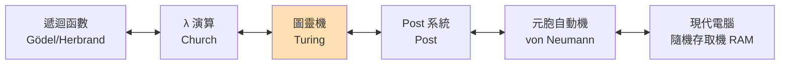
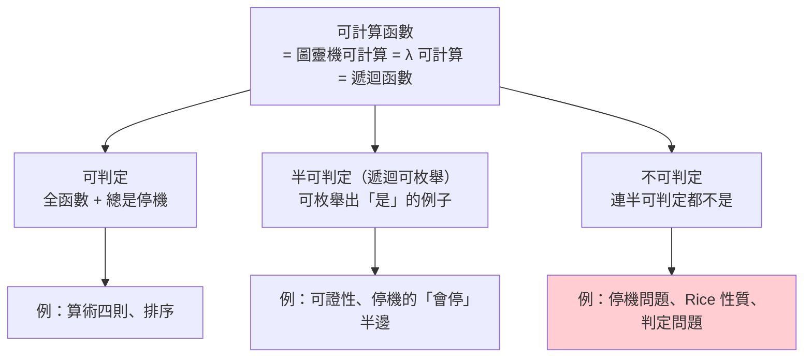

# 01.2 圖靈機與可計算性理論：什麼是可被計算的

## 導言：定義「計算」之前，沒有人能證明「不可計算」

上一章我們看到，希爾伯特綱領的第四項——判定問題（Entscheidungsproblem）——要求一個機械程序，對任意數學命題判斷其可證性。哥德爾證明：若這程序存在則會導出矛盾，但「機械程序」本身仍是個直覺詞彙。要徹底埋葬希爾伯特綱領，必須先給「計算」一個**數學定義**。

1936 年，Alan Turing 在論文《論可計算數及其在判定問題上的應用》（On Computable Numbers, with an Application to the Entscheidungsproblem）中完成了這件事。他不是從邏輯出發，而是從**人**出發：一個人在紙上做計算時，究竟在做什麼？把這個過程拆到最素、最無可再簡，就得到圖靈機。

## 圖靈的分析：人類計算者會做什麼？

Turing 的論證風格是現象學式的。一個計算者：

1. 看著紙上的符號；
2. 根據當下的心理狀態與看到的符號，決定動作；
3. 動作只能是：**擦掉、寫下、移動視線**。

Turing 再做幾個「不失一般性」的化約：

- 紙張可以是二維的，但一維紙帶夠用（可以分段編號）；
- 每格寫一個符號就夠了；
- 心理狀態只需有限個（人腦一次能分辨的狀態有限）；
- 讀寫頭一次移動一格就夠（多格移動可分解為多次單格移動）。

化約後的機器，就是**圖靈機**。

## 定義：圖靈機

**定義（圖靈機）**：一個七元組 $M = (Q, \Gamma, \Sigma, \delta, q_0, \sqcup, F)$ ：

- $Q$ ：有限狀態集；
- $\Gamma$ ：紙帶字母表（有限）； $\Sigma \subseteq \Gamma$ ：輸入字母表；
- $\sqcup \in \Gamma$ ：空白符；
- $q_0 \in Q$ ：起始狀態； $F \subseteq Q$ ：接受狀態集；
- $\delta : Q \times \Gamma \to Q \times \Gamma \times \{L, R\}$ ：轉移函數（可部分定義）。

機器配置（configuration）為 $(q, w, i)$ ：狀態 $q$ 、紙帶內容 $w$ 、讀寫頭位置 $i$ 。執行就是重複套用 $\delta$ ，直到進入 $F$ 或 $\delta$ 無定義（停機）或永不停。

**圖靈可計算**：函數 $f : \mathbb{N} \to \mathbb{N}$ 稱為可計算，若存在圖靈機 $M$ 使 $M$ 對輸入 $n$ 停機且輸出 $f(n)$ 。

### 這個定義為何令人信服？

圖靈機的每一個成分都「素」到無可辯駁：有限狀態、一格一符號、單步移動。任何人若宣稱某函數「直覺上可計算」，圖靈機都能模擬其過程——這正是 **Church–Turing 命題**的內容。它無法被證明（因為「直覺上可計算」不是數學概念），但八十年來所有候選模型都落在同一等價類裡，使命題獲得堅實的經驗支持。



## 普遍性：一台機器模擬所有機器

圖靈的第一個重大發現：存在**通用圖靈機**（Universal Turing Machine, UTM） $U$ ，它吃兩個輸入——機器的編碼 $\langle M \rangle$ 與資料 $x$ ——並模擬 $M$ 在 $x$ 上的行為：

$$U(\langle M \rangle, x) = M(x)$$

這在 1936 年是哲學炸彈：機器可以吃下「另一台機器的描述」。描述本身是資料、資料可以被當作程式執行——**程式即資料**（code as data）。你正在用的電腦，就是把 UTM 做成了實物；你把 `.py` 檔（資料）交給 Python 直譯器（另一個程式）執行，就是 UTM 的日常。

更深刻的是：UTM 的存在使「自我引用」成為可能——程式可以把自己的原始碼當輸入。哥德爾對角化的機械版本，就此誕生。

## 停機問題：不可計算的第一個定理

**定理（Turing, 1936）**：不存在圖靈機 $\mathrm{HALT}$ ，能對任意輸入 $(\langle M \rangle, x)$ 判斷 $M(x)$ 是否停機。

證明是對角化的典範。反設存在 $\mathrm{HALT}$ ，構造：

```python
def trouble(code: str, inp: str):
    if halts(code, inp):        # 假設存在的停機判定器
        while True:             # 永不停止
            pass
    else:
        return                  # 立即停止
```

現在問：`trouble(trouble_source, trouble_source)` 呢？

- 若它停機，則 `halts` 判定它「會停」，於是程式進入無窮迴圈——矛盾；
- 若它不停，則 `halts` 判定它「不停」，於是程式立即返回——矛盾。

兩種情況皆矛盾，故 `halts` 不可能存在。 $\blacksquare$

注意這個證明的結構：**任何「足夠強到能觀察自己」的預言者，都會被一個故意唱反調的程式打敗**。這與哥德爾的「 $G$ 說自己不可證」、羅素的「包含所有不包含自身的集合」是同一個對角化骨架。

## 由停機問題輻射出的不可判定性

停機問題一旦確立，一片「不可判定地景」就跟著浮現（多數用**歸約**證明：若問題 B 可判定，就能判定停機問題，矛盾）：

| 問題 | 敘述 | 判定？ |
|------|------|--------|
| 停機問題 | $M(x)$ 會停嗎？ | ✗ |
| 判定問題（希爾伯特） | 一階邏輯公式 $\varphi$ 可證嗎？ | ✗（Church & Turing 各自證明） |
| 波斯特對應問題 | 兩組字串能否拼出相同序列？ | ✗ |
| Rice 定理 | 程式的**任何**非平凡語義性質（會輸出 3 嗎？是質數產生器嗎？）可判定嗎？ | ✗ |
| Wang 瓷磚鋪滿平面 | 給定磚組能否鋪滿無限平面？ | ✗ |

**Rice 定理**值得特別品味：它說**所有**關於程式行為的非平凡問題都不可判定。靜態分析、編譯器最佳化、惡意程式偵測——都不可能做到完美。這不是工程困難，而是數學定律。

## 判定問題的倒數第二根釘子：Church 與 Turing 的合流

有了精確的「可計算」定義，判定問題便可正面攻擊：

1. 把一階邏輯的公式與證明**編碼**成自然數（哥德爾已鋪路）；
2. 「可證性」是**半可判定**的：存在機械程序，若 $\varphi$ 可證，終會枚舉出其證明（只需窮舉所有證明並逐一檢查）；
3. 反設「可證性」全可判定，則可判定停機問題（把「 $M(x)$ 停機」編碼成邏輯公式）——與停機問題不可判定矛盾。

Church 用 λ 演算、Turing 用圖靈機，在 1936 年各自完成此論證。Turing 為了確認兩個看似迥異的模型等價，赴普林斯頓跟隨 Church 攻讀博士——這段歷史本身就是兩大計算模型合流的象徵。而 λ 演算的故事，我們留到第二章細講。

## 範例：通用圖靈機的縮影——一個 20 行的直譯器

```python
# 一個玩具「通用機」：模擬由字典定義的狀態機
# rule[(state, read)] = (write, move, next_state)

def run(rules, tape, head=0, state="q0", max_steps=10_000):
    tape = list(tape) + ["_" ] * 100      # 預留空白
    for _ in range(max_steps):
        symbol = tape[head]
        if (state, symbol) not in rules:
            return "HALT", "".join(tape).rstrip("_")
        write, move, nxt = rules[(state, symbol)]
        tape[head] = write
        head += 1 if move == "R" else -1
        head = max(head, 0)
        state = nxt
    return "TIMEOUT", "".join(tape)

# 二進位遞增器：...b1 b0 -> ...b1 (b0+1)
inc = {
    ("q0", "1"): ("1", "L", "q0"),   # 走到最左
    ("q0", "0"): ("0", "L", "q0"),
    ("q0", "_"): ("_", "R", "q1"),   # 回頭
    ("q1", "1"): ("0", "R", "q1"),   # 進位
    ("q1", "0"): ("1", "S", "HALT"), # 補一
    ("q1", "_"): ("1", "S", "HALT"), # 全 1 進位
}
print(run(inc, "1011"))   # HALT, 1100
print(run(inc, "111"))    # HALT, 1000
```

把 `inc` 這個 dict 序列化成字串，就得到「機器的編碼」 $\langle M \rangle$ 。一個吃下這種編碼並執行它的函數，就是 UTM 的縮影。**寫直譯器，就是在重演圖靈 1936 年的論文**。

## 範例：用 Haskell 感受「程式即資料」

```haskell
-- 極簡 Brainfuck 直譯器：把「程式文字」當資料解釋執行
import qualified Data.Map as M
import Data.Char (ord, chr)

type Tape = M.Map Int Int

get :: Tape -> Int -> Int
get t i = M.findWithDefault 0 i t

step :: Int -> Int -> Tape -> String -> Either String (Int, Int, Tape)
step _ _ _ [] = Left "done"
step p out t ('>':rest) = step (p+1) out t rest
step p out t ('<':rest) = step (p-1) out t rest
step p out t ('+':rest) = step p out (M.insert p ((get t p + 1) `mod` 256) t) rest
step p out t ('-':rest) = step p out (M.insert p ((get t p - 1) `mod` 256) t) rest
step p out t ('.':rest) = step p (out+1) t rest   -- 省略輸出細節
step p out t ('[':rest)
  | get t p == 0  = step p out t (skip rest 1)
  | otherwise     = step p out t rest
  where skip ('[':xs) n = skip xs (n+1)
        skip (']':xs) n = if n == 1 then xs else skip xs (n-1)
        skip []       _ = error "unbalanced"
step p out t (']':rest)
  | get t p /= 0 = step p out t (rewind p rest)
  | otherwise    = step p out t rest
  where rewind _ xs = xs  -- 簡化：真實實作需回跳
step p out t (_:rest) = step p out t rest

-- Brainfuck 的 "+++" 把第一格加到 3
main = print $ step 0 0 M.empty "+++."
-- 這個程式「吃下」另一個程式（字串）——通用性的縮影
```

## 可計算性的地圖

把本節成果畫成一張地圖：



**半可判定**（semi-decidable）是個微妙概念：「 $M(x)$ 會停」可以**驗證**（等著看就好），但「 $M(x)$ 不停」無法驗證（要等多久才敢說不停？）。可證性同理：找到證明就確認，沒有證明則永遠等下去。這個不對稱，正是數學中「猜想」之所以存在的計算性根源。

## 定理整理

**定理（Church–Turing 命題，非定理而是命題）**：直覺可計算＝圖靈可計算。

**定理（普遍性）**：存在通用圖靈機 $U$ ， $U(\langle M\rangle, x) = M(x)$ 。

**定理（Turing, 1936）**：停機問題不可判定。

**定理（Rice）**：程式語義的任何非平凡性質皆不可判定。

## 章末小結

- 圖靈從「人如何計算」的現象學分析出發，得到最素樸的計算模型——圖靈機，並為「可計算」給出第一個數學定義。
- 通用圖靈機揭示了「程式即資料」，使自我引用與對角化成為機械化的武器。
- 停機問題不可判定，宣告希爾伯特判定問題死刑；Rice 定理則把不可判定性推廣到一切程式語義性質。
- 可計算性地圖分為：可判定、半可判定、不可判定三層，數學的「證明搜尋」恰落在半可判定層。
-Church 與 Turing 在 1936 年從不同模型抵達同一結論——這不只是巧合，而是「計算」這個概念內在統一性的第一次展露。

## 下一步

在圖靈用「機器」定義計算的同時，Church 用一個看似與機器毫無關聯的系統——**λ 演算**——給出了等價定義。λ 演算沒有紙帶、沒有狀態、沒有循環，只有三樣東西：變數、函數抽象、函數應用。為什麼如此貧瘠的系統竟與圖靈機等價？它與構造性數學、直覺主義邏輯又有什麼血緣？這是下一章（01.3 構造性數學）與第二章（邱奇的偉大發明）要回答的問題。我們先在 01.3 看看：布勞威爾的直覺主義如何從哲學側面，指向了同一個「計算」的核心。

## 習題

1. 寫一個 Python 函數，模擬「將任意字典規則機與輸入執行」的通用機（即本節 `run` 的推廣），並用它執行兩個不同的規則機。
2. 證明：「判定 $M$ 在**空輸入**上是否停機」與一般停機問題等價難度。（歸約。）
3. 用 Rice 定理說明：無法寫出完美的「偵測程式是否含無窮迴圈」的 lint 工具。
4. 思考題：你的 Python 直譯器是圖靈機嗎？記憶體有限的真實電腦，與圖靈機的差距該如何刻劃？
