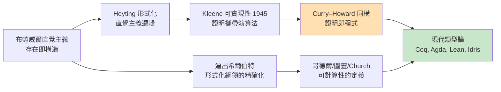

# 01.3 構造性數學與布勞威爾的直覺主義

## 導言：一場關於「存在」的戰爭

1908 年，荷蘭拓撲學家布勞威爾（L.E.J. Brouwer）提出一個在當時看來近乎異端的宣言：**數學是心智的構造活動，而不是獨立存在的符號遊戲或柏拉圖天堂**。數學命題為真，不是因為它在某個形式系統裡可證，而是因為**心智中有一個構造**見證了它。

這個立場——**直覺主義**（intuitionism）——引發了二十世紀數學基礎的三強爭霸：希爾伯特的形式主義、布勞威爾的直覺主義、羅素（與弗雷格一脈）的邏輯主義。表面上是哲學之爭，實質上每一方都被迫發明新的技術工具；而直覺主義逼出來的「構造性證明」，在七十年後化身為**類型論與 Curry–Howard 同構**，成為程式語言理論的心臟。本章講述這段前因後果。

## 布勞威爾的基本主張

### 1. 存在即構造

古典數學說「存在 $x$ 滿足 $P(x)$ 」，意思通常是：「假設不存在會導出矛盾」。布勞威爾問：**矛盾給了我那個 $x$ 嗎？沒有。** 對直覺主義者，「存在」意味著：

> 我能**給出**（或至少給出得到它的方法）一個具體的 $x$ ，並驗證 $P(x)$ 。

這就是**構造性存在證明**的要求。

### 2. 排中律失去普遍性

古典邏輯的基石之一是排中律（law of excluded middle）：

$$P \lor \neg P$$

布勞威爾接受它在**有限**情形的有效性（有限集逐個檢查即可），但拒絕它在**無限**情形的盲目套用。例子：

> 令 $P$ = 「 $\pi$ 的小數展開中出現連續七個 7」。 $P \lor \neg P$ 為真嗎？

古典答案：「當然，總有一邊成立」。直覺主義答案：「你**既沒有**構造出七個 7 的位置，也**沒有**證明它不存在——所以你尚未擁有 $P \lor \neg P$ 的證明」。注意：布勞威爾不是說 $P \lor \neg P$ 為**假**，而是說「目前沒有證明」。真理與證明的概念被重新焊接：**真 = 有構造**。

### 3. 雙重否定不等於肯定

在古典邏輯中 $\neg\neg P \iff P$ （這正是排中律的化身）。直覺主義只保留一個方向：

$$P \to \neg\neg P \quad \text{（成立）} \qquad \neg\neg P \to P \quad \text{（不成立）}$$

理由：「我證明了『 $P$ 不可能不成立』」只給了一個**間接**證明，沒有給出構造 $P$ 的方法。

## 直覺主義邏輯：一個精確的系統

把布勞威爾的哲學翻譯成規則，就得到**直覺主義邏輯**（intuitionistic logic），亦稱**構造性邏輯**。它與古典邏輯的差異，可以用一張「證明規則」表說清。以下我們用 **BHK 解釋**（Brouwer–Heyting–Kolmogorov）刻劃「什麼是命題 $A$ 的證明」：

| 命題 | 證明是什麼？ |
|------|------|
| $\top$ | 一個平凡的構造 |
| $A \land B$ | 一對證明 $(a, b)$ ， $a$ 證 $A$ 、 $b$ 證 $B$ |
| $A \lor B$ | 或者一個標記為左的 $A$ 證明，或者標記為右的 $B$ 證明 |
| $A \to B$ | 一個**程序**，把任何 $A$ 的證明轉換成 $B$ 的證明 |
| $\bot$ （假） | 沒有證明（空） |
| $\neg A$ | 一個程序，把任何假想的 $A$ 證明變成 $\bot$ 的證明 |
| $\exists x.\, A(x)$ | 一個具體的 $x$ ，配上 $A(x)$ 的證明 |
| $\forall x.\, A(x)$ | 一個程序，對每個 $x$ 給出 $A(x)$ 的證明 |

**請仔細盯著 $A \to B$ 那一行**：「一個把證明轉成證明的**程序**」。這就是整本書最重要的伏筆——命題的證明結構，與**函數**的概念在此正面相遇。Curry–Howard 同構的種子已經埋下。

直覺主義邏輯的公理系統（Heyting 算術 HA，相當於把皮亞諾算術的邏輯骨架換成直覺版）只保留：

- $A \to (B \to A)$
- $(A \to (B \to C)) \to ((A \to B) \to (A \to C))$
- $A \to (B \to A \land B)$ 、 $A \to A \lor B$ 、 $B \to A \lor B$
- $A \land \neg A \to \bot$
- 量詞的相應規則

拿掉的恰恰是： $\neg\neg A \to A$ （雙重否定消去）與 $A \lor \neg A$ （排中律）。

### 一個失效的古典證明

古典證明：「存在兩個無理數 $a, b$ 使 $a^b$ 為有理數」：

> 考慮 $\sqrt{2}^{\sqrt{2}}$ 。若它有理，取 $a=b=\sqrt{2}$ ；若它無理，取 $a = \sqrt{2}^{\sqrt{2}}, b = \sqrt{2}$ ，則 $a^b = 2$ 有理。由排中律，必居其一。 $\blacksquare$

這證明**優雅但非構造**：讀完之後，你知道存在，卻不知道「那對 $(a,b)$ 到底是誰」。構造性版本則直接給貨：

$$a = \sqrt{2}, \quad b = \log_2 9, \qquad a^b = \sqrt{2}^{\log_2 9} = 3$$

直覺主義者說：後者才是數學。前者只是「**要麼 A 要麼 B，總有一個能用**」的空頭支票。

## 拓撲學家的反擊：布勞威爾自己的硬功夫

常見誤解是布勞威爾只會談哲學。事實上他是當代最強的拓撲學家之一——**布勞威爾不動點定理**、維度不變性、單純逼近——都是他的傑作。更耐人尋味的是：這些定理的**古典證明全是非構造的**（依賴排中律與間接證明），而布勞威爾親自證明：**在直覺主義邏輯內，不動點定理的一般形式不可證**。

這帶來一個深刻的張力：

- **放棄古典邏輯**：失去大批優美定理（不動點、極大理想、Zorn 引理一族）；
- **保留古典邏輯**：證明不再攜帶「可提取的計算內容」。

數學社群的兩難，最終由兩個方向化解：

1. **雙面主義**（Hilbert–Bernays、後來的 Bishop）：對有限對象用構造，對抽象對象允許古典推理；
2. **語義橋樑**：為直覺主義邏輯找到「計算解釋」——Kleene 的**可實現性**（realizability，1945）證明：每個 HA 可證的 $\exists x.\,A(x)$ 都能**提取出具體的 $x$ **。換句話說：直覺主義證明本身攜帶演算法。

Kleene 可實現性是 Curry–Howard 同構的前身：它第一次讓「**證明即程式**」成為可操作的定理，而不只是哲學口號。

## 範例：構造性證明提煉出演算法

構造性版本的「存在證明」，其證明本身就是程式。看一對照：

```python
# 非構造性（古典）：用排中律 + 反證
# 「存在 x，x² = 2 且 x 是有理數的補集元素」之類的間接論證
# —— 只能證明存在，不能取出 x

# 構造性（直覺主義）：證明即程式
from math import isqrt

def constructive_existence() -> tuple[int, int]:
    """定理：存在連續兩個整數平方數的差為奇數。
       構造性證明 = 直接回傳見證物。"""
    # 對任意 n：(n+1)² - n² = 2n+1，恆為奇數
    n = 7                      # 任何 n 皆可，證明對每個 n 給出見證
    return (n * n, (n + 1) * (n + 1))

lo, hi = constructive_existence()
assert (hi - lo) % 2 == 1    # 見證物自帶驗證
```

再看一個直覺主義的否定如何運作——否定是「把證明變矛盾」的函數：

```haskell
-- 直覺主義的否定：Neg a = a -> Void（Void 為空型別）
data Void                      -- 沒有構造子的型別 = 假
type Neg a = a -> Void         -- ¬A = A → ⊥

-- 定理：¬¬A 不給你 A（沒有這樣的函數）
-- doubleNegElim :: Neg (Neg a) -> a   -- 這個型別**無法**在 Haskell 中
--                                      -- 用 total、非 bottom 的程式實現！

-- 但「從矛盾推出一切」可以構造：
exFalso :: Void -> a
exFalso v = case v of {}        -- 空模式匹配：Void 無值，函數永遠不必給結果

-- De Morgan 律的直覺主義可用方向：
notBoth :: Neg a -> Neg b -> Neg (a, b)
notBoth na nb (x, y) = exFalso (na x)   -- 接受一對，丟一邊入否定即得矛盾
```

`doubleNegElim` 型別的函數**不可能**被純粹、全面的程式寫出——這不是功力問題，而是定理（此型別在直覺主義邏輯中不可證）。程式語言因此成為檢驗「證明是否構造性」的**物理儀器**：型別可 inhabited，當且僅當命題構造可證。

## 希爾伯特的反擊與歷史的合流

希爾伯特對直覺主義深惡痛絕（名言：「把排中律從數學家手中拿走，就像拿走望遠鏡給天文學家」）。但他沒有忽視它：直覺主義逼出了**有窮主義方法論**的精確化，也間接逼出「證明需要被當成對象研究」的整個證明論。而圖靈與 Church 定義「可計算」時，構造性精神已無處不在——**演算法**本來就是構造的極致。



## 直覺主義在今天的實用面貌

直覺主義不是歷史古董，它活在每一個依賴型別的系統裡：

- **Coq / Lean / Agda**：定理證明助手。你在裡面證明的每一個 $\exists x.\,P(x)$ ，都可以用 `extract` 指令**提取出可執行的 OCaml/Haskell 程式**。著名的 CompCert 認證 C 編譯器，就是 Coq 證明中提取出來的程式。
- **依賴型別程式語言 Idris**：把「帶見證的存在型別」變成一等公民：

```idris
-- Idris：存在型別攜帶見證物
-- 定理「存在 n : Nat，n 是某數的平方」的構造性證明：
existsSquare : (m : Nat) -> (n ** n = m * m)
existsSquare m = (m * m ** Refl)
-- 型別 (n ** n = m * m) 讀作：存在 n，使得 n = m*m
-- 右邊直接「給出」n —— 證明即程式，字面上的意義
```

- **程式驗證**：當你要求證明是構造性的，證明器不只能告訴你「程式正確」，還能**生產**出正確程式。這正是構造性數學的工業化。

## 定理整理

**定義（BHK 解釋）**：命題的證明依邏輯連接詞歸納定義（見上表）； $A \to B$ 的證明是「把 $A$ 的證明轉成 $B$ 的證明的程序」。

**定理（Kleene 可實現性，1945）**：若 $\exists x.\,A(x)$ 在 Heyting 算術中可證，則存在具體自然數 $n$ 使 $A(n)$ 真且可機械提取。

**定理（布勞威爾）**：布勞威爾不動點定理的一般形式在直覺主義邏輯中不可證。

**觀念（直覺主義 ↔ 古典的關係）**：直覺主義邏輯是古典邏輯的子系統； $\neg\neg$ 翻譯（哥德爾–Gentzen 譯）把古典證明嵌入直覺系統，但代價是命題被 $\neg\neg$ 包裹、失去直接計算內容。

## 章末小結

- 布勞威爾主張「存在即構造」，拒絕排中律的無限域濫用，引出直覺主義邏輯。
- Heyting 將其形式化，BHK 解釋把「 $A \to B$ 的證明」定義為**程序**——函數概念進入邏輯核心。
- Kleene 可實現性證明：直覺主義證明攜帶演算法，構造性不是損失而是**增強**。
- 直覺主義與形式主義的對抗，共同催生了「證明作為數學對象」的證明論與可計算性理論。
- 構造性證明可以提取程式——這條線在 1930 年代是哲學，在今天是 Coq/Lean/Idris 的日常。

## 下一步

我們已經有兩條線在此交會前的短暫平行：

1. **Church 的 λ 演算**：一個只有變數與代換的系統，被證明與圖靈機等價（第二章主題）；
2. **構造性邏輯**：證明的結構天生是「函數與程序」（第三章主題）。

第二章（02.1–02.3）我們深入 λ 演算：它為何誕生（Church 最初竟是為了替邏輯打地基！）、β 化約如何運作、以及如何**只用函數**建造出自然數、布林值、遞迴——乃至整個數學。讀完第二章，你會發現構造性邏輯與 λ 演算根本是同一枚硬幣的兩面，而翻轉這枚硬幣的手，就是 Curry–Howard 同構。

## 習題

1. 用 BHK 解釋說明：為什麼 $A \lor \neg A$ 的證明要求「你必須知道是哪一邊」？
2. 在 Python 中寫出 $\neg A$ （ $A$ 為型別）的對應物，並解釋為何 Haskell 的 `Neg (Neg a) -> a` 不可實現。
3. 古典證明「存在無理數 $a,b$ 使 $a^b$ 有理」中，排中律用在哪一句話？構造性版本繞過了什麼？
4. 思考題：若採用直覺主義， $\pi$ 的數字中「連續七個 7」這類命題該如何處理？這對數學研究是限制還是引導？
