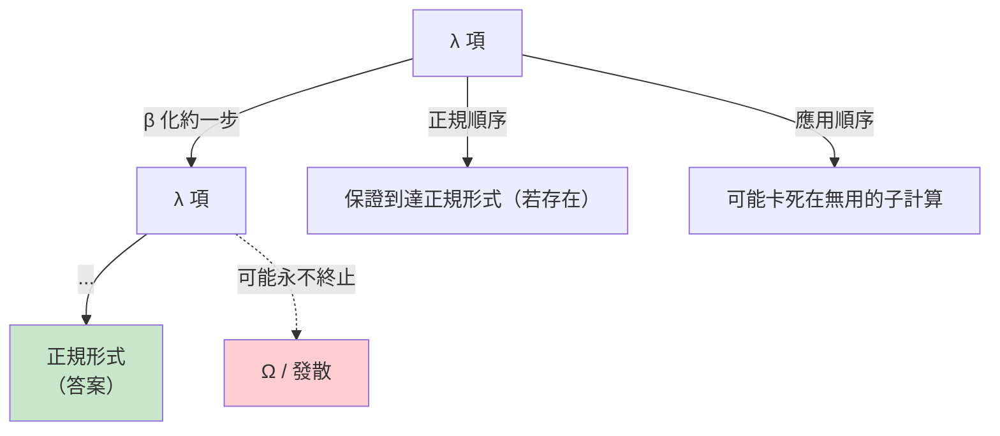

# 02.2 β化約與無值型蘭布達演算的表達力

## 導言：一條代換規則能走多遠？

上一章我們建立了 λ 演算的文法與 β 化約。本章回答一個挑戰性的問題：**只有「把參數代進函數體」這一個動作，如何產生條件分支、資料結構、乃至遞迴？** 答案將展示：β 化約不只是計算的機制，它就是計算的全部——而它的表達力恰好等同圖靈機。

「無值型」（untyped，亦譯「非型別化」）λ 演算是邱奇的原始版本：任何項都可以應用於任何項。這份自由既孕育了驚人的表達力（本章），也埋下了危險（某些項沒有正規形式——即死迴圈），並最終引出了第三章的型別論。讓我們先享受自由。

## 布林值：if-then-else 是一個函數

在 λ 演算中，**資料就是它自己的使用說明書**。定義：

$$\mathrm{TRUE} = \lambda x.\,\lambda y.\,x \qquad \mathrm{FALSE} = \lambda x.\,\lambda y.\,y$$

這叫**教會布林**（Church booleans）。它們的聰明之處：TRUE 是「選第一個」的函數，FALSE 是「選第二個」的函數。因此 if-then-else **不需要語法**，就是應用：

$$\mathrm{IF}\ b\ t\ f = b\ t\ f$$

驗證：

$$\mathrm{IF}\ \mathrm{TRUE}\ t\ f = (\lambda x.\lambda y.\,x)\ t\ f \to (\lambda y.\,t)\ f \to t \checkmark$$
$$\mathrm{IF}\ \mathrm{FALSE}\ t\ f = (\lambda x.\lambda y.\,y)\ t\ f \to (\lambda y.\,y)\ f \to f \checkmark$$

**未被選中的分支仍然會被「寫進」代換裡**，但在正規順序（normal order，最左最外優先）求值下不會被**執行**。這正是惰性求值的理論根據：`if cond then crash else 42` 在 cond 為真時不會 crash。

```haskell
-- Haskell：這些定義不只是類比，教會布林就是這樣用的理論基礎
let tru = \x -> \y -> x
let fls = \x -> \y -> y
let iff b t f = b t f

-- 布林運算也全是函數組合：
let and' = \p -> \q -> p q fls      -- p 真→回 q；p 假→回 fls
let or'  = \p -> \q -> p tru q
let not' = \p -> p fls tru

main = print (iff (and' tru fls) "yes" "no")   -- "no"
```

## 自然數：教會數字與疊代

**定義（教會數字）**： $n$ 表示為「把函數 $f$ 應用 $n$ 次」：

$$\bar{0} = \lambda f.\,\lambda x.\,x \qquad \bar{1} = \lambda f.\,\lambda x.\,f\ x \qquad \bar{n} = \lambda f.\,\lambda x.\,f^n(x)$$

零是「什麼都不做」，三是「疊代三次」。這個定義的深意：**自然數 = 疊代的次數**。它與皮亞諾公理「零 + 後繼」的結構完美同構，也與函數式程式的 `fold`/`foldr` 概念同源。

加法與乘法因而是「疊代的疊代」：

$$\mathrm{ADD} = \lambda m.\,\lambda n.\,\lambda f.\,\lambda x.\,m\ f\ (n\ f\ x) \qquad \mathrm{MUL} = \lambda m.\,\lambda n.\,\lambda f.\,m\ (n\ f)$$

驗證 $\mathrm{ADD}\ \bar{2}\ \bar{3}$ ：先給 $n=\bar 3$ 把 $f$ 疊 3 次，再讓 $m=\bar 2$ 把「疊 3 次」再疊 2 次——總共疊 5 次。 $\checkmark$

```python
# Python 中親手操作教會數字
SUCC = lambda n: lambda f: lambda x: f(n(f)(x))       # 後繼
ADD  = lambda m: lambda n: lambda f: lambda x: m(f)(n(f)(x))
MUL  = lambda m: lambda n: lambda f: m(n(f))

def church(n):                                        # int -> 教會數字
    return lambda f: lambda x: f(f(f(...))) if False else (
        (lambda f, x, n: (lambda k: (lambda g: g)(lambda _:
            f(f(f(x)))) ) ) )   # 遞迴版本見下，此處直接展開

def to_int(cn):                                       # 教會數字 -> int
    return cn(lambda i: i + 1)(0)

zero = lambda f: lambda x: x
one  = SUCC(zero)
two  = SUCC(one)
three = SUCC(two)
five = ADD(two)(three)
six  = MUL(two)(three)
print(to_int(five), to_int(six))    # 5 6
```

條件判斷「 $n$ 是否為零」：

$$\mathrm{ISZERO} = \lambda n.\,n\ (\lambda \_.\,\mathrm{FALSE})\ \mathrm{TRUE}$$

把常數函數疊 $n$ 次：疊零次得 TRUE，疊一次以上得 FALSE。零的偵測是「疊代器的天性」。

## 不動點：遞迴如何從虛空中出現

現在來到本章的高潮。想定義遞迴函數（如階乘），需要函數能呼叫「自己」。但 λ 項是匿名的——函數體內**沒有名字可用來指稱自己**！邱奇如何突破？

### 第一步：把「自己」當參數傳進來

寫階乘時，不直接呼叫自己，而是接受一個「假想的自己」作為參數：

$$F = \lambda \mathrm{self}.\,\lambda n.\,\mathrm{IF}\ (\mathrm{ISZERO}\ n)\ \bar{1}\ (\mathrm{MUL}\ n\ ((\mathrm{self}\ \mathrm{self})\ (\mathrm{PRED}\ n)))$$

這是**開放的**遞迴： $F$ 還需要一個 self。但我們有個自欺欺人的妙招——**把 $F$ 自己傳給自己**： $F\ F$ 。因為 self 的位置正好收到 $F$ ，函數體內的 `self self` 就化約為 $F\ F$ ——遞迴成立了！

$$F\ F \to \lambda n.\,\ldots(\mathrm{self}\ \mathrm{self})\ldots \stackrel{n\ \text{應用}}{\longrightarrow} \ldots (F\ F)\ldots$$

$F\ F$ 在化約中不斷**重新生成自己**——這就是不動點的動態面目。

### 第二步：抽象出通式——Y 組合子

「 $F\ F$ 產生 $F\ F$ 」的現象可以一般化。觀察：若存在項 $Y$ 使得

$$Y\ F = F\ (Y\ F) \quad \text{對所有 } F$$

則 $Y\ F$ 就是 $F$ 的**不動點**（fixed point）—— $F$ 應用上去不變。邱奇的學生 Curry 找到了（邱奇版本稍異，通稱 **Y 組合子**）：

$$Y = \lambda f.\,(\lambda x.\,f\ (x\ x))\ (\lambda x.\,f\ (x\ x))$$

驗證（一步 β 化約即見證奇蹟）：

$$Y\ F \to (\lambda x.\,F\ (x\ x))\ (\lambda x.\,F\ (x\ x)) \to F\ ((\lambda x.\,F\ (x\ x))\ (\lambda x.\,F\ (x\ x))) = F\ (Y\ F)$$

$Y\ F$ 化約一步後，**以 $F\ (Y\ F)$ 的形態重現**——每化約一次，就把自己展開一層。遞迴 = 不斷重生的不動點。

```python
# Y 組合子在 Python 中的活體展示
Y = (lambda f: (lambda x: f(lambda v: (x(x))(v)))
               (lambda x: f(lambda v: (x(x))(v))))

# 階乘：完全匿名、完全無遞迴關鍵字
factorial_gen = lambda self: lambda n: 1 if n == 0 else n * self(n - 1)

factorial = Y(factorial_gen)
print(factorial(10))   # 3628800 —— 來自一個沒有 def、沒有名字的世界
```

```haskell
-- Haskell 版（注意：Haskell 需要小心 bottom，此處用惰性使 Y 可用）
newtype Mu a = InF { outF :: Mu a -> a }
y :: (a -> a) -> a
y f = g (InF g) where g x = f (outF x x)
-- Mu 型別是「自指型別」：Mu a 裝著一個「吃 Mu a 給 a」的函數
-- 這正是 (x x) 需要的：x 既是函數又是參數
-- 無型別 λ 演算允許 x x；型別化之後，x x 直接型別錯誤！
-- 這就是「無值型的表達力 vs 型別化的一致性」張力的具體落點。
```

## Ω：發散的原型

Y 的原料是 $(\lambda x.\,x\ x)\,(\lambda x.\,x\ x)$ ——著名的 **Ω**：

$$\Omega = (\lambda x.\,x\ x)(\lambda x.\,x\ x) \to (\lambda x.\,x\ x)(\lambda x.\,x\ x) = \Omega$$

Ω 化約一步**回到自己**：永不完結。它是停機問題在 λ 演算裡的具體化身（回憶 01.2：無窮迴圈程式）。而 $Y\ F$ 可以看成「**馴化的 Ω**」：Ω 直接自食， $Y\ F$ 則在自食之間「經手」 $F$ ，每次重生都推進一點計算。**無窮與生產力只隔一個函數應用。**

## 兩種求值策略：正規順序與應用順序

β 化約可以多個「紅色子項」（形如 $(\lambda x.\,M)\ N$ 的位置）同時存在，先化約哪個？兩大策略：

| 策略 | 規則 | 對應語言 |
|------|------|------|
| **正規順序**（normal order） | 最左最外優先；參數**先不代換** | Haskell（惰性）、Call-by-need |
| **應用順序**（applicative order） | 先化約參數再應用 | Python、Scheme（急切）、Call-by-value |

關鍵定理（**標準化定理**，standardization theorem 的推論）：

**定理**：若項 $M$ 有正規形式（normal form，不再可化約），則正規順序求值**必然**找到它；應用順序則可能在半路撞上無窮迴圈。

實例： $(\lambda x.\,\bar{1})\ \Omega$ 。

- 正規順序：直接得 $\bar{1}$ ，完成。✓
- 應用順序：先化約 Ω——永無寧日。✗

這解釋了 Haskell 的設計哲學（惰性求值 = 正規順序的工程化），也解釋了為什麼 Python 中 `f(g(x))` 一定先算 `g(x)`：應用順序是它的理論基因。但也注意：急切求值效率高（不重複求值），惰性求值用共享（sharing / call-by-need）補救——理論的兩難延伸成語言的譜系。



## 表達力封頂：與圖靈機等價

本章的構件——教會布林、教會數字、配對（ $\mathrm{PAIR} = \lambda a.\,\lambda b.\,\lambda f.\,f\ a\ b$ ）、Y 組合子——合起來足以**在 λ 演算內模擬任意图靈機**：用教會數字編碼紙帶內容、用函數組合表示狀態轉移、用 Y 驅動每一步。因此：

**定理**：λ-可計算函數 = 圖靈可計算函數 = 部分遞迴函數。

同時，λ 演算也有自己的「停機問題」：**正規形式的存在性不可判定**（給定 $M$ ，判斷它是否會化約到正規形式，等價於停機問題）。第二章結尾（02.3）我們會把這個等價性具體演給你看。

## 範例綜合：用純 λ 演算寫「前驅」

乘法、加法都好辦，**前驅**（ $n-1$ ）才是教會數字的試金石——因為疊代器只會前進，如何後退？邱奇的解法是攜帶「舊值」的疊代：

$$\mathrm{PRED} = \lambda n.\,\lambda f.\,\lambda x.\,n\ (\lambda g.\,\lambda h.\,h\ (g\ f))\ (\lambda u.\,x)\ (\lambda u.\,u)$$

```python
# 前驅函數的化約過程（Python 可執行版）
PRED = (lambda n: lambda f: lambda x:
        n(lambda g: lambda h: h(g(f)))(lambda u: x)(lambda u: u))

to_int = lambda c: c(lambda i: i + 1)(0)
print(to_int(PRED(three := (lambda f: lambda x: f(f(f(x)))))))   # 2
```

原理：疊代 $n$ 次的過程中，攜帶一個「慢一拍」的副本； $n$ 次結束時，慢一拍的正是 $n-1$ 。**在純粹的「只能前進」的宇宙裡，倒退是靠影子達成的**——這類巧思正是無型別 λ 演算的迷人之處，也預告了第三章的主題：這些巧妙卻無規則可循的編碼，為何在加上型別後反而**崩壞**（教會數字在簡單型別 λ 演算中無法定義前驅！），從而逼出更強的型別系統。

## 章末小結

- 布林、數字、條件、配對都能用純函數編碼：**資料 = 它自己的解釋器**。
- 教會數字把自然數定義為「疊代次數」，與皮亞諾結構及 fold 同構。
- $F\ F$ 與 Y 組合子顯示：遞迴不是原語，而是 β 化約的**定理**；Ω 是發散的原型， $Y\ F$ 是馴化的 Ω。
- 求值策略（正規 vs 應用順序）決定能否繞過無用的發散子項——這是 Haskell 惰性與 Python 急切的理論分野。
- λ 演算表達力與圖靈機等價；其自身亦有不可判定的停機問題。

## 下一步

本章我們見證了無型別宇宙的蠻荒之力：`x x` 允許自指，Y 組合子允許遞迴，Ω 允許發散。但「什麼都能應用於什麼」也意味著**沒有安全保障**——`(λx. x x) (λx. x x)` 的型別在什麼意義上「不存在」？下一章（02.3）我們把整個數學搬進這個只有函數的宇宙：自然數系、算術、乃至更多的結構，全部由 λ 項構成。然後你將在第三章看到：當我們試圖**給這個宇宙加上型別**（回應第一章羅素悖論的同一份歷史直覺），Curry–Howard 同構的舞台就正式搭好了。

## 習題

1. 用 β 化約逐步驗證 $\mathrm{AND}\ \mathrm{TRUE}\ \mathrm{FALSE} \to \mathrm{FALSE}$ 。
2. 寫出教會數字的減法（提示： $\mathrm{SUB} = \lambda m.\,\lambda n.\,n\ \mathrm{PRED}\ m$ ——把前驅疊 $n$ 次），並用 Python 驗證 $5 - 3$ 。
3. 證明 $Y\ F = F\ (Y\ F)$ 只在「允許無窮化約」的意義下成立；在急切求值的 Python 中，為何 Y 需要加上 `lambda v: ...` 的包裝（eta 展開）才能運作？
4. 挑戰題：用教會編碼寫出 `PAIR` 與 `FST`/`SND`，並實作教會數字列表的「長度」函數。
