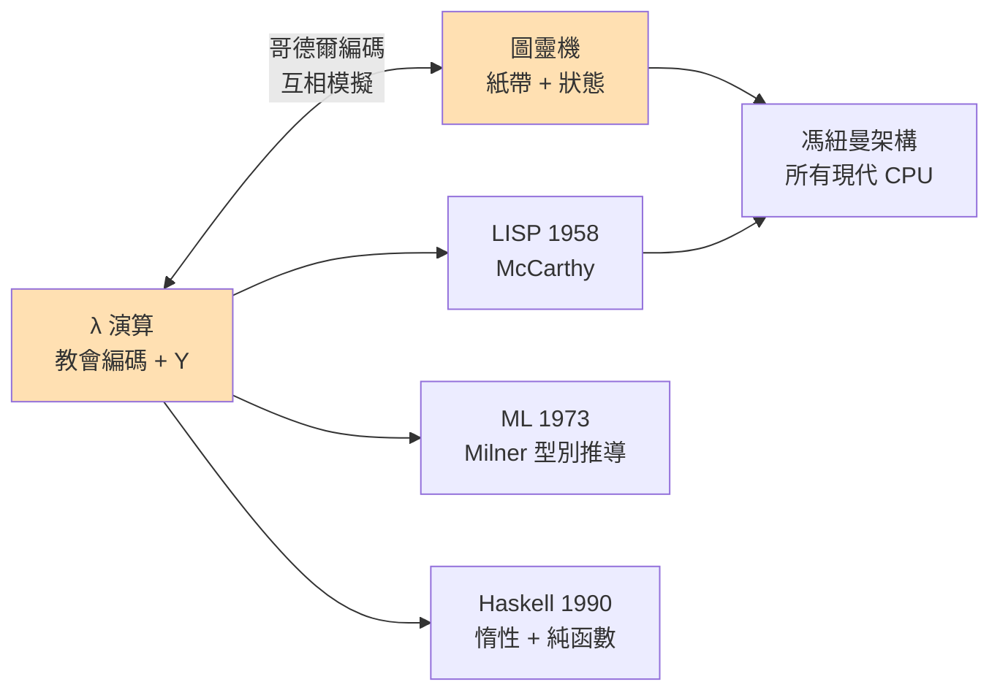

# 02.3 函數作為唯一的公民：用蘭布達演算模擬整個數學

## 導言：一場徹底的建構實驗

前兩章我們造好了磚（β 化約）與樑（Y 組合子）。本章進行一次徹底的實驗：**在只有函數的宇宙裡，重建數學的骨架**——布林代數、自然數、有序對、列表、遞迴方程——並證明這個宇宙與圖靈機等價。這不是智力遊戲的堆砌：1950–60 年代，McCarthy 正是把這套編碼思想工程化，設計出 LISP；1970 年代，Milner 從 λ 演算的可證明等價性提煉出 ML 的型別推導。你今天寫的每一行函數式程式，都是這個實驗的後代。

## 一、資料的統一原理：資料即其解釋器

無型別 λ 演算中，唯一的「值」是函數。如何表示一個二元組？邱奇給出統一的設計原理：

> **一個資料，由「它能被如何消費」來定義。**

有序對 $\langle a, b \rangle$ 是什麼？是「給我一個雙參數函數 $f$ ，我就把 $a, b$ 餵給它」的東西：

$$\mathrm{PAIR} = \lambda a.\,\lambda b.\,\lambda f.\,f\ a\ b \qquad \mathrm{FST} = \lambda p.\,p\ \mathrm{TRUE} \qquad \mathrm{SND} = \lambda p.\,p\ \mathrm{FALSE}$$

驗證： $\mathrm{FST}\ (\mathrm{PAIR}\ a\ b) = (\lambda f.\,f\ a\ b)\ \mathrm{TRUE} \to \mathrm{TRUE}\ a\ b \to a$ 。 $\checkmark$

回憶教會布林 $\mathrm{TRUE} = \lambda x.\lambda y.\,x$ ：布林本來就是「二選一的消費者」！**配對與布林在此自然交會**——`FST` 不需要特別寫，它就是「用 TRUE 消費配對」。資料的表示法彼此咬合，這是邱奇編碼最優雅的一面。

```python
# 資料即消費協議：Python 演示
PAIR = lambda a: lambda b: lambda f: f(a)(b)
FST  = lambda p: p(lambda x: lambda y: x)
SND  = lambda p: p(lambda x: lambda y: y)

p = PAIR(3)(7)
print(FST(p), SND(p))    # 3 7
```

## 二、列表：疊代器的鏈

有了配對與「零/後繼」的思想，列表是水到渠成的推廣。**教會列表**（Church list，採右摺疊編碼）：

$$\mathrm{NIL} = \lambda c.\,\lambda n.\,n \qquad \mathrm{CONS} = \lambda h.\,\lambda t.\,\lambda c.\,\lambda n.\,c\ h\ (t\ c\ n)$$

一個列表是「給我摺疊函數 $c$ 與基底 $n$ ，我把整條鏈摺給你看」。長度、求和、映射，全是不同的「消費方式」：

```python
# 教會列表：列表 = 右摺疊本身
NIL  = lambda c: lambda n: n
CONS = lambda h: lambda t: lambda c: lambda n: c(h)(t(c)(n))

LENGTH = lambda lst: lst(lambda h: lambda acc: SUCC(acc))(ZERO)
SUM    = lambda lst: lst(lambda h: lambda acc: ADD(h)(acc))(ZERO)

mylist = CONS(ONE)(CONS(TWO)(CONS(THREE)(NIL)))
print(to_int(LENGTH(mylist)))   # 3
print(to_int(SUM(mylist)))      # 6
```

深意：**列表與 fold 在編碼層面就是同一個東西**。Haskell 中 `foldr :: (a -> b -> b) -> b -> [a] -> b` 的型別之所以萬能（能表達一切列表遞迴），理論根源就在此——列表的教會編碼**就是** foldr。這個觀察的型別論版本（初代代數資料型 = 其摺疊）將在第三章 Curry–Howard 的框架下再次出現。

## 三、自然數的完整建構：不只是編碼，而是結構

教會數字已見於 02.2。此處把它們組裝成**滿足皮亞諾公理的結構**：

| 皮亞諾要求 | 教會編碼 | 狀態 |
|------|------|------|
| 零 | $\bar 0 = \lambda f.\lambda x.\,x$ | ✓ |
| 後繼 | $\mathrm{SUCC} = \lambda n.\lambda f.\lambda x.\,f\ (n\ f\ x)$ | ✓ 單射（可證） |
| 零非後繼 | $\mathrm{ISZERO}$ | ✓ |
| 數學歸納法 | ？ | **微妙**——見下 |

前三條易驗證；第四條——**歸納原理**——在無型別宇宙中無法「表示為一個項」，因為它是一個**量化所有命題的推理規則**，而無型別系統中沒有命題的位階。這個缺口不是缺陷，而是**線索**：要讓歸納法進入 λ 演算，必須讓「命題」成為系統內的物件——第三章的型別系統將補上這一環。理論缺口的修補，再次由跨章的歷史驅動鏈完成。

## 四、等價性定理：λ 宇宙 ≅ 圖靈機宇宙

**定理（Turing, 1937）**：部分 λ-可計算函數類 ＝ 部分圖靈可計算函數類。

兩個方向的證明骨架（理解骨架比記住細節重要）：

**圖靈機 → λ**：用教會數字編碼紙帶配置（位置、內容、狀態三元組），寫一個項 `STEP` 表示單步轉移，再寫 `RUN = Y (λr. λcfg. IF HALTED cfg cfg (r (STEP cfg)))`。每化約一步，模擬機器走一步。**模擬是逐字面的**。

**λ → 圖靈機**：將 λ 項與 β 化約本身編碼為自然數上的操作（回憶 01.1 的哥德爾編碼——此刻它成為橋樑）。可用 Kleene 的 **s-m-n 與通用函數**理論，或直接證明代換操作是原始遞迴的。故存在模擬 λ 演算的圖靈機。



**推論（λ 演算的停機問題）**：給定 λ 項 $M$ ，判斷 $\beta$ 化約是否終止，是不可判定的。（由等價性直接歸約自 01.2 的停機問題。）因此，無型別 λ 演算**不可能有完備的（既健全又完備的）靜態終止檢查器**。

## 五、歷史的迴響：從宇宙到工程

### LISP（1958）：邱奇編碼的工程化身

McCarthy 讀懂了 λ 演算，做了三個關鍵工程決定：匿名函數（`lambda` 保留到今天）、把**程式本身也當資料**（S-表達式，即「程式即資料」的 UTM 傳統）、自動記憶體管理。LISP 的 `eval` 就是通用圖靈機的直譯器。附帶一提：McCarthy 1958 年論文裡展示的那個幾十行的 `eval` 直譯器，成了每個函數式語言設計者的成年禮——「寫一個 eval，就懂了整個語言」。

### 組合子邏輯：連變數都不要了

Curry 與 Schönfinkel 更進一步：**連變數名都省掉**。僅用兩個組合子：

$$S = \lambda f.\lambda g.\lambda x.\,f\ x\ (g\ x) \qquad K = \lambda x.\lambda y.\,x$$

**定理（變數消除定理）**：任何閉 λ 項都可用 $S$ 與 $K$ （以及應用）表示。

這是驚人的極簡主義：**兩個函數 + 應用 = 一切計算**。實務上它成為惰性語言編譯器的中間表示（如 GHC 的 Spineless Tagless G-machine 用的正是 STG/組合子式核心）。「抽象」不再是語法操作，而是等式變換——名為**括號抽象演算法**（bracket abstraction）的機械過程可以把任何 λ 項機械地編譯成 SK 項。

```python
# 組合子邏輯：兩個函數搭起一切
S = lambda f: lambda g: lambda x: f(x)(g(x))
K = lambda x: lambda y: x
I = S(K)(K)                    # 恆等函數 = S K K ！

print(I(42))                   # 42
# K = TRUE（選第一個），K I = FALSE（K 回傳 I，I 選第二個）
TRUE_, FALSE_ = K, K(I)
# SUCC 也能寫出：SUCC = S(S(K S) K)  —— 教會數字的組合子版本
```

$S\ K\ K = I$ 的化約，值得手推一次，體會「兩個原語」的力量：

$$S\ K\ K\ x \to K\ x\ (K\ x) \to x \checkmark$$

### 名字消失之後：De Bruijn 索引

Nicolaas de Bruijn（1972）提出另一條路：變數不用名字，用「**距離**」表示—— $\lambda x.\,x$ 寫成 $\lambda.\,0$ （繫到最近的 binder）， $\lambda x.\,\lambda y.\,x$ 寫成 $\lambda.\,\lambda.\,1$ 。α-變換**整個消失**（沒有名字就沒有改名問題），捕獲避免代換變成純索引運算。這是 Coq、Agda、Lean 的實作基石，也是 03 章證明助手敘事的技術伏筆。

```python
# De Bruijn 索引下的代換：無名宇宙
# Lam(body), App(f, a), Var(k)；k 表示「往外數第 k 個 binder」
def subst_db(t, depth, s):
    match t:
        case ('Var', k):
            return ('Var', k) if k < depth else \
                   s if k == depth else ('Var', k - 1)   # 跨過 binder 時索引 -1
        case ('Lam', body):
            return ('Lam', subst_db(body, depth + 1, shift1(s, 0)))
        case ('App', f, a):
            return ('App', subst_db(f, depth, s), subst_db(a, depth, s))

def shift1(t, cutoff):
    """將 s 中大於等於 cutoff 的自由索引 +1（為新 binder 騰位）"""
    match t:
        case ('Var', k): return ('Var', k) if k < cutoff else ('Var', k + 1)
        case ('Lam', b): return ('Lam', shift1(b, cutoff + 1))
        case ('App', f, a): return ('App', shift1(f, cutoff), shift1(a, cutoff))

t = subst_db(('App', ('Var', 1), ('Var', 0)), 0, ('Var', 99))
print(t)   # ('App', ('Var', 100), ('Var', 99)) —— 索引運算，全程無名字
```

## 六、邊界：這個宇宙「不能」做什麼

誠實地刻劃邊界，與展示能力同樣重要：

1. **無法保證終止**：停機問題不可判定（見上）。任何「保證會停」的子系統必然犧牲表達力——這句話是第三章型別論的核心張力。
2. **無法在系統內談論自身的一致性**：由哥德爾第二定理，若 λ 演算一致（Church–Rosser 定理證明其一致），則它無法在自身內部證明這件事。
3. **教會編碼無法「自省」**：一個教會數字 $n$ 無法在 λ 演算內部判斷「自己是不是教會數字」——編碼的意義只存在於後設層。這與 01.1 的 MU 謎題同一教訓：**不變量活在系統外**。

## 定理整理

**定理（變數消除）**：每個閉 λ 項皆可由 $S, K$ 表示。

**定理（Turing 1937）**：λ 可計算性與圖靈可計算性重合。

**定理（λ 停機問題不可判定）**：正規形式存在性不可判定。

**觀念（三種「去名字」策略）**：組合子邏輯（去變數，換成 S/K）、De Bruijn 索引（去名字，換成索引）、以及α-等價類（把名字視為虛物）。三者是同一深層結構的三種表面語法。

## 章末小結

- 資料的邱奇編碼遵循「資料 = 消費協議」：布林、配對、列表彼此咬合，列表的編碼就是 foldr。
- 自然數的皮亞諾結構可編碼，唯歸納原理需要「命題層」，留下通往型別論的缺口。
- λ 演算與圖靈機可互相模擬（哥德爾編碼是橋樑），表達力等價，停機問題皆不可判定。
- 組合子邏輯把系統縮到 $S, K$ 兩個原語；De Bruijn 索引解決了名字的一切麻煩——兩者都成為現代實作的基礎。
- 無型別宇宙的兩大軟肋：發散不可避免、意義只能活在後設層。

## 下一步

我們的函數宇宙強大而野蠻：它能表達一切計算，卻無法承諾任何安全性——`x x` 隨時可能爆發成 Ω，而沒有任何機制告訴你「這個項一定會停在正確答案」。1940 年代，Church 自己提出**簡單型別 λ 演算**（simple type theory）來馴服它；同一時期，Curry 在研究組合子邏輯時，注意到一個足以改寫整本書走向的現象：**組合子的型別，長得像直覺主義邏輯的公理；而化約，長得像證明**。第三章（03.1–03.3）我們見證這個「驚人的巧合」如何被 Curry、Howard、Martin-Löf 逐步鑄造成 Curry–Howard 同構——**程式即證明，型別即命題**。

## 習題

1. 用 Python 實作教會列表的 `MAP`（把函數 $g$ 應用到每個元素）——提示：一個列表被消費時的形狀決定輸出形狀。
2. 手推 $S\ K\ S\ K\ K$ 化約為什麼項？它在 SK 宇宙中扮演什麼角色？
3. 用 De Bruijn 實作 `subst_db` 的完整版本（含 `shift1` 處理被代換項中的自由索引），並測試嵌套 binder 情形。
4. 思考題：`x x`（自我應用）在組合子邏輯的 SK 編碼下需要什麼形狀？為什麼簡單型別系統（下一章登場）會自動排除它？
