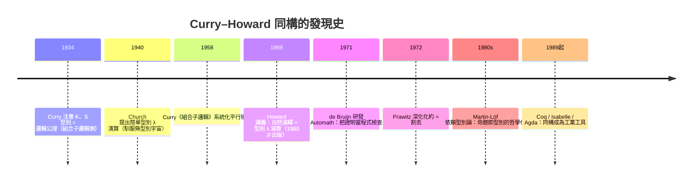

# 03.1 驚人的巧合：邏輯公式與電腦類型的完全對應

## 導言：一個被發現三次的秘密

1934 年，邏輯學家 Haskell Curry 在研究組合子邏輯時，注意到 $K$ 的型別 $\alpha \to \beta \to \alpha$ 與直覺主義邏輯公理 $A \to (B \to A)$ 形狀相同——他當時只當作有趣的平行。1958 年 Curry 的學生 William Howard 在未發表的講義中，把這個平行推到了極致：**整個直覺主義自然演繹系統與簡單型別 λ 演算，是同一個結構的兩種記法**。這就是 **Curry–Howard 同構**（亦稱 propositions-as-types）。

本章我們像偵探一樣重演這個發現：從最平凡的對應開始，一層層挖到驚人的深度。這不只是邏輯史話——它是 Coq、Lean 證明助手、Haskell 型別系統、乃至「程式驗證」產業的理論地基。

## 第一層：型別就是命題

比較兩個系統的語法：

| 直覺主義邏輯 | 型別化 λ 演算 | 對應 |
|------|------|------|
| 命題 $A, B$ | 型別 $\sigma, \tau$ | 命題即型別 |
| $\land$（且） | $\times$（積型別，如 tuple） | 且 = 配對 |
| $\lor$（或） | $+$（和型別，如 tagged union） | 或 = 標記聯合 |
| $\to$（蘊含） | $\to$（函數型別） | 蘊含 = 函數 |
| $\top$（真） | 單元型別 `()` | |
| $\bot$（假） | 空型別 `Void` | |
| $\neg A$（否定） | $A \to \mathrm{Void}$ | 否定 = 「送到空型別的函數」 |
| $\forall x.\,A(x)$ | 依賴函數型別 $\prod x\colon\sigma.\,\tau(x)$ | 全稱 = 泛型 |
| $\exists x.\,A(x)$ | 依賴配對型別 $\sum x\colon\sigma.\,\tau(x)$ | 存在 = 帶見證的配對 |

把命題翻譯成型別、邏輯連接詞翻譯成型別建構子之後，**邏輯的證明規則與程式的構造規則逐條重合**。

## 第二層：證明就是程式

回憶 01.3 的 BHK 解釋：「$A \to B$ 的證明是把 $A$ 的證明變成 $B$ 證明的**程序**」。現在給這句話肉身——那個程序，就是一個 λ 項。

**恆等律** $A \to A$ 的證明：恆等函數。

```haskell
id :: a -> a
id x = x        -- 恆等命題的證明，就是恆等函數
```

**組合律**（交換律的蘊含版）$(A \to (B \to C)) \to (B \to (A \to C))$：

```haskell
flip :: (a -> b -> c) -> b -> a -> c
flip f y x = f x y     -- 邏輯公理的證明，就是參數交換函數
```

**K 公理** $A \to (B \to A)$ 與 **S 公理** $(A \to (B \to C)) \to ((A \to B) \to (A \to C))$——正是組合子 $K$ 與 $S$ 的型別！Curry 1934 年看到的，就是這兩個最基礎的組合子背著兩條最基礎的邏輯公理。

## 第三層：證明檢查就是型別檢查

同構的第三根柱子：**「項 $M$ 在環境 $\Gamma$ 下有型別 $\sigma$」的型別推導樹，與「在假設 $\Gamma$ 下 $M$ 是命題 $\sigma$ 的證明」的自然演繹推導樹，是同一棵樹。**

型別規則（左）與邏輯規則（右）並排：

```text
型別規則（λ 演算）              邏輯規則（自然演繹）
───────────  Var              ───────────  假設
Γ, x:σ ⊢ x : σ                  Γ, A ⊢ A

Γ, x:σ ⊢ M : τ                 Γ, A ⊢ B
───────────────  Abs           ───────────────  →引入
Γ ⊢ λx. M : σ → τ              Γ ⊢ A → B

Γ ⊢ M : σ → τ   Γ ⊢ N : σ      Γ ⊢ A → B    Γ ⊢ A
────────────────────────  App  ──────────────────────  →消除（modus ponens）
Γ ⊢ M N : τ                    Γ ⊢ B
```

**Var 規則**＝「假設可用」。**Abs（抽象）**＝「→ 引入」（要證蘊含，假設前件、推後件）。**App（應用）**＝「→ 消除」（modus ponens，用蘊含）。

在 Haskell 中可以直接驗證：**一個函數的型別簽名，就是一條邏輯定理；函數本體，就是證明**。

```haskell
-- 以下每個型別簽名都是直覺主義邏輯定理，函數體是構造性證明

id      :: a -> a                          -- A → A
id = \x -> x

const   :: a -> b -> a                     -- A → (B → A)
const = \x -> \y -> x

compose :: (b -> c) -> (a -> b) -> a -> c  -- (A→B) → (B→C) → A → C
compose = \f -> \g -> \x -> f (g x)

-- 「三段論」：(A→B) → (B→C) → A → C 就是 syllogism 的型別！
-- 亞里斯多德 2300 年前的推論形式，與 compose 同構
```

## 第四層：化約就是證明化簡

最後一根柱子最深刻：**β 化約 $= $ 證明化簡（cut elimination / normalize）**。

$(\lambda x.\,M)\ N \to M[x{:=}N]$ 對應邏輯上的「先把 $N$ 的證明插進 $M$ 的證明」——即**割去**（cut，見 03.3 專章）。而合流性（Church–Rosser）對應 Gentzen 的 **Hauptsatz**：每個證明都可化為**正規形式**（cut-free proof）。正規形式的程式意義是「沒有多餘的中間步驟」，邏輯意義是「沒有引入後未消去的連接詞」。

Curry–Howard 同構的完整對照表：

| 計算世界 | 邏輯世界 |
|------|------|
| λ 項 / 程式 | 證明 |
| 型別 | 命題 |
| 型別 inhabited | 命題可證 |
| 型別檢查 | 證明檢查 |
| β 化約 | 割去（cut elimination） |
| 正規形式 | 無割證明 |
| 遞迴 / 不終止 | 循環論證（一致性破壞） |
| 死碼消除 | 證明化簡 |
| 通用型別變數 | 全稱量詞 |
| 模組/介面 | 定義/引理 |

## 歷史的三次發現與驅動鏈



注意驅動關係：**Curry 的發現來自組合子邏輯的型別化**（而組合子邏輯來自無型別 λ 演算，而無型別 λ 演算來自邱奇的邏輯基礎計畫——02.1 的歷史在此閉環）；**Howard 的推廣依賴 Gentzen 的自然演繹**（1935 年，Gentzen 為了證明一致性發明自然演繹與相繼式演算，而這又是希爾伯特綱領刺激下的產物——01.1 的歷史再次閉環）。三條歷史線——邏輯基礎、可計算性、構造主義——在 Curry–Howard 一點匯合。

## 範例：把邏輯定理「編譯」成程式

直覺主義可證的命題，型別必可 inhabited；且**證明（程式）可以機械提取**。

**定理**：$(A \to B) \to (A \to C \to D) \to A \to D$。

構造性證明思路（BHK）：給我「$A \to B$ 的程序 $f$」、「$A \to C \to D$ 的程序 $g$」與 $a : A$；我用 $f\ a$ 得 $B$——但 $D$ 需要 $A$ 與 $C$……等等，$D$ 只需 $g\ a\ c$，而 $c$ 從何而來？此命題其實**不可證**（除非額外假設）！這正是同構的檢測力：**寫不出程式 = 命題不成立**。改寫成正確版本：

**定理**：$(A \to B \to C) \to A \to B \to C$。

```haskell
thm :: (a -> b -> c) -> a -> b -> c   -- 可證！
thm = \f -> \x -> \y -> f x y         -- 證明：直接套用 f

-- 不可證的例子（型別會被檢查器拒絕）：
-- bad :: (a -> b) -> (a -> c -> d) -> a -> d   -- 無法構造！
-- 直覺主義者：沒有構造，就沒有證明
```

再看否定相關的定理：

```haskell
data Void                                -- ⊥：無構造子
type Neg a = a -> Void                   -- ¬A

-- 雙重否定引入：A → ¬¬A（可證）
dnIntro :: a -> Neg (Neg a)
dnIntro x = \k -> k x                    -- 給我 k : A→Void，把 x 餵進去得矛盾

-- 雙重否定消去：¬¬A → A（直覺主義不可證！）
-- dnElim :: Neg (Neg a) -> a            -- 此型別沒有全域函數實現
-- 原因：你拿到了「把 A 的證明變矛盾」的程序，
--       但沒有任何手段「製造」出 A 的證明 —— 無中生有不可構造
-- 但「把 ¬¬A 變 ¬B」可以（矛盾可以傳導）：
contrapose :: Neg a -> Neg b -> (a -> b) -> ... -- 練習題
```

與 01.3 的 BHK 表對照，全部嚴絲合縫：$A \lor B$ 的證明是 tagged union（要標明選了哪邊），$\exists x.\,A(x)$ 的證明是依賴配對（要攜帶見證物 $x$）。

## 「巧合」的哲學重量

為什麼會有這種同構？三種回應：

1. **結構主義**：邏輯與計算都是「組合系統」，同構或許只是組合結構的共性。但對應的精細程度（連化約與割去都對上）遠超「巧合」的解釋力。
2. **Martin-Löf 的回答**：命題的本來意義**就是**「可能的證明之集合」，判斷的本來意義**就是**「構造」。邏輯從一開始就該被讀作型別論——我們兩千年來只是用了錯誤的記法。
3. **實用主義**：不管哲學上如何解釋，同構給出可操作的后果——**想要正確的程式？證明定理。想要驗證數學？編譯程式。** 兩個幾世紀的問題變成一個問題。

## 章末小結

- Curry–Howard 同構：命題即型別、證明即程式、化約即割去。
- 發現史：Curry（1934，組合子型別）→ Howard（1969，自然演繹全同構）→ Martin-Löf（依賴型別）→ Coq/Agda（工業化）。
- 每個函數型別簽名是邏輯定理，函數體是構造性證明；寫不出實現＝命題構造不可證。
- 直覺主義邏輯（01.3）正是「有程式對應」的那部分古典邏輯——排中律不可證，因為它要求無中生有的選擇。

## 下一步

本章建立了對應的「靜態」三層：型別↔命題、程式↔證明、檢查↔驗證。下一章（03.2）深入「動態」面：**每一行程式碼的執行，如何對應到一次邏輯推導**？我們將逐行解析程式與證明的同構蹤跡，並展示依賴型別語言如何讓「型別即規格、程式即證明」落地為日常工具。

## 習題

1. 為下列型別各寫一個 Haskell 函數，並寫出對應的邏輯定理：`(a -> b -> c) -> (b -> a -> c)`、`(a -> b) -> (b -> c) -> a -> c`。
2. 判斷下列型別是否可 inhabited（直覺主義意義），並說明理由：`(a -> b) -> a -> b`、`((a -> b) -> a) -> b`、`a -> (b -> a)`。
3. 解釋為什麼 `Void` 上沒有建構子，使得 `Void -> a` 可以 inhabited（對應邏輯規則 ex falso quodlibet）。
4. 思考題：若你的語言有 `undefined :: a`（可 inhabit 任何型別的 bottom 值），Curry–Howard 會被怎樣破壞？這對「用 Haskell 型別談邏輯」的限制是什麼？
