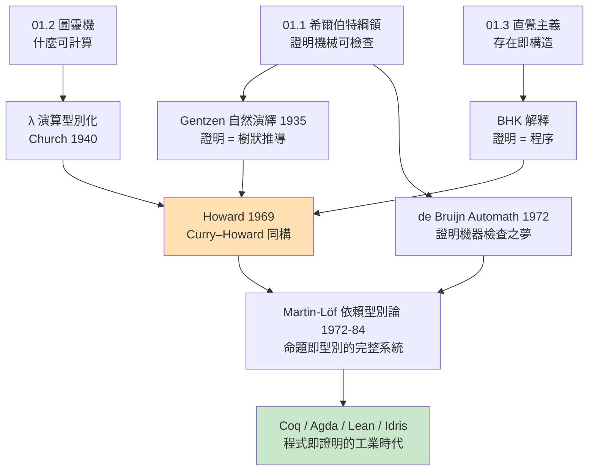

# 03.2 程式即證明類型即命題：每一行程式碼都是邏輯推導

## 導言：從對應到同構，從靜態到動態

上一章我們建立了 Curry–Howard 同構的骨架：型別即命題、程式即證明、型別檢查即證明檢查。本章把鏡頭拉近，逐行逐句地看：**一段程式的每一個構造，如何精確對應一條邏輯推導**；以及這個觀點如何在依賴型別語言（Idris、Agda、Lean）中變成日常實務——寫程式就是寫證明，跑測試就是跑邏輯。

## 一、逐行對照：函數體 = 證明樹

取一個簡單函數：

```haskell
apply :: (a -> b) -> a -> b
apply f x = f x
```

它的型別檢查推導（左）與邏輯證明（右）逐節點對應：

```text
程式構造                    邏輯推導
──────────────────────    ──────────────────────
假設 f : a -> b, x : a    假設 A→B 與 A
子項 f x : b              modus ponens：B
抽象 λf.λx. f x           →引入（假設下證得結論）
型別 (a→b) → a → b        定理 (A→B) → A → B
```

**規則總表**：程式的每個語法構造，都有一條邏輯規則一一對應。

| 程式構造 | 邏輯推導 | 說明 |
|------|------|------|
| 變數引用 `x` | 假設的使用 | 用掉一個前提 |
| 函數定義 `\x -> ...` | → 引入 | 「假設 x 成立，證明……」 |
| 函數呼叫 `f x` | → 消除 | modus ponens |
| 配對 `(e1, e2)` | ∧ 引入 | 同時證明兩者 |
| `fst` / `snd` | ∧ 消除 | 從合取取一邊 |
| `Left e` / `Right e` | ∨ 引入（左/右） | 標明證的是哪一邊 |
| `case e of ...` | ∨ 消除 | 分情況討論 |
| 空匹配 `case v of {}`（v : Void） | ⊥ 消除（ex falso） | 從矛盾推一切 |
| 匿名丟棄參數 `\_ -> e` | 弱化（weakening） | 前提可以不用 |

## 二、全稱量詞 = 泛型；存在量詞 = 帶見證的配對

簡單型別系統只涵蓋命題邏輯。**依賴型別**（dependent types）把量詞也納入：

- 依賴函數型別 $\prod x : \sigma.\, \tau(x)$ = $\forall x.\, \tau(x)$：回傳型別**取決於**參數值；
- 依賴配對型別 $\sum x : \sigma.\, \tau(x)$ = $\exists x.\, \tau(x)$：攜帶**見證物**的結構化證明。

```idris
-- Idris：量詞的活體示範

-- ∀ n : Nat. Vec A n 的長度恆為 n（型別層面攜帶長度！）
-- 定理：對任何 n，存在長度為 n 的向量
nil : {A : Type} -> Vect A 0
nil = []

-- ∀ n. 存在 m，m = n + 1（存在型別攜帶見證 m 與等式證明）
existsSucc : (n : Nat) -> (m ** m = S n)
existsSucc n = (S n ** Refl)
-- 見證物：S n；等式證明：Refl（自反性，因為兩邊語法上相同）
```

`Refl` 是等式型別 `=` 的唯一建構子，型別 `x = x`。它對應邏輯的**自反公理**；而等式的其他性質（對稱、傳遞）都是可寫出程式的定理：

```idris
sym : {A : Type} -> {x, y : A} -> x = y -> y = x
sym Refl = Refl        -- 對 Refl 的模式匹配強制 x 與 y 統一
-- 「模式匹配一個等式證明」= 「利用等式做代換」= 邏輯的等式消去規則
```

**模式匹配 = 邏輯的消去規則**。這句話是依賴型別程式設計的心法：對 `Refl` 匹配 → 等式消去；對 `Left`/`Right` 匹配 → ∨ 消除；對空型別匹配 → 矛盾消去。**控制流程的每一個分支，都是一條推理規則的應用。**

## 三、每行就是一步推導：一個完整例子

**定理**：$n + 0 = n$（加法右零元）。

皮亞諾加法（按第一參數遞迴）：$0 + m = m$、$Sn + m = S(n+m)$。注意 $n + 0$ 要遞迴到深處才能化簡——這正是它需要「證明」而非「計算」的原因。

```idris
-- 定理：n + 0 = n。證明：對 n 歸納。
plusZeroRight : (n : Nat) -> n + 0 = n
plusZeroRight Z     = Refl          -- 基例：0 + 0 = 0 計算上即 Refl
plusZeroRight (S k) =
  let ih = plusZeroRight k in       -- 歸納假設 IH：k + 0 = k
  cong S ih                         -- 步驟：對 IH 兩邊套 S，得 S(k+0) = S k
-- cong : (f : a -> b) -> x = y -> f x = f y   「函數保持相等」
```

逐行對應邏輯歸納：

| 程式行 | 邏輯步驟 |
|------|------|
| `plusZeroRight Z = Refl` | 歸納基例：直接計算成立 |
| `let ih = plusZeroRight k` | 歸納假設的引用 |
| `cong S ih` | 從 $k+0=k$ 推 $S(k+0) = S k$（函數保持相等） |
| 整個 `case`（對 `S k` 的匹配） | 歸納原理（Nat 的消去規則） |

**遞迴呼叫 = 歸納假設**；**模式匹配資料 = 歸納消去**；**遞迴的 termination = 歸納的良基性**。依賴型別語言會檢查所有遞迴呼叫的參數「結構上變小」，以保證終止——正是為了維持邏輯一致性（無限遞迴的證明 = 循環論證，會使 `Void` 可 inhabit，03.1 習題 4 的後果）。

## 四、規格即型別：寫下簽名，就已經寫下定理

依賴型別革命性的一步：**函數的前置與後置條件可以放進型別**。

```idris
-- 傳統做法：排序函數 + 事後測試
-- sort : List Nat -> List Nat
-- 測試：sort [3,1,2] == [1,2,3]？有序性？置換性？——只能抽樣驗證

-- 依賴型別做法：規格即型別
-- 定理：「對任何列表，存在一個有序的置換」
SortedPerm : Type
SortedPerm = (xs : List Nat) ->
  (ys : List Nat ** (Sorted ys, Permutation xs ys))

-- 要 inhabit 這個型別，你的程式**必須**：
--   1. 產出 ys（程式部分）
--   2. 附上 Sorted ys 的證明（有序性證明）
--   3. 附上 Permutation xs ys 的證明（置換性證明）
-- 型別檢查器替你檢查全部三項 —— 編譯通過 = 規格 100% 滿足
```

這就是「程式即證明」的工程兌現：**測試是抽樣，型別是全稱**。一個 `sort :: (xs : List Nat) -> (ys ** ...)` 型別的函數，編譯通過的瞬間，你同時獲得演算法與它的正確性證明，且證明被機器檢查過。

### 真實世界的案例

- **CompCert**（INRIA，Xavier Leroy 團隊）：C 編譯器，用 Coq 證明「編譯結果的語義與源程式等價」。證明完成後從 Coq 提取出 OCaml 程式。民航與醫療領域實際使用。
- **seL4** 微核心：用 Isabelle/HOL 證明核心的正確性與安全性质，約一萬行 C 對應數十萬行證明。
- **Lean 數學庫**：費馬小定理、佩讓定理等大學數學已機器驗證；數學家開始「寫定理像寫程式」。

## 五、歷史閉環：三條線的最終匯流



注意驅動鏈的兩端：起點是**希爾伯特的「證明機械可檢查」**（1920s），終點是 **Lean 上的數學家**（2020s）。整整一百年，理論的每一環——形式化、可計算性、構造主義、λ 演算、型別論——都是為了回答同一個問題：**什麼是可靠的推理，且機器能檢查它？**

## 六、張力與誠實：這套同構的邊界

1. **bottom 值破壞邏輯**：Haskell 的 `undefined`、`error` 可 inhabit 任何型別——若允許，每個定理都「可證」。依賴型別語言以**全域性**（totality）檢查封堵：所有函數必須終止、所有匹配必須窮盡。這是 02.2 Ω 問題的終極解答：**用禁止發散換取邏輯一致性**。
2. **「證明即程式」不等於「自動證明」**：型別檢查器只**驗證**證明，不**尋找**證明（回憶 01.2：證明搜尋半可判定）。人仍然給出構造，機器保證無誤——這是分工，不是魔法。
3. **古典數學怎麼辦**：直覺主義丟掉了排中律。解法有二：Lean 預設古典（加入排中律公理——犧牲計算提取）；Coq 保持直覺核心、按需引入公理——提取程式時排除使用排中律的部分。

## 定理整理

**觀念（逐行同構）**：變數=假設、抽象=→引入、應用=→消除、配對=∧引入、case=∨/等式消去、遞迴呼叫=歸納假設。

**定義（依賴型別）**：$\prod$ 型別對應 $\forall$，$\sum$ 型別對應 $\exists$；證明物件攜帶見證物。

**定理（全域性 ⟷ 一致性）**：若語言的定義全域（必終止、匹配窮盡），則型別系統一致（`Void` 不可 inhabit）；允許非終止則破壞邏輯。

**觀念（規格即型別）**：前置/後置條件編入型別，編譯通過即驗證完成。

## 章末小結

- 程式的每個語法構造精確對應一條邏輯推導；控制流程就是推理規則。
- 依賴型別把量詞納入系統：$\forall$ = 依賴函數，$\exists$ = 帶見證配對；模式匹配 = 消去規則。
- 遞迴 = 歸納，終止檢查 = 良基性檢查，這是邏輯一致性的代價。
- 規格即型別：CompCert、seL4 展示了「編譯通過 = 驗證完成」的工程現實。
- 這條百年鏈：希爾伯特的可查證明 → Gentzen 自然演繹 → Howard 同構 → Martin-Löf 依賴型別 → 今日證明助手。

## 下一步

本章聚焦「程式的構造 = 推導的堆疊」。但還有一個更深的結構等著我們：**β 化約與邏輯的割去（cut elimination）的對偶性**。為什麼化約掉一段計算，等於化簡掉一段「繞遠路」的證明？正規形式的程式與證明為何「更簡潔」且性質更強？下一章（03.3）我們深入 Gentzen 的 Hauptsatz，見證計算與推理在最深層的同一性——也看到 Martin-Löf 名言的落點：「正規形式的存在，就是數學可以被構造主義化的理由」。

## 習題

1. 在 Haskell 中寫出 `(a -> b, a) -> b` 的函數（uncurry 的變體），並畫出其型別檢查樹與對應的自然演繹證明。
2. 用 Idris 語法寫出定理 `plus_comm : (n, m : Nat) -> n + m = m + n` 的證明骨架（可先只完成對 `n` 的歸納與基例）。
3. 解釋：為什麼 `undefined :: Void`（若存在）會使 Curry–Howard 完全失效？用「循環論證」的邏輯術語描述這件事。
4. 思考題：測試與依賴型別規格的取捨是什麼？在什麼情況下「100 行規格型別 + 20 行實作」反而不如「20 行實作 + 200 行測試」？
