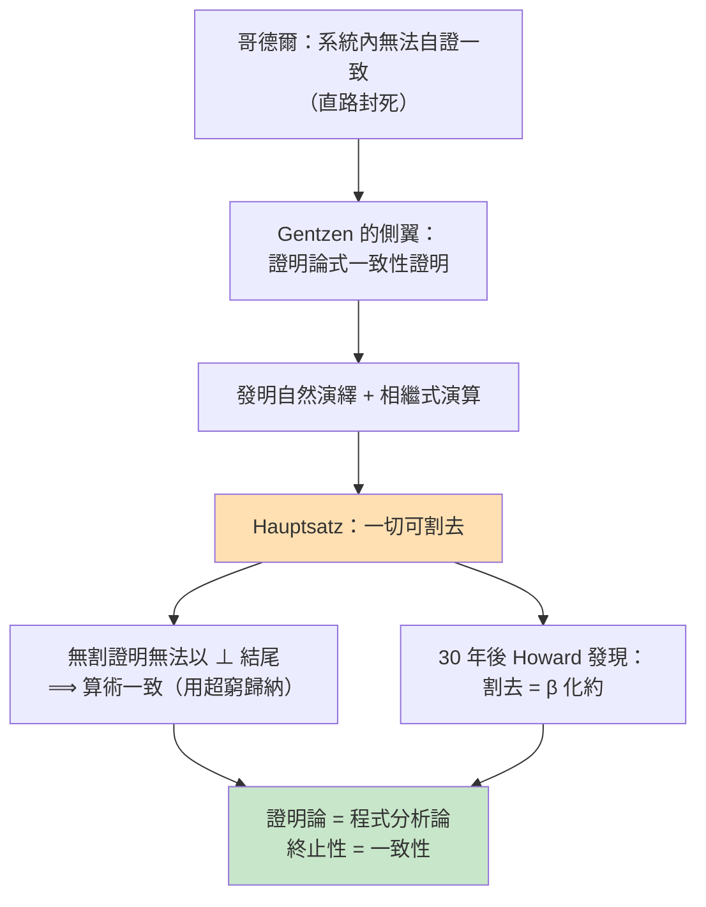
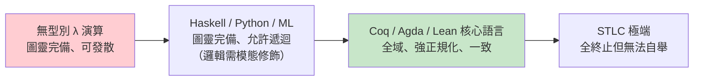

# 03.3 割去定理與程式執行的對偶性

## 導言：兩個世界最深處的同一條定理

前三節我們建立了 Curry–Howard 同構的靜態（型別=命題）與動態（程式=證明）面貌。本章深入這個同構最深的對應——也是 Gentzen 與 Prawitz 眼中的核心：

$$\text{β 化約（計算）}\;\Longleftrightarrow\;\text{割去（證明化簡）}$$

Gentzen 1935 年的 **Hauptsatz**（主定理，cut-elimination theorem）是證明論的皇冠：任何證明都可以機械地化簡為**無割證明**（cut-free proof）。三十年後，人們在型別論中發現：**執行程式，就是把證明中的割割掉**。本章講述這個對偶的內容、歷史與哲學后果——它解釋了「為什麼程式會終止」「為什麼正規形式有意義」「為什麼構造性數學擁有計算內容」。

## 一、什麼是「割」（cut）？

Gentzen 的**自然演繹**系統中，每個邏輯連接詞有一對規則：**引入**（intro，如何證得它）與**消去**（elim，如何使用它）。一個證明是「有割的」，若某連接詞**剛被引入就隨即被消去**——推理繞了遠路。

最簡單的割：證明 $A \to B$ 的方式是「假設 $A$ 得 $B$」（→ 引入），然後立刻把這個蘊含應用於手邊 $A$ 的證明（→ 消除）：

```text
        [A¹]          ⋮ (A 的證明)
        ⋮ (B 的證明)   A
     ──────→ 引入     ─────
      A¹ → B           A → B        ← 割：引入後馬上消去
     ─────────────────────────  → 消除
                B
```

這個證明有明顯的多餘：我們費力證得「假設 $A$ 則 $B$」，卻**根本已經有 $A$ 的證明**，直接把 $A$ 代回去就好。Gentzen 的**化簡規則**（reduction）正是把這種繞路拆掉——而這個化簡，**逐條就是 β 化約**：

$$((\lambda x.\,M)\ N) \to M[x{:=}N]$$

λ 抽象就是「→ 引入」（假設 $x:A$，證 $M:B$）；函數應用就是「→ 消除」（用蘊含）。**「引入後立即消除」=「先建函數再立刻呼叫」= 一個 β 紅色子項。** 割去定理在 λ 演算的化身，就是正規化定理：每個項都可化約到正規形式（在終止的前提下）。

## 二、對偶性：完整對照表

| 計算側（λ 演算） | 邏輯側（自然演繹） |
|------|------|
| β 紅色子項 $(\lambda x.\,M)\ N$ | 割：引入後緊接消除 |
| β 化約 | 割去化簡（reduction） |
| 正規形式（無紅色子項） | 無割證明（normal proof） |
| 正規化定理（終止性） | Hauptsatz（割去定理） |
| 合流性（Church–Rosser） | 無割證明的唯一性（每連接詞一種規範形） |
| 項的**子公式性質** | 無割證明只用出現過的公式的子公式 |
| 中間值被拋棄 | 引理被內聯（lemma inlining） |

**子公式性質**（subformula property）特別值得體會：無割證明中，出現的每個公式都是結論公式的子公式——**證明不會無中生有地引用不相干的概念**。這在計算側的對應是：正規形式的程式**不會產生用不到的中間資料**（從靜態看；動態的最佳化另議）。割去定理因此不只是「化簡」的存在性，而是**正規證明具有規範、可分析的形狀**——這是它的分析力所在。

### Gentzen 為什麼要證割去定理？

歷史驅動鏈在此又現形：Gentzen 的目標是**希爾伯特綱領的殘存目標**——證明算術的一致性。01.2 已說明哥德爾封死了「系統內證明自身一致」之路，但 Gentzen 發現一條側翼：**若每個證明都可化為無割證明，而無割證明的「末尾公式」只可能是原子公式或顯然為真的形狀，則 $\bot$ 不可證**（因為無割證明的最後一步必須引入某個連接詞，而 $\bot$ 沒有引入規則！）。



Gentzen 為了證一致性而發明的技術（自然演繹、割去），在三十年後成為程式語言語義學的核心——**追求數學基礎的工具，最後成為編譯器與型別檢查器的理論**。這是本書反覆出現的模式：基礎研究的果實，落地時間超乎所有人預期。

## 三、終止性 = 一致性：對偶的頂點

割去定理最深刻的推論，把兩個世界的「生死」綁在一起：

**計算側**：若所有型別良好的項都正規化（終止），則語言**強正規化**（strongly normalizing）。

**邏輯側**：若所有證明都割得掉，則系統**一致**（$\bot$ 不可證，因為 $\bot$ 沒有引入規則，無割證明不可能以它結尾）。

**定理（兩者等價，在 Curry–Howard 下）**：

$$\text{強正規化} \iff \text{一致性}$$

為什麼？反設系統不一致，即存在型別為 `Void` 的閉項 $M$。若語言強正規化，$M$ 化約到正規形式 $N$。而正規形式意味著「所有引入都已消除」——但 `Void` 沒有建構子、沒有引入規則，正規形式的 $N$ 只能是變數、應用或消去，不可能在空環境下被型別檢查為 `Void`。矛盾。故強正規化 ⟹ 一致。反之亦然（概略地）。

**定理（強正規化的實例）**：簡單型別 λ 演算（STLC）是強正規化的（Tait 1967 的可滿足性/邏輯關係法）。因此：

- STLC 中每個程式終止——**你寫不出無窮迴圈**；
- STLC 對應的直覺主義命題邏輯一致——**你證不出矛盾**；
- 代價：STLC **無法**定義 Y 組合子（`x x` 型別錯誤，回憶 02.2 結尾），因此**圖靈完備性喪失**——你連通用遞迴都寫不出。

這就是本書最重要的張力的精確陳述：

> **表達力（圖靈完備、可遞迴）⟷ 安全性（保證終止、邏輯一致），二者在型別論中互為代價。**

現代語言的選擇譜系正沿此軸分布：



Coq/Agda 的工程解法：**核心語言（kernel）全域且一致**，負責驗證；**戰術層（tactics）與程式層允許發散**，負責搜尋與產生——最終產物會被核心檢查。「不可信的搜尋 + 可信的驗證」是證明助手的架構哲學，恰如密碼學中「不可信的網路 + 可信的驗證」。

## 四、範例：親眼看見割被割掉

```haskell
-- 一個有「割」的程式：先建函數，立即呼叫
type family CutDemo where ...
-- 邏輯側：(λx. x + 1) 5 有割：→引入（λx. x+1）後立即 →消除（應用 5）
-- β 化約 = 割去：5 直接代入，繞路消失
--
-- Haskell 中對應「inline 後 dead code elimination」：
--   (let f x = x + 1 in f) 5  →  (λx. x+1) 5  →  5 + 1  →  6
-- GHC 的最佳化器每天做的，就是 Gentzen 的割去！

-- 看一個帶證明意義的化約：
-- 命題：A → B 的證明 (λx. g x) 其中 g 已存在
-- 邏輯：證明「假設 A 得 B」，方式是「先引入蘊含、再套用已有的 g」——割！
-- 化簡：直接給 g —— 證明更短，內容相同
```

再以一階直覺邏輯的具體例子走一遍化簡規則（證明側的「β」）：

```text
化簡前（有割）：
  證明 A ∧ B（用 ∧ 引入：π₁ 與 π₂）
  然後用 ∧ 消除取左邊 → 得 A
計算側：((λp. (a, b)) x) 的 fst → a   —— 配對剛建就拆，繞路

化簡後（無割）：直接就是 π₁ : A 的證明
```

每條化簡規則的形狀都相同：**「建構子緊跟消去子」→「把消去子的其他輸入直接送進建構子的原料」**。β（→）、∧-化簡（配對投影）、∨-化簡（case 對 tagged union）、乃至等式化簡（Refl 緊跟等式消去）——**一個模式，四種連接詞**。這個統一模式在理論上叫 **β-規範**（β-normality 的推廣），是lambda演算與證明論語法層面同構的最深證據。

## 五、執行 = 割去：哲學的收束

回到本節標題的「對偶性」。我們現在可以給出它的完整哲學表述：

> **程式的執行，就是證明的化簡。** 每一次函數呼叫，是消去一個引入；每一次計算推進，是把證明變得更直接。**程式運行到終點（輸出值），就是證明化到無割（最直接的路）。** 輸出值在證明側的意義是：**這個命題的最規範的見證物**。

Martin-Löf（1972）的名言總結了這一切：

> 「正規形式的項，就是它所代表的數學物件本身。」

意思是：當你把一個依賴型別的證明化到正規形式，剩下的不僅是「更簡潔的證明」，而是**可以提取的、最直接的構造——即程式的輸出**。構造性數學的「證明攜帶演算法」（01.3 的 Kleene 可實現性），在割去定理這裡得到了語法層面的機制：**實現性就是正規化**。

## 定理整理

**定義（割）**：證明中「引入後緊接消去」的片段；計算側對應 β 紅色子項。

**定理（Gentzen Hauptsatz，1935）**：（相繼式演算中）每個證明皆可化為無割證明；一階直覺邏輯中割去必終止。

**定理（正規化 ⟷ 一致性）**：強正規化的型別系統一致；一致 + Curry–Howard ⟹ 無法構造 `Void` 的閉項。

**定理（子公式性質）**：無割證明只含結論公式的子公式——計算對應：正規形式無多餘中間層。

**觀念（核心權限分離）**：證明助手的核心全域一致，外層戰術可發散——安全性由最後的型別檢查保證。

## 章末小結

- 割 = 「引入後立即消除」= β 紅色子項；割去化簡 = β 化約，一個模式涵蓋 →、∧、∨、等式。
- Gentzen 為繞過哥德爾限制證明一致性而發明割去定理；三十年後它成為程式語言語義的核心。
- 強正規化 ⟷ 邏輯一致性：STLC 保證終止但失去圖靈完備；無型別系統圖靈完備但可證矛盾。Coq/Agda 以「全域核心 + 發散外層」架構平衡二者。
- 程式執行 = 證明化簡；輸出值 = 正規證明的見證物；Martin-Löf：正規形式就是數學物件本身。
- 本書主線在此收束：亞里斯多德的形式 → 希爾伯特的機械可查 → 圖靈/Church 的可計算 → 布勞威爾的構造 → Curry–Howard 的同構 → 割去定理的對偶——**邏輯與計算是同一件事的兩種母語**。

## 下一步

本書第一至三章完成了「程式與數學」的理論主幹。有了這個基礎，後續章節將轉向應用與延伸：依賴型別的實戰（如何在 Idris/Agda 中以規格驅動開發）、古典邏輯的計算解讀（call/cc 與雙重否定消去的控制流對應——中樞協奏式對偶 classical duality）、以及集合論與型別論作為數學基礎的現代之爭。但無論走向何方，你都將帶著本章的眼鏡：**每一段計算，都是一場化簡中的證明。**

## 習題

1. 寫出 ∨-連接詞的「割」形狀（用 `Left`/`Right` 與 `case`），並描述其化簡規則如何類比 β 化約。
2. 解釋為什麼「無割證明不可能以 $\bot$ 結尾」可以推出一致性。這個論證在非構造的古典系統中哪裡失效？（提示：$\bot$ 的古典引入有隱含假設嗎？）
3. 在 STLC（無遞迴、無通用型別）中，嘗試定義教會數字的前驅函數（02.2 的 PRED）。你會發現**可以**——但 Y 組合子**不行**。為什麼 PRED 行而 Y 不行？給出型別層面的解釋。
4. 思考題：GHC 編譯器的 inline/最佳化與 Gentzen 割去的類比，在哪一點上是精確的、哪一點上只是啟發性的？「最佳化不改變語義」與「割去不改變可證命題」如何對應？
