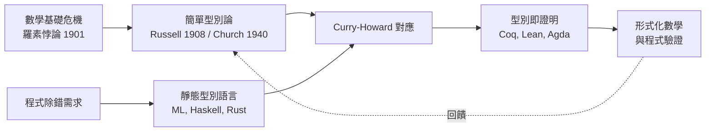

# 04.1 為什麼程式需要型別：從錯誤檢查到邏輯安全網

## 引言：型別不是官僚制度，而是防波堤

初學者常覺得型別（type）是編譯器強加的繁文縟節：明明一行就能寫完的程式，卻要宣告這是 `int`、那是 `String`。但工程經驗告訴我們相反的事實——**型別是程式設計史上最成功的自動化除錯工具**。它在程式執行之前，就用數學的語言描述了「這段程式在做什麼」，並機械地驗證其中不含某類錯誤。

本章的目標是讓讀者理解一條主線：

> 型別系統的演化史，就是「錯誤檢查」逐漸升級為「邏輯證明」的歷史。

---

## 1. 定義：什麼是型別

**定義 1.1（型別）.** 型別是一個標籤（label），附加在程式中的每個值（value）與表示式（expression）上，用以描述該值所屬的「可能取值範疇」以及「允許的操作集合」。

例如：

- 值 `3` 的型別是 `Integer`；
- 值 `"hello"` 的型別是 `String`；
- 函數 `\x -> x + 1` 的型別是 `Integer -> Integer`。

**定義 1.2（型別判斷）.** 型別系統中，我們寫

$$
\Gamma \vdash e : \tau
$$

讀作「在環境（context） $\Gamma$ 之下，表示式 $e$ 具有型別 $\tau$ 」。其中 $\Gamma$ 記錄了每個自由變數的型別， $\vdash$ 是「可推導」的符號。

這個記號並非裝飾：它與邏輯中的「在假設 $\Gamma$ 之下可證明命題 $\phi$ 」記號 $\Gamma \vdash \phi$ **完全同構**。這正是 Curry–Howard 對應的起點，將在 04.2 與後續章節展開。

---

## 2. 前因：沒有型別的世界

在組合語言與早期 Fortran 之前的世界（以及今天的機器碼層面），記憶體只是一條長長的位元序列。`0x68656C6C6F` 既可能是字串 `"hello"`，也可能是某個巨大的整數，也可能是一段指令。**位元本身沒有意義，意義來自使用者的解讀。**

### 2.1 三類經典災難

| 錯誤類型 | 例子 | 後果 |
|---|---|---|
| 型別混淆 | 把字串當整數相加 | 垃圾值、資料損毀 |
| 記憶體越界 | 讀取陣列第 100 項但陣列只有 10 項 | 安全漏洞（緩衝區溢位攻擊的根源） |
| 空參照 | 對 `null` 呼叫方法 | 執行期崩潰（Tony Hoare 自稱「十億美元的錯誤」） |

這些錯誤的共同特徵是：**它們在編寫時無聲無息，在執行時爆炸**。動態檢查（執行期檢查）只能減輕爆炸，不能預防。型別系統的目標是：把盡可能多的這類錯誤，搬到「編譯期」——搬到程式還沒跑之前。

### 2.2 一個最小的示範

```python
# 動態型別：錯誤延遲到執行期
def add(a, b):
    return a + b

add(1, 2)        # 3，沒問題
add("1", 2)      # TypeError: 發生在「使用者已經按下按鈕之後」
```

```haskell
-- 靜態型別：錯誤在編譯期被攔截
add :: Int -> Int -> Int
add x y = x + y

-- add "1" 2  -- 編譯錯誤：Couldn't match type `[Char]' with `Int'
```

Haskell 的程式根本無法通過編譯——錯誤被攔截在「任何使用者接觸到它之前」。

---

## 3. 定理：型別安全（Type Safety）

型別系統為何值得信賴？因為它有數學保證，即所謂的 **type soundness theorem**。

**定理 3.1（型別安全 / Soundness）.** 若一個型別系統滿足：

1. **進展性（Progress）**：若 $\vdash e : \tau$ 且 $e$ 不是終值，則 $e$ 可以再執行一步（不會卡死）。
2. **保持性（Preservation）**：若 $\vdash e : \tau$ 且 $e$ 一步執行為 $e'$ ，則 $\vdash e' : \tau$ 。

則任何通過型別檢查的程式，執行時都不會陷入「未定義行為」：不會把函數當數字用、不會讀取不存在的欄位。

這兩個性質的證明是對「小步語意（small-step operational semantics）」的結構歸納法——型別系統的確是**被證明的數學定理**，不是工程慣例。這正是本書反覆強調的態度：程式語言理論就是數學。

### 3.1 型別系統能抓到什麼、不能抓到什麼

**能抓到（透過型別）：**
- 函數呼叫參數個數/型別不符
- 對不存在的欄位存取（record types）
- 忘記處理某個分支（exhaustive pattern matching）
- `null` 參照（`Option`/`Maybe` 型別，見 05.1）

**不能（僅靠簡單型別）：**
- 除以零（需要依賴型別或 refinement types，見 06.3）
- 「年齡必為正數」這類值域限制
- 一般化的程式邏輯正確性（那需要完整的形式驗證）

型別系統是「安全網」，不是「萬能證明器」——但這張網的網眼大小，正是理論家不斷收緊的戰場。

---

## 4. 範例：從執行期崩潰到編譯期保證的演化

以「處理可能不存在的值」為例，看型別如何逐步升級：

```python
# 版本一：動態型別 + None
def find_user(name, db):
    for u in db:
        if u.name == name:
            return u
    return None

u = find_user("alice", db)
print(u.email)   # 若 u 是 None → 執行期 AttributeError
```

問題：編譯器（或直譯器）無法在你 `print` 之前提醒你 `u` 可能是 `None`。

```rust
// 版本二：靜態型別 + Option 型別
fn find_user(name: &str, db: &[User]) -> Option<&User> {
    db.iter().find(|u| u.name == name)
}

let u = find_user("alice", &db);
// println!("{}", u.email);  // 編譯錯誤！Option<&User> 沒有 email 欄位

match u {
    Some(user) => println!("{}", user.email),
    None => println!("查無此人"),
}
```

Rust 把「可能沒有值」這件事**寫進了型別**，於是「忘記處理空值」這一整類錯誤被連根拔除。這不是風格問題，而是型別表達力提升的結果——`Option<T>` 是一個「和型別（sum type）」，詳見 05.1。

---

## 5. 範例：型別即證明（Curry–Howard 初見）

最令人震撼的例子：型別與邏輯命題的一一對應。

| 邏輯 | 型別 |
|---|---|
| 命題 $A$ | 型別 $A$ |
| 證明 $A$ | 型別 $A$ 的一個項（term） |
| $A \Rightarrow B$ （蘊含） | 函數型別 $A \to B$ |
| $A \land B$ （且） | 積型別 $A \times B$ （tuple，見 05.1） |
| $A \lor B$ （或） | 和型別 $A + B$ （Either，見 05.1） |
| 假 | 空型別（無值之型別） |

```haskell
-- 型別 A -> B 若有值，等價於命題「A 蘊含 B」有證明
modusPonens :: (a -> b) -> a -> b
modusPonens f x = f x

-- 這就是邏輯的三段論（modus ponens），它同時是一個合法的 Haskell 程式！
```

```python
# 以 Python 類比驗證：型別正確的函數就是一個構造性的邏輯證明
from typing import Callable, TypeVar
A = TypeVar("A"); B = TypeVar("B")

def modus_ponens(f: Callable[[A], B], x: A) -> B:
    return f(x)
```

**「寫出型別正確的程式」=「構造出邏輯證明」**。型別系統因此從錯誤檢查工具，躍升為邏輯安全網。這條線索貫穿本章與下一章。

---

## 6. 後果與互相驅動

型別系統的發展呈現理論與實務的螺旋：



理論（型別論）源自數學基礎的危機（04.3），卻在半世紀後成為最強的程式除錯工具；實務（大型軟體的除錯需求）又推動型別論發展出依賴型別、線性型別等新武器，回頭重塑數學的形式化。**理論與工程互相驅動**，是本書的母題。

---

## 7. 章末小結

- 型別是標籤，更是**機器可驗證的規格**； $\Gamma \vdash e : \tau$ 與邏輯推導記號同構。
- 沒有型別的世界裡，錯誤延遲到執行期爆發；靜態型別把錯誤搬到編譯期。
- 型別安全定理（Progress + Preservation）證明了這張安全網的可靠性。
- `Option` 型別示範了「把設計決策編入型別」的力量。
- Curry–Howard 對應揭示：型別即命題、程式即證明。

## 下一步

型別系統為何能免於自相矛盾？這要回溯到 Church 對蘭布達演算加上型別的原始動機——下一節 04.2，我們將定義**簡單型別蘭布達演算**，並證明它的**強正規化性質**：每個型別良好的程式必然停止。再下一節 04.3，我們將回到一切的原點：**羅素悖論**如何催生型別論。
