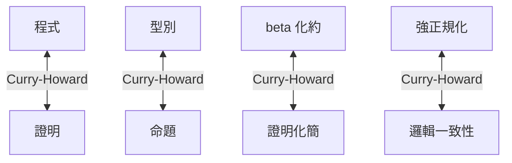

# 04.2 簡單型別蘭布達演算與強正規化性質

## 引言

上一節我們看到型別是程式的邏輯安全網。本節要深入型別系統的**原型**：簡單型別蘭布達演算（simply typed lambda calculus, STLC）。它是 1940 年代 Church 為了替「函數」這個直覺概念建立形式基礎而發明的，卻意外成為所有現代程式語言的骨架。理解 STLC，就理解了型別與邏輯之間那座橋的每一根樑柱。

---

## 1. 無型別蘭布達演算：簡潔與危機並存

**定義 1.1（無型別蘭布達演算的語法）.**

$$
e ::= x \mid \lambda x.\, e \mid e_1\, e_2
$$

即：變數、抽象（建構函數）、應用（呼叫函數）。

**定義 1.2（ $\beta$ 化約）.**

$$
(\lambda x.\, e_1)\, e_2 \longrightarrow e_1[x := e_2]
$$

把 $e_1$ 中的自由變數 $x$ 代換為 $e_2$ 。

這個只有三條語法規則的系統威力驚人：自然數、布林值、配對、遞迴都能用純 $\lambda$ 項編碼（Church 編碼）。但它有一個致命缺陷。

### 1.1 自我應用的問題

考慮項

$$
\Omega = (\lambda x.\, x\, x)\,(\lambda x.\, x\, x)
$$

一步化約： $\Omega \to (\lambda x. xx)(\lambda x. xx) = \Omega$ 。**無限迴圈，永不終止。**

更糟的是：

$$
(\lambda x.\, y)\,\Omega \longrightarrow y
$$

這個項明明可以一步就得出 $y$ ，但無型別系統裡也存在「化約永不止息」的化約序列。能否定義一個判準，**事先**知道哪些項必然終止？

Church 的答案：**加上型別**。而且動機不僅是工程上的，而是數學基礎上的——見 04.3。

---

## 2. 簡單型別蘭布達演算

**定義 2.1（型別）.** 給定一組基本型別（如 $o$ ），型別由以下語法生成：

$$
\tau ::= o \mid \tau_1 \to \tau_2
$$

**定義 2.2（型別判斷規則）.**

$$
\frac{x : \tau \in \Gamma}{\Gamma \vdash x : \tau} \;(\text{Var})
\qquad
\frac{\Gamma, x : \tau_1 \vdash e : \tau_2}{\Gamma \vdash \lambda x.\, e : \tau_1 \to \tau_2} \;(\text{Abs})
\qquad
\frac{\Gamma \vdash e_1 : \tau_1 \to \tau_2 \quad \Gamma \vdash e_2 : \tau_1}{\Gamma \vdash e_1\, e_2 : \tau_2} \;(\text{App})
$$

關鍵在 **App 規則**：想應用 $e_1$ 到 $e_2$ ， $e_2$ 的型別必須正好是 $e_1$ 的定義域。這一條規則就殺死了 $x\,x$ ：

假設 $x : \alpha$ ，要使 $x\,x$ 型別良好，需要 $x : \alpha \to \beta$ ，即 $\alpha = \alpha \to \beta$ ——這是**有限型別表達式不可能滿足的方程**（ $\alpha$ 的「長度」有限， $\alpha \to \beta$ 恆比 $\alpha$ 大一層）。因此 $\Omega$ 在 STLC 中**根本寫不出來**。

### 2.1 型別推導的例子

證明 $\lambda x.\, x : \alpha \to \alpha$ （恆等函數）：

$$
\frac{\frac{x : \alpha \in \Gamma}{\Gamma \vdash x : \alpha}\,(\text{Var})}{\vdash \lambda x.\, x : \alpha \to \alpha}\,(\text{Abs})
$$

---

## 3. 定理：強正規化（Strong Normalization）

**定義 3.1（正規形式）.** 若項 $e$ 無法再 $\beta$ 化約，稱 $e$ 為正規形式（normal form）。

**定義 3.2（強正規化）.** 若項 $e$ 的**每一條**化約序列都會在有限步後到達正規形式，稱 $e$ 為強正規化的。

**定理 3.3（強正規化定理，Church 1940 / Tait–Girard）.**
若 $\vdash e : \tau$ 可推導，則 $e$ 是強正規化的。

**推論 3.4.** STLC 的型別檢查是可判定的，且所有型別良好的程式必然停止——STLC 中**不可能寫出無限迴圈**。

證明思想（Tait 的「可及性」方法，red-metho $d$ ）值得一看，因為它示範了數學如何馴服無限：

**證明概要.** 對每個型別 $\tau$ 定義一組「可及項」 $\llbracket \tau \rrbracket$ ：

1. $\llbracket o \rrbracket = \{ e \mid e \text{ 強正規化} \}$ ；
2. $e \in \llbracket \tau_1 \to \tau_2 \rrbracket$ 若 $e$ 強正規化，且對所有 $a \in \llbracket \tau_1 \rrbracket$ ， $e\,a \in \llbracket \tau_2 \rrbracket$ 。

然後對 $e$ 做結構歸納，證明所有型別良好的項皆可及。歸納之所以能封閉，正是因為函數型別「高一層」的結構堵住了自我應用。 $\blacksquare$

> **哲學意涵**：型別不只防 bug，它改變了系統的**計算性質**。犧牲自我應用（從而犧牲直接的遞迴），換來了「一切終止」的保證。圖靈完備性與可判定性之間的張力，將在 06.3 依賴型別中再次出現。

---

## 4. 範例：Haskell 中的 STLC 片段

STLC 的一切都能在 Haskell 中直接體驗（Haskell 的類型類與遞迴超出 STLC，但核心就是 STLC）：

```haskell
-- 恆等函數：對應證明 A -> A
id' :: a -> a
id' x = x

-- 函數組合：(A->B) -> (B->C) -> A -> C，對應邏輯三段論
compose :: (b -> c) -> (a -> b) -> a -> c
compose g f x = g (f x)

-- 交換論證順序：currying 的骨幹（詳見 05.3）
flip' :: (a -> b -> c) -> b -> a -> c
flip' f y x = f x y
```

用 Python 模擬 $\beta$ 化約器，親眼看看 STLC 的代換：

```python
# 極簡 STLC 直譯器（名稱型，不處理捕捉規避，僅供教學）
from dataclasses import dataclass

class Term: pass

@dataclass
class Var(Term):
    name: str

@dataclass
class Lam(Term):      # lambda x. body
    param: str
    body: Term

@dataclass
class App(Term):      # f a
    f: Term
    a: Term

def subst(t: Term, name: str, val: Term) -> Term:
    match t:
        case Var(n):
            return val if n == name else t
        case Lam(p, body):
            return Lam(p, subst(body, name, val) if p != name else body)
        case App(f, a):
            return App(subst(f, name, val), subst(a, name, val))

def step(t: Term) -> Term:
    match t:
        case App(Lam(p, body), a):
            return subst(body, p, a)          # beta 化約
        case App(f, a):
            return App(step(f), a)
        case _:
            return t

omega = App(Lam("x", App(Var("x"), Var("x"))),
            Lam("x", App(Var("x"), Var("x"))))
# 在無型別系統中 omega 永遠化約不完；
# 但若加上型別註記，omega 根本無法通過型別檢查（見正文第 2 節）。
```

用 Lean 表達「型別良好 ⇒ 終止」的核心結構：

```lean
-- STLC 語法（de Bruijn 指數版精簡示意）
inductive Ty where
  | o : Ty
  | arr : Ty → Ty → Ty

inductive Tm : List Ty → Ty → Type where
  | var : ∀ {Γ ty}, Tm Γ ty → Tm Γ ty            -- 簡化示意
  | lam : ∀ {Γ a b}, Tm (a :: Γ) b → Tm Γ (a.arr b)
  | app : ∀ {Γ a b}, Tm Γ (a.arr b) → Tm Γ a → Tm Γ b

-- 在 Lean 中，STLC 的強正規化定理是可以完整形式化並證明的
-- （完整證明見 Tait–Girard 方法的形式化版本，此處僅列出骨架）
```

---

## 5. Curry–Howard 對應的精確形式

STLC 之下，對應變成嚴格的雙射：

| 蘭布達演算 | 直覺主義命題邏輯 |
|---|---|
| 型別 $\alpha \to \beta$ | 蘊含 $A \Rightarrow B$ |
| 項 $\lambda x.\, e$ | $\Rightarrow$ 引入（假設 $A$ 證 $B$ ） |
| 應用 $e_1\, e_2$ | $\Rightarrow$ 消去（modus ponens） |
| $\beta$ 化約 | 證明化簡（proof normalization） |
| **強正規化定理** | **無型別良好的項化約不止 ⇔ 直覺主義邏輯一致** |

最後一行是重點：若存在型別良好的項化約永不終止，我們就能在邏輯中證明假（empty type 的居民），導致體系崩潰。**強正規化性質 = 邏輯一致性的計算版本**。這也是為什麼 STLC 只能證明直覺主義邏輯的定理——排中律（ $A \lor \lnot A$ ）在其中有型別但無項，即「無法構造」。



---

## 6. 互相驅動的迴圈

- **數學驅動程式**：強正規化定理給了語言設計者信心——「只要型別檢查通過，就不會當機（在 STLC 範圍內）」。ML、Haskell 的核心即建立於此。
- **程式驅動數學**：實務需要遞迴與圖靈完備性，於是在 STLC 之上加 **Y 組合子 / 遞迴型別**——但立刻失去強正規化，邏輯一致性也失守（帶一般遞迴的系統可證明假）。解法是「區分程式與證明層」：Coq/Lean 用**全套（totality）檢查**（structural recursion）保住證明層的終止性，同時允許程式層有遞迴。這個張力在 06.3 會再出現。

---

## 7. 章末小結

- 無型別 $\lambda$ 演算允許 $x\,x$ ，導致 $\Omega$ 這類永不終止的項。
- STLC 用唯一的 App 規則封死了自我應用（ $\alpha = \alpha \to \beta$ 無解）。
- **強正規化定理**：型別良好的項，任何化約序列皆終止。證明工具是 Tait 的可及性歸納。
- Curry–Howard 之下，強正規化 ⇔ 直覺主義邏輯一致。
- 圖靈完備性（需要遞迴）與全面終止性（需要邏輯安全）不可兼得，這是型別論的核心張力。

## 下一步

為什麼 Church 要在 1940 年做這件事？因為 1901 年羅素發現的悖論已經讓樸素集合論崩潰，數學基礎危在旦夕。下一節 04.3，我們回到災難現場：**羅素悖論如何催生型別論**——你會看到「 $\alpha = \alpha \to \beta$ 無解」這件事，正是「集合不能包含自身」的計算版本。
