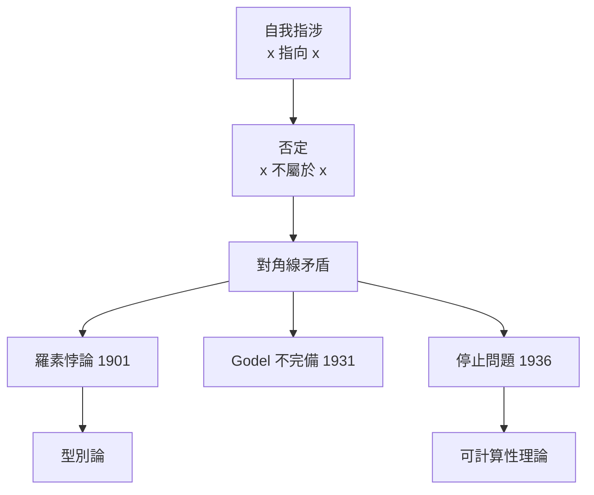

# 04.3 羅素悖論與型別論的誕生：避免數學體系崩潰的防火牆

## 引言：數學的 Chernobyl 時刻

1901 年，羅素（Bertrand Russell）寄給弗雷格（Gottlob Frege）一封信，信末附了一個問題。弗雷格晚年回憶，這封信讓他的畢生工作「地基動搖」。那個問題就是**羅素悖論**——它不只是一個邏輯謎題，而是暴露了當時整個數學基礎（樸素集合論）的內在矛盾。

本節的主線是：**型別論不是程式設計師的發明，而是數學家為了拯救數學而建造的防火牆**。而一百年後，這道防火牆以「型別系統」的身份，回到了每個程式語言的編譯器裡。

---

## 1. 前因：弗雷格的野心

弗雷格在《算術基礎》（1884）與《算術基本法則》（1893）中提出宏偉計畫：**把全部算術還原為純邏輯**（邏輯主義 logicism）。他的工具是：

- **概念（concept）**：從對象到真值的函數，如「 $x$ 是素數」；
- **外延（extension）**：一個概念所適用的所有對象的集合，記作 $\hat{x}\, F(x)$ ；
- **基本法則 V**（Basic Law V）：兩個概念的外延相等，若且唯若它們對所有對象的取值相同。

$$
\hat{x}\, F(x) = \hat{x}\, G(x) \;\Longleftrightarrow\; \forall y\, (F(y) \leftrightarrow G(y))
$$

這條法則讓「任何條件都可以定義一個集合」變成邏輯真理。看似無害，實則埋著炸彈。

---

## 2. 定義：羅素悖論

**定義 2.1（羅素集合）.** 考慮所有「不包含自身」的集合：

$$
R = \{ x \mid x \notin x \}
$$

**定理 2.1（羅素悖論，1901）.** 在樸素集合論中， $R$ 的存在導致矛盾。

**證明.** 問： $R \in R$ ？

- 若 $R \in R$ ，則依 $R$ 的定義， $R \notin R$ ；
- 若 $R \notin R$ ，則 $R$ 滿足成員條件，故 $R \in R$ 。

兩種情況皆矛盾。 $\blacksquare$

用弗雷格的系統說：把 $F(x)$ 取為「 $x \notin x$ 」，Basic Law V 保證外延 $\hat{x}\, F(x)$ 存在，於是矛盾是**在公理層面**推導出來的——弗雷格的系統是不一致的，任何命題都能證明。

### 2.1 悖論的結構：「自我指涉 + 否定」

羅素悖論的骨架是**對角線論證**（diagonal argument），同一結構還出現在：

| 年代 | 悖論 | 結構 |
|---|---|---|
| 1874 | Cantor：實數不可數 | $f(x) \ne$ 第 $x$ 個的對角線值 |
| 1897 | Burali-Forti：所有序數的集合 | 序數集合的序數 $\notin$ 自己 |
| 1901 | Russell： $R = \{x \mid x \notin x\}$ | 自我否定 |
| 1931 | Gödel 不完備定理 | $\ulcorner$ 本命題不可證 $\urcorner$ |
| 1936 | Turing 停止問題 | 對角線程式 |



---

## 3. 解法一：Zermelo 公理化集合論（限制「哪些集合存在」)

Zermelo（1908）的策畧：保留「集合」這個概念，但**不讓任意條件都生成集合**。分離公理（Separation）只允許從**既有集合**中切出子集：

$$
\forall a\, \exists b\, \forall x\, (x \in b \leftrightarrow x \in a \land \phi(x))
$$

於是 $R = \{x \mid x \notin x\}$ 只能在某個 $a$ 之內定義， $R \in R$ 的問題變成「 $a$ 是否包含自身」——不導致全域矛盾，只導致「 $a$ 不是所有集合的集合」。搭配正則公理（ $x \notin x$ 對一切集合恆真），矛盾被排除。

## 4. 解法二：型別論（限制「誰能屬於誰」）

羅素本人的解法走的是另一條路：**分層**。

**定義 4.1（簡單型別論）.** 對象分為層級：

- 層 0：個體（individuals，不談成員關係）；
- 層 $n+1$ ：層 $n$ 物件的**集合**（更精確地：層 $n$ 上的性質）。

成員關係只允許「低層屬於高層」：

$$
x \in y \quad \text{僅當} \quad \mathrm{level}(x) + 1 = \mathrm{level}(y)
$$

**「 $x \in x$ 」這個公式在語法層面就是非法的**——不是被證明為假，而是**根本不能寫出來**。悖論不是被解決，而是被禁止。

### 4.1 防火牆的比較

| | ZFC 集合論 | 型別論 |
|---|---|---|
| 策畧 | 限制集合的生成 | 限制成員關係的語法 |
| 悖論的命運 | 被公理排除 | 被語法禁止 |
| 全集 $V$ | 不存在（是「真類」） | 每層有自己的全集 |
| 程式對應 | 較少 | **就是型別系統** |

---

## 5. 從邏輯型別論到程式型別：Church 的綜合

1940 年，Church 把羅素的分層思想移植到 $\lambda$ 演算上，得到簡單型別蘭布達演算（04.2 的主角）。連接點正是：

$$
x : \alpha \to \beta \;\text{且}\; x : \alpha \quad \Longrightarrow \quad \alpha = \alpha \to \beta \;(\text{無解})
$$

「函數不能應用到自己身上」⇔「集合不能包含自身」。**型別系統就是集合論正則性的語法化**。羅素悖論的防火牆，在編譯器裡以「型別錯誤」的形式日夜運轉。

### 5.1 範例：三種語言中的防火牆

```python
# Python 的「動態防火牆」：語法允許自我應用，執行期才爆炸
f = lambda x: x(x)
f(f)   # RecursionError: maximum recursion depth exceeded
# Python 沒有靜態層級，所以羅素式的項能通過檢查——代價是執行期風險
```

```haskell
-- Haskell 的「靜態防火牆」：自我應用無法通過型別檢查
-- f x = x x  -- 編譯錯誤：Occurs check: cannot construct the infinite type:
--            --   t = t -> t0
-- 注意錯誤訊息的名字：Occurs check！
-- 這正是「x 出現在自身型別中」被檢出的機制——羅素悖論的計算版偵測器
```

```lean
-- Lean 4 的「邏輯防火牆」：試圖在型別層重現羅素集合
-- universe u
-- def R : Type := { x : Type // x ∉ x }  -- 語法上要求 x 與其成員關係不同層
-- 在依賴型別論中，Type : Type 被禁止，代之以型別宇宙層級 Type 0 : Type 1 : Type 2 : ...
-- 這正是羅素分層的現代形式（Russell 宇宙），詳見 06.3
```

Haskell 的 **occurs check** 特別值得品味：Hindley–Milner 推導在統一（unify） $\alpha$ 與 $\alpha \to \beta$ 時，檢查 $\alpha$ 是否「出現在」待統一的型別內部——這個檢查的名字與數學上的「無基礎（non-well-founded）」禁止，是同一件事。

### 5.2 用 Python 驗證對角線結構

```python
def diagonal_contraption(pairs: list[tuple[int, int]]) -> int:
    """Cantor 對角線：構造與列表中每一列都不同的數。
    這是羅素悖論、Godel 編碼、停止問題共用的骨架。"""
    return 1 + pairs[0][0]  # 第 0 列的第 0 項不同
    # 完整版：d[i] = (pairs[i][i] + 1) % 2，d 與每一列在對角線位置不同

def cantor_theorem_demo():
    """定理（Cantor）：不存在從 N 到 P(N) 的滿射。
    給定任何 f: N -> P(N)，構造 D = { n | n notin f(n) }。
    若 D = f(k)，則 k in D  <=>  k notin f(k) = D，矛盾。
    這個 D 就是羅素集合 R 的相對化版本——差別只在：
    Cantor 在 P(N) 內部做對角線（安全），
    Russell 對「所有集合的全集」做對角線（爆炸）。"""
    f = {0: {1, 2}, 1: {0}, 2: {0, 1, 2}}   # f(n) ⊆ N 的例子
    D = {n for n, s in f.items() if n not in s}
    print(D)  # {0, 1}：D 不等於任何 f(n)，滿射被破壞
```

---

## 6. 定理：型別論的一致性

**定理 6.1.** 簡單型別蘭布達演算是**一致的**：空型別（記作 $\bot$ 或 `Void`）沒有居民，即不存在型別良好的閉項 $e : \bot$ 。

**證明.** 由強正規化定理（04.2 定理 3.3）， $e$ 化約到正規形式 $v$ 。正規形式不能是 $\lambda x.\, b$ （因為 $\lambda x.\, b : \bot$ 要求 $\bot = \tau_1 \to \tau_2$ ，型別語法上不可能）。也不能是變數（閉項無自由變數）、不能是應用（正規形式不含紅色項）。無任何情況成立，故 $e$ 不存在。 $\blacksquare$

由 Curry–Howard：**型別論一致 ⇔ 沒有「型別為假」的程式**。防火牆的防火牆，就是 04.2 那條定理。

---

## 7. 後果：一場危機，三個遺產

羅素悖論的餘波塑造了二十世紀數學與計算的三條主線：

1. **公理化集合論（ZFC）**：成為多數數學家的工作基礎；
2. **型別論**：經 Curry–Howard 轉化為證明助理（Coq、Lean、Agda）的基礎，今日菲爾茲獎級成果（如液體張量猜想）已在 Lean 中形式化；
3. **可計算性理論**：對角線方法的純化（Gödel、Turing），奠定電腦科學。

對程式設計師而言，每次編譯器拒絕一個型別錯誤的程式，都是 1901 年那場危機的迴聲：**自我指涉被分層擋在門外，數學與程式因此不會崩潰**。

---

## 8. 章末小結

- 羅素悖論（ $R = \{x \mid x \notin x\}$ ）使樸素集合論與弗雷格系統不一致。
- 兩種防火牆：ZFC 限制集合生成；型別論限制成員關係的語法（分層）。
- Church 的 STLC = 羅素分層 + $\lambda$ 演算；「 $x\,x$ 非法」⇔「 $x \in x$ 非法」。
- Haskell 的 occurs check 是悖論偵測器的現代名字。
- 強正規化 ⇒ 空型別無居民 ⇒ 邏輯一致。
- 對角線方法一魚三吃：Cantor、Gödel、Turing。

## 下一步

我們已有了型別的安全保證與邏輯對應，但型別還很貧乏：只有基本型別與箭頭。接下來進入第五章，為型別世界補上**積（tuple/struct）與和（enum/Either）**——你將看到代數型別如何讓「資料結構」與「邏輯連接詞 $\land$ 、 $\lor$ 」再次嚴格對應，並引出「型別即代數式」的驚人視角。
