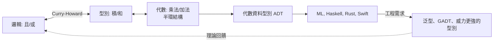

# 05.1 積型與和型：Tuple、Struct 與 Enum、Either

## 引言

第四章建立了型別的安全網。本章開始把型別世界建成一座**代數花園**：型別可以相乘、相加、取冪，而這些運算服從熟悉的代數律。本節先介紹兩個最基礎的複合型別——**積型（product type）**與**和型（sum type）**。它們分別對應邏輯的「且」與「或」，對應代數的乘法與加法，也對應你每天在寫的 `struct` 與 `enum`。

理解積與和，你就理解了「資料建模」的數學本質。

---

## 1. 積型：同時擁有兩者

**定義 1.1（積型 / Cartesian 積）.** 給定型別 $A$ 與 $B$，積型 $A \times B$ 的元素是有序對 $(a, b)$，其中 $a : A$、$b : B$：

$$
|A \times B| = |A| \cdot |B|
$$

**定義 1.2（投影與引入/消去規則）.**

| | 規則 | 名稱 |
|---|---|---|
| 引入 | $(a, b) : A \times B$，其中 $a:A, b:B$ | 配對 |
| 消去 | $\pi_1(a,b) = a$、$\pi_2(a,b) = b$ | 第一/第二投影 |

對應邏輯：$(a : A) \land (b : B)$ 的證明就是一對證明 $(a,b)$——**配對 = 且的引入，投影 = 且的消去**。這正是 Curry–Howard 中 $\land \leftrightarrow \times$ 的實質內容。

### 1.1 程式語言中的積型

```haskell
-- Haskell：內建 tuple 即無名積型
point :: (Double, Double)
point = (3.0, 4.0)

-- 有名積型 = record / struct
data Point = Point { px :: Double, py :: Double }
```

```python
# Python：tuple 是無名積、dataclass 是有名積
from dataclasses import dataclass

@dataclass(frozen=True)
class Point:
    px: float
    py: float

p = Point(3.0, 4.0)
q = (3.0, 4.0)   # 同一個數學物件 A × B 的兩種寫法
```

```rust
// Rust：tuple 與 struct 都是積型
struct Point { px: f64, py: f64 }
let p = (3.0, 4.0);            // (f64, f64) 積型
let q = Point { px: 3.0, py: 4.0 };
```

**有意義的細節**：`(A, A)` 與有名 `struct { x: A, y: A }` 在數學上**同構**（見 05.2）——差別只是「欄位有無名字」，這是工程介面問題，不是數學結構問題。

---

## 2. 和型：二選一

**定義 2.1（和型 / 不相交聯集）.** 給定型別 $A$ 與 $B$，和型 $A + B$ 的元素是「打上標籤的 $A$ 值」或「打上標籤的 $B$ 值」：

$$
|A + B| = |A| + |B|
$$

**定義 2.2（注入與 case 分析）.**

| | 規則 | 名稱 |
|---|---|---|
| 引入 | $\mathrm{inl}\, a : A + B$、$\mathrm{inr}\, b : A + B$ | 左/右注入 |
| 消去 | case：給定 $f : A \to C$、$g : B \to C$，得 $[f, g] : A + B \to C$ | 分情況處理 |

對應邏輯：$\mathrm{inl}$/$\mathrm{inr}$ 是 $\lor$ 的引入，case 是 $\lor$ 消去（分情況證明）。**關鍵**：用 $A + B$ 時，你**必須**同時提供兩種情況的處理器——「忘記處理分支」這一類 bug 在數學上不可能存在。

### 2.1 程式語言中的和型

```haskell
-- Either：二選一和型的標準名字
data Either a b = Left a | Right b

-- 最著名的應用：取代 null
safeDiv :: Int -> Int -> Either String Int
safeDiv _ 0 = Left "除以零"
safeDiv x y = Right (x `div` y)

-- Maybe = 帶「無值」的和型：data Maybe a = Nothing | Just a
-- 這正是 04.1 中 Option 型別的真身！
```

```rust
// Rust：enum 就是有標籤的和型
enum Shape {
    Circle(f64),                    // 一個 f64（半徑）
    Rectangle { w: f64, h: f64 },   // 一個積型
}
// match 是 case 消去規則；漏一個分支 → 編譯錯誤（邏輯強制完備性）
fn area(s: &Shape) -> f64 {
    match s {
        Shape::Circle(r) => std::f64::consts::PI * r * r,
        Shape::Rectangle { w, h } => w * h,
    }
}
```

```python
# Python 3.10+ 的型別層面終於有了和型：Union / |
from typing import Union

def safe_div(x: int, y: int) -> Union[str, int]:   # str | int
    return "除以零" if y == 0 else x // y

# 但 Python 不強制 case 完備性：和型只有語法，沒有邏輯效力
# 這是「動態型別安全網網眼較大」的又一例證
```

### 2.2 和型的殺手級應用：狀態機建模

```rust
// 把「連線狀態」用和型精確建模：不合法的狀態在型別上不存在
enum ConnState {
    Disconnected,
    Connecting { attempts: u32 },
    Connected { session_id: u64 },
}
// 「已連線但沒有 session id」這種狀態無法表達——
// 這是「Make illegal states unrepresentable」設計原則
```

---

## 3. 定理：代數律

積與和讓型別構成一個（在「同構意義下」的）**半環（semiring）**：

**定理 3.1（型別代數律）.** 以下同構成立（$0$ = 空型別，$1$ = 單位型別）：

| 代數恆等式 | 型別同構 | 邏輯對應 |
|---|---|---|
| $A \times 1 \cong A$ | 與單位積 | $A \land \top \Leftrightarrow A$ |
| $A + 0 \cong A$ | 與空型和 | $A \lor \bot \Leftrightarrow A$ |
| $A \times B \cong B \times A$ | 交換律 | $\land$ 交換 |
| $(A + B) + C \cong A + (B + C)$ | 結合律 | $\lor$ 結合 |
| $A \times (B + C) \cong A \times B + A \times C$ | **分配律** | 分配律 |
| $(A \times B) \to C \cong A \to (B \to C)$ | **柯里化** | 見 05.3 |

注意 $\bot$（空型別）對應假、$\top$（單位型別）對應真——整張表就是邏輯定律的型別版本。證明方式都是**構造兩個互逆函數**（見 05.2 的同構定義）。

```haskell
-- 分配律的顯式同構（兩個方向的函數，互為逆）
distrib :: (a, Either b c) -> Either (a, b) (a, c)
distrib (a, Left b)  = Left (a, b)
distrib (a, Right c) = Right (a, c)

undistrib :: Either (a, b) (a, c) -> (a, Either b c)
undistrib (Left (a, b))  = (a, Left b)
undistrib (Right (a, c)) = (a, Right c)
-- distrib . undistrib = id 且 undistrib . distrib = id：這就是「同構」的程式證明
```

---

## 4. 範例：Option 與錯誤處理的代數

04.1 的 `Option<T>` 現在可以完全解密：

$$
\mathrm{Option}(A) = A + 1
$$

「可能是 $A$，也可能是一個特殊單元值」。它在代數上就是 $|A| + 1$。

```python
# Result/Option 的本質是和型：錯誤處理 = case 分析
from dataclasses import dataclass
from typing import Generic, TypeVar

T = TypeVar("T"); E = TypeVar("E")

@dataclass
class Ok(Generic[T]):
    value: T

@dataclass
class Err(Generic[E]):
    error: E

Result = Ok[T] | Err[E]   # 型別層面：Result[T, E] = T + E

def parse_int(s: str) -> Result[int, str]:
    try:
        return Ok(int(s))
    except ValueError as e:
        return Err(str(e))

# case 消去：呼叫者被迫處理兩個分支
match parse_int("42"):
    case Ok(v):  print(v * 2)
    case Err(m): print(f"解析失敗: {m}")
```

進一步：`Either` 的鏈式組合（monad）讓錯誤像異常一樣傳播，但**全程在型別中可見**。這是和型從邏輯規則升級為工程架構的例子。

### 4.1 依值個數驗證代數

```python
def card(t) -> int:
    """計算小型型別的元素個數，驗證 |A+B| = |A|+|B|、|A×B| = |A|·|B|"""
    match t:
        case ("bool",):            return 2
        case ("unit",):            return 1
        case ("void",):            return 0
        case ("sum", a, b):        return card(a) + card(b)
        case ("prod", a, b):       return card(a) * card(b)

Bool = ("bool",); Unit = ("unit",); Void = ("void",)
assert card(("prod", Bool, Bool)) == 4        # 2*2
assert card(("sum",  Bool, Bool)) == 4        # 2+2（可與積區分：值的形狀不同！）
assert card(("sum",  Bool, Void)) == 2        # A + 0 ≅ A
assert card(("prod", Bool, Void)) == 0        # A × 0 ≅ 0
print("所有代數律通過")
```

注意 `Bool + Bool` 與 `Bool × Bool` **個數相同但型別不同**：前者有標籤 `inl`/`inr`，後者是配對。基數相等 ⇏ 同構（需構造互逆映射，見 05.2）。

---

## 5. 互相驅動：邏輯、代數與工程



代數資料型別（ADT）這個名字本身就是宣言：**資料結構就是代數式**。一個 JSON 值的型別可以寫成遞迴方程

$$
\mathrm{Json} = \mathrm{Null} + \mathrm{Bool} + \mathrm{Number} + \mathrm{String} + \mathrm{List}(\mathrm{Json}) + \mathrm{Map}(\mathrm{String} \times \mathrm{Json})
$$

而解方程式的技術（不動點、最小解）來自域理論——代數、邏輯、計算在此匯流。

---

## 6. 章末小結

- 積型 $A \times B$：有序對，基數相乘，邏輯上是 $\land$；tuple/struct 是其化身。
- 和型 $A + B$：帶標籤二選一，基數相加，邏輯上是 $\lor$；enum/Either 是其化身。
- case 消去強制完備性，使「漏處理分支」不可能存在。
- 積與和構成半環：$1$ 是乘法單位、$0$ 是加法單位；分配律與柯里化把代數與函數型別縫合。
- `Option = A + 1`、錯誤處理 = 和型 case 分析——型別代數直接改寫了工程實踐。

## 下一步

我們反覆使用「同構」「基數」這些詞，但還沒精確定義它們。下一節 05.2，我們將從**集合論視角**審視型別：何謂型別的大小？有限型別、可數型別、不可數型別在程式中如何顯現？以及最關鍵的——**兩個型別「一樣大」和「兩個型別同構」是同一件事嗎？**（提示：$\mathbb{Z}$ 與 $\mathbb{N}$ 一樣大，但有一個自然同構，一個反例將讓你看到選擇公理的影子。）
