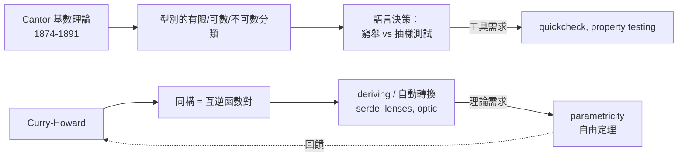

# 05.2 集合論視角下的型別：型別的大小基數與同構

## 引言

上一節我們不斷寫下 $|A \times B| = |A| \cdot |B|$ 這類式子，彷彿型別有「大小」。本節把這個直覺嚴格化：用集合論的**基數（cardinality）**理論度量型別，並區分兩個常被混用的概念——「一樣大」與「同構」。你將看到 Cantor 的對角線如何劃出「有限/可數/不可數」三個世界，以及這個分類如何直接對應到程式語言的表達能力（可枚舉、可比較、可序列化）。

---

## 1. 定義：基數與等勢

**定義 1.1（等勢，equipotent）.** 兩個型別（視為其所有值的集合）$A$、$B$ **等勢**，記 $|A| = |B|$，若存在雙射 $f : A \to B$。

**定義 1.2（基數層級）.**

| 類別 | 定義 | 型別例子 |
|---|---|---|
| 有限型 | 基數為自然數 $n$ | `Bool`（2）、`u8`（256）、`Option<Bool>`（3） |
| 可數無限 | 與 $\mathbb{N}$ 等勢 | `String`、`[Int]`（整數串列）、所有有限程式 |
| 不可數 | 嚴格大於可數 | `Real`、`Int -> Bool`（見定理 2.1） |

**定理 1.1（Cantor，1874/1891）.** 對任何型別 $A$，

$$
|A| < |A \to \mathrm{Bool}| = |2^A|
$$

即冪集型別總是嚴格更大。**證明**就是對角線：設 $f : A \to (A \to \mathrm{Bool})$ 為任意映射，定義 $D(a) = \lnot f(a)(a)$，則 $D$ 不在任何 $f$ 的像中。$\blacksquare$

這正是 04.3 羅素悖論的「安全版本」：對角線永遠能製造「清單之外的新元素」。

---

## 2. 定理：程式世界裡的基數事實

**定理 2.1（函數型別的爆炸）.** $|\mathrm{Bool} \to \mathrm{Bool}| = 4$（有限！），但 $|\mathbb{N} \to \mathrm{Bool}| = 2^{\aleph_0}$（不可數，等勢於實數）。

**定理 2.2（可計算函數是可數的）.** 所有程式（有限字串）只有可數多個，故**可計算函數 $\mathbb{N} \to \mathbb{N}$ 是可數的**；但所有函數 $\mathbb{N} \to \mathbb{N}$ 有 $\aleph_0^{\aleph_0} = 2^{\aleph_0}$ 個。

**推論 2.3.** 幾乎所有函數**不可計算**。「可程式化」在函數宇宙中是可數的塵埃。

```python
# 枚舉 Bool -> Bool 的全部 4 個函數：有限型別可以「列表窮舉」
from itertools import product

all_bool_fns = [
    dict(zip((False, True), vals))
    for vals in product([False, True], repeat=2)
]
for i, f in enumerate(all_bool_fns):
    print(f"fn{i}: F->{f[False]}, T->{f[True]}")
# fn0: 恆 False；fn1: T only；fn2: F only；fn3: 恆 True（含 not、id）
# 這就是 |Bool -> Bool| = 4 的顯式展開
```

對可數型別，程式的態度是「窮舉/搜尋」；對不可數型別，只能「取樣/逼近」。這解釋了為何浮點數不是實數：`f64` 其實是**有限**型別（$2^{64}$ 個值），是對不可數的 $\mathbb{R}$ 的有限網格逼近。

---

## 3. 同構：比「等勢」更強

**定義 3.1（型別同構）.** 型別 $A \cong B$，若存在 $f : A \to B$、$g : B \to A$ 使

$$
g \circ f = \mathrm{id}_A \quad\text{且}\quad f \circ g = \mathrm{id}_B
$$

**定義 3.2（自然同構）.** 若同構映射不依賴於 $A$、$B$ 的具體內容，且與所有函數可交換（即為**自然變換**），稱之為自然的。

### 3.1 等勢 ≠ 自然同構的經典例子

$|\mathbb{N}| = |\mathbb{Z}| = |\mathbb{Q}| = \aleph_0$，三者等勢。但：

- $\mathbb{N} \cong \mathbb{Z}$ 有**自然**同構：$0,1,-1,2,-2,\dots$（交錯編碼，可用算術寫出）；
- $\mathbb{N} \cong \mathbb{Q}$ 的標準對角線編碼是雙射，但**不保持任何運算結構**（既不保序、也不保加法），且需要先化約分數——它依賴於 $\mathbb{Q}$ 的表示法，不是「免費」的。

在程式中這有具體後果：**自然同構 = 可自動導出的轉換（deriving）**，不自然同構 = 需要人工維護的轉換層。

```haskell
-- 五邊形恆等式一例：三重積的重新結合，所有映射都是「純重排」
assoc1 :: ((a, b), c) -> (a, (b, c))
assoc1 ((x, y), z) = (x, (y, z))

-- 此同構對任意型別 a b c 一律成立 → 參數化多型寫出的同構必是自然的
-- 這是「parametricity」定理的一角，詳見 06.1
```

```python
# 有限型同構的完整驗證：Either(Bool, Unit) ≅ Option(Bool)
from itertools import product

L, R = ("inl",), ("inr",)
A_plus_B = {("inl", b) for b in (False, True)} | {("inr", "unit")}
Opt_Bool = {None} | {("just", b) for b in (False, True)}

# 基數都是 3；下面構造互逆映射證明同構
f = lambda x: None if x == ("inr", "unit") else ("just", x[1])
g = lambda y: ("inr", "unit") if y is None else ("inl", y[1])

assert all(g(f(x)) == x for x in A_plus_B)
assert all(f(g(y)) == y for y in Opt_Bool)
print("Either(Bool, Unit) ≅ Option(Bool)：同構成立")
```

### 3.2 基數相同但不（自然）同構的反例

| 型別 | 基數 | 能否自然同構 | 原因 |
|---|---|---|---|
| $\mathbb{N}$ 與 $\mathbb{N} + 1$ | $\aleph_0$ | 可以（偏移映射） | 平移是純算術 |
| $\mathbb{N}$ 與 $\mathbb{Q}$ | $\aleph_0$ | **沒有保持結構的** | $\mathbb{Q}$ 帶稠密序與域結構 |
| `Bool × Bool` 與 `Bool + Bool` | 4 | 基數相同，同構存在但**不是自然指定** | 需要選一個配對/標籤的約定 |

最後一列的微妙之處：對**每一對**具體型別，我們可以硬寫出一個雙射；但**沒有單一的多型函數**對所有型別給出 $\;A \times B \cong A + B\;$ 的映射（基數根本不一定相等，如 $|A|=2,|B|=3$ 時 $6 \ne 5$；即使是 $4 = 2+2$ 的情況，映射也依賴具體值）。這個「多型函數被迫自然」的現象，將在 06.1 以 parametricity 正式化。

---

## 4. 範例：序數、排序與「可比較性」

型別的大小還決定了它支撐哪些操作：

```python
import math

def countable_enumeration(t):
    """可數型別可提供『窮舉器』；有限型別還能提供『雙射編碼』"""
    if t == "bool":
        return [False, True]                       # 有限：完整窮舉
    if t == "u8":
        return list(range(256))                    # 有限：256 個
    if t == "nat":
        return None                                # 可數無限：只能惰性窮舉
    if t == "real":
        return None                                # 不可數：連窮舉都不可能，只能逼近

# 有限基數的實際威力：完美雜湊、窮舉測試、飽和驗證
def exhaustive_test(f, dom):
    """對有限型別上的函數做窮舉測試 = 完整證明（對該型別而言）"""
    return all(f(x) for x in dom)

xor = lambda b: (b, not b[0]) if False else None  # 示意
print(exhaustive_test(lambda x: x >= 0, range(256)))   # True = 對全部 256 值證明
```

- **有限型**：可以**完整驗證**（model checking 對有限狀態空間是完備的）。
- **可數型**：可以**反例驅動**（property-based testing 找得到反例，若存在）。
- **不可數型**：只能**抽樣與逼近**（浮點測試永遠可能漏）。

基數不是抽象玩具，而是「你的測試能不能變成證明」的分水嶺。

---

## 5. 定理：同構即資料格式等價

**定理 5.1（序列化觀點）.** 兩個型別同構，若且唯若存在不失真的雙向轉換格式。

這在工程上就是「格式相容」的數學定義：

```python
# protobuf/JSON schema 設計中的同構問題
# 原始型別：(name: str, age: int) — 積型
# 版本二：  (age: int, name: str) — 欄位順序交換
# 兩者自然同構（swap），所以資料可以無損遷移：

swap = lambda p: (p[1], p[0])
unswap = swap  # swap 自逆！
p = ("Alice", 30)
assert swap(unswap(p)) == p

# 版本三：(name: str, age: Option[int])
# 與原版不同構（基數：|str|·|int| vs |str|·(|int|+1)）
# → 遷移需要「預設值」策略：把 None 映到某個哨兵值，並承認失去雙射性
```

同構的判定因此是**資料工程的核心問題**：schema 演化、API 版本相容、資料庫遷移，全都是在問「新舊型別是否同構」。

---

## 6. 互相驅動的迴圈



集合論提供**量的語言**（基數），範疇論提供**質的語言**（同構、自然性），程式語言把兩者都變成**可執行的檢查**。下一節的指數律，將完成型別代數的最後一塊拼圖。

---

## 7. 章末小結

- 等勢（有雙射）弱於同構（有互逆函數對），自然同構更強（不依賴表示法）。
- Cantor 對角線：$|A| < |A \to \mathrm{Bool}|$；$\mathbb{N} \to \mathrm{Bool}$ 不可數。
- 可計算函數可數，故絕大多數函數不可程式化。
- 基數決定工程能力：有限可窮舉（測試即證明）、可數可反例搜尋、不可數只能逼近。
- 同構是資料格式相容、schema 演化的數學本質。
- 多型寫出的同構必是自然的——此現象的正式名稱是 parametricity（06.1）。

## 下一步

積、和都齊了，還差第三種運算：**冪**。為什麼函數型別 $A \to B$ 記作 $B^A$？柯里化為何是 $(B^A)^C \cong B^{A \times C}$？下一節 05.3 將證明：**柯里化不是語法糖，而是指數律**——你每天寫的多參數函數，都在行使一條代數恆等式。
