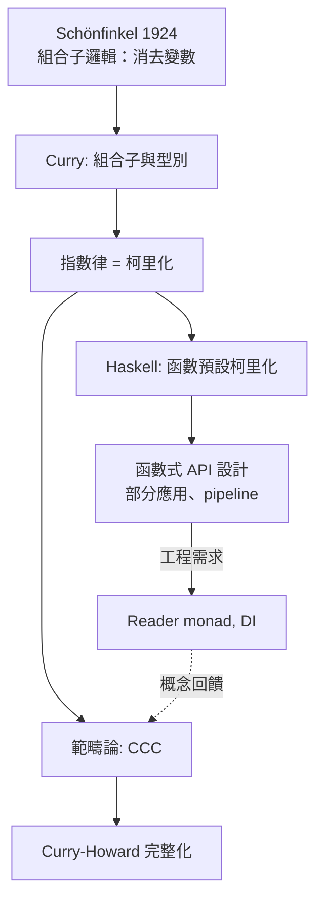

# 05.3 柯里化與指數律在型別中的體現

## 引言

每個 Haskell 程式設計師都知道函數可以「部分應用」：`add 3` 是一個還在等待下一個參數的函數。這個現象叫**柯里化（currying）**，以邏輯學家 Haskell Curry 命名（思想其實源自 Schönfinkel，故有時稱 curry–schönfinkel 化）。本節要證明一個更深的身世：柯里化**不是程式語言的便利設計，而是集合論指數律** $(B^A)^C \cong B^{A \times C}$ 在型別世界的重現。寫下 `f : A -> B -> C` 的那一刻，你正在使用一條與 $2^{3} = 2^{1 \times 3}$ 同源的數學恆等式。

---

## 1. 定義：函數型別是冪

**定義 1.1（函數型別的基數）.** 對集合 $A$ 、 $B$ ，從 $A$ 到 $B$ 的全體函數記為 $B^A$ ，因為

$$
|B^A| = |B|^{|A|}
$$

**證明.** 給定 $a \in A$ ，函數值 $f(a) \in B$ 有 $|B|$ 種選擇；對 $|A|$ 個獨立參數，總組合數為 $|B|^{|A|}$ （乘法原理的連乘）。 $\blacksquare$

**定義 1.2（求值映射）.** 指數律的「單位元素」是求值：

$$
\mathrm{eval} : B^A \times A \to B, \qquad \mathrm{eval}(f, a) = f(a)
$$

在範疇論中，存在 eval 且允許柯里化的範疇稱為**笛卡兒封閉範疇（Cartesian closed category, CCC）**——這正是「型別是邏輯」所需的最低結構。

---

## 2. 定理：柯里化 = 指數律

**定理 2.1（柯里化 / 指數律）.** 對任意型別 $A$ 、 $B$ 、 $C$ ：

$$
(A \times B) \to C \;\cong\; A \to (B \to C)
$$

基數形式： $|C|^{|A| \cdot |B|} = \left(|C|^{|B|}\right)^{|A|}$ ——**就是中學代數的 $(x^{mn}) = (x^n)^m$ **。

**證明（程式形式）.** 構造互逆映射：

```haskell
curry   :: ((a, b) -> c) -> a -> b -> c
curry f x y = f (x, y)

uncurry :: (a -> b -> c) -> ((a, b) -> c)
uncurry f (x, y) = f x y

-- 互逆性的驗證（自由定理保證這對任意 f 成立）：
-- unurry . curry = id  且  curry . uncurry = id
```

```python
from typing import Callable, Tuple

def curry[A, B, C](f: Callable[[Tuple[A, B]], C]) -> Callable[[A], Callable[[B], C]]:
    return lambda x: lambda y: f((x, y))

def uncurry[A, B, C](f: Callable[[A], Callable[[B], C]]) -> Callable[[Tuple[A, B]], C]:
    def g(p: Tuple[A, B]) -> C:
        return f(p[0])(p[1])
    return g

def f_pair(p: Tuple[int, int]) -> int:
    return p[0] * 10 + p[1]

def f_cur(x: int) -> Callable[[int], int]:
    return lambda y: x * 10 + y

# 互逆驗證
for x, y in [(1, 2), (3, 4), (0, 9)]:
    assert uncurry(curry(f_pair))((x, y)) == f_pair((x, y))
    assert curry(uncurry(f_cur))(x)(y) == f_cur(x)(y)
print("柯里化同構驗證通過")
```

**邏輯對應**：這條同構在證明論中就是**蘊含的輸出策略重排**——

$$
(A \land B) \Rightarrow C \;\Longleftrightarrow\; A \Rightarrow (B \Rightarrow C)
$$

即「給齊兩個前提才能證 $C$ 」⇔「先給 $A$ 得到一個『待 $B$ 』的中間結論」。柯里化因此是**邏輯定律的程式化**， curry 命名的雙關（Haskell Curry 本人）並非巧合。

---

## 3. 範例：部分應用與函數工廠

柯里化的實用紅利是**部分應用（partial application）**：先餵幾個參數，得到特化函數。

```haskell
add :: Int -> Int -> Int
add x y = x + y

inc :: Int -> Int
inc = add 1            -- 固定第一參數：C^1 特化自 C^2

-- 運算子區段（section）同樣是柯里化的直接受益者
double = (* 2)
halve  = (/ 2)

map (add 10) [1, 2, 3]   -- [11, 12, 13]
```

```python
from functools import partial

def scale(factor: float, value: float) -> float:
    return factor * value

double = partial(scale, 2.0)   # Python 需要庫函數輔助，因為函數預設不柯里化
assert double(21) == 42.0
```

```rust
// Rust 函數天然是多參數的（非柯里化），但閉包語法輕鬆手動柯里化
let add = |x: i32, y: i32| x + y;
let add10 = move |y| add(10, y);   // 部分應用 = 閉包捕獲
assert_eq!(add10(5), 15);
```

**設計視角**：柯里化語言（Haskell）把「函數工廠」變成預設行為；非柯里化語言（Python/Rust/Java）則需要 `partial`、閉包或 Builder 模式來手動補上。這是「型別系統的數學傾向」直接塑造工程風格的實例。

### 3.1 多參數函數的代數視角

一個三參數函數：

```haskell
volume :: Double -> Double -> Double -> Double
volume w h d = w * h * d
-- 其型別等價於：(Double, Double, Double) -> Double
--   因為  ((a,b),c) ≅ (a,(b,c)) ≅ (a,b,c)   （積的結合律）
-- 於是  a -> b -> c -> r ≅ (a×b×c) -> r   （指數律 + 結合律）
```

**Haskell 的所有函數其實都是一參數函數**；「多參數」是柯里化與積結合律合成的假象。這個觀點讓「為什麼 Haskell 沒有多參數語法」的問題消失：數學上只需要一種東西——**指數**。

---

## 4. 定理：對數觀點——參數即「冪次」

把型別代數取對數（ $\log$ ），指數律變成線性代數：

$$
\log\!\left(C^{A \times B}\right) = \log C \cdot (|A| + \text{誤}) \;\Longrightarrow\; \text{用} \; \ell(X) = \log_2 |X| \;\text{則} \; \ell(B^A) = |A| \cdot \ell(B)
$$

**定義 4.1（資訊量）.** 型別 $A$ 的一個值的「資訊量」為 $\ell(A) = \log_2 |A|$ 位元。則：

| 型別式 | 對數式 | 資訊解讀 |
|---|---|---|
| $A \times B$ | $\ell(A) + \ell(B)$ | 資訊相加（串接） |
| $A + B$ | $\lceil \log_2 (|A|{+}|B|) \rceil$ | 需 1 位標籤 + 選擇 |
| $B^A$ | $|A| \cdot \ell(B)$ | 每個輸入點花 $\ell(B)$ 位 |

**範例 4.2.** `u8 -> Bool` 有 $2^{256}$ 個函數——超過原子數量，不可窮舉；但 `Bool -> Bool` 只有 4 個。**函數型別的儲存成本是指數級的**，這解釋了為何函數通常以「程式碼（描述）」而非「真值表（枚舉）」表示——除非定義域極小。

```python
# 當定義域夠小，真值表表示法是可行的（也更快！）
from functools import lru_cache

# Bool->Bool 的四個函數中，not 是唯一「非平凡」的：
truth_table = {False: True, True: False}          # 真值表即映射，O(1) 求值
assert truth_table[False] is True

# u8->u8 有 256^256 個函數：只能存「描述」（演算法）
@lru_cache(maxsize=None)
def f(x: int) -> int:
    return (x * 7 + 3) % 256
# 教訓：基數決定表示法。小定義域→查表；大定義域→演算法+記憶化
```

---

## 5. 定理：指數律完備了半環——更進一步，成為「指數半環」

**定理 5.1.** 型別在同構意義下構成**半環 $(\mathcal{T}, +, \times, 0, 1)$ **，且函數型別給出冪運算，滿足：

1. $C^{A + B} \cong C^A \times C^B$ （分配律的指數版： $x^{m+n} = x^m x^n$ ）
2. $(B^A)^C \cong B^{A \times C}$ （柯里化）
3. $1^A \cong 1$ 、 $B^1 \cong B$ 、 $B^0 \cong 1$

```haskell
-- 律 1 的程式證明：處理 A+B 的函數 = 兩個函數的配對
fanOut :: (Either a b -> c) -> (a -> c, b -> c)
fanOut f = (f . Left, f . Right)

fanIn  :: (a -> c, b -> c) -> Either a b -> c
fanIn (g, _) (Left x)  = g x
fanIn (_, h) (Right y) = h y

-- fanOut . fanIn = id 且 fanIn . fanOut = id
-- 「case 分析」與「函數配對」是同一件事——又是邏輯規則的代數化
```

律 1 的邏輯版本： $(A \lor B) \Rightarrow C \Leftrightarrow (A \Rightarrow C) \land (B \Rightarrow C)$ 。**每一條型別代數律，都是一條直覺主義邏輯定理**——這不是巧合，而是 CCC 與命題邏輯的證明網（proof net）同構。

### 5.1 一個完整的計算實例

```python
# 驗證指數半環三律（在小型有限型別上窮舉）
from itertools import product

def fn_type(dom, cod):
    """列出 dom -> cod 的全部函數（以 tuple 編碼：真值表）"""
    return tuple(tuple(dict(zip(dom, vals))[x] for x in dom)
                 for vals in product(cod, repeat=len(dom)))

Nat2 = (0, 1)          # |A| = 2
Nat3 = (0, 1, 2)       # |C| = 3

# 律 3: C^(A×1) ≅ C^A
# 律 2（柯里化）: |(C^A)^B| = (|C|^|A|)^|B| = |C|^(|A|·|B|)
lhs = len(fn_type(Nat2, fn_type(Nat2, Nat3)))    # (3^2)^2 = 81
rhs = len(fn_type((0,1,0,1), Nat3))              # 3^4     = 81  (A×B 有 4 個值)
assert lhs == rhs == 81
print("柯里化 = 指數律，在有限型別上窮舉驗證成立")
```

---

## 6. 互相驅動：從 Schönfinkel 到現代 API 設計



組合子邏輯的原始動機（Schönfinkel）是**消去變數**：若函數只能一參數且可部分應用，則 $S$ 、 $K$ 兩個組合子足以表達一切。這條線直接通向 04.2 的 $\lambda$ 演算。而工程側，依賴注入（DI）、Reader monad、middleware 管線，本質上都是柯里化視角下的「先注入環境、後執行」——一個 1924 年的邏輯技巧，至今仍塑形著 web 框架的架構。

---

## 7. 章末小結

- 函數型別 $B^A$ 的基數是 $|B|^{|A|}$ ：函數型別就是**冪**。
- 柯里化 $(A \times B) \to C \cong A \to (B \to C)$ 是指數律，也是蘊含的重組律。
- Haskell 函數皆一參；「多參數」是柯里化 × 積結合律的合成。
- 資訊量觀點： $\ell(B^A) = |A| \cdot \ell(B)$ ；定義域大小決定「查表 vs 演算法」。
- 指數半環三律對應三條邏輯定理；型別代數與直覺主義邏輯同步完備。

## 下一步

型別代數已經完備：加、乘、冪。但我們的函數仍是「對所有型別一律特化」的具體函數。如何寫一個 `id` 同時服務於無窮多種型別？這需要**參數多型**——型別的通用量化 $\forall$ 。下一節 06.1 將證明一個魔術般的結果（parametricity）：**多型函數的型別幾乎完全決定了它的行為**。型別，開始變成真正的定理。
