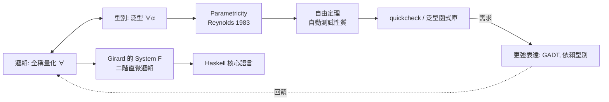

# 06.1 參數多型：代數中的通用量化

## 引言

到目前為止，我們的函數都是「具體」的：`add : Int -> Int -> Int` 只對整數有意義。但有些函數的邏輯與元素型別**無關**：排序（任意可比較物）、反轉（任意串列）、恆等（任意值）。**參數多型（parametric polymorphism）**讓我們寫一個函數服務所有型別——在型別邏輯中，這就是**全稱量化（universal quantification, $\forall$）**。

本節的驚喜在於：多型不只是「重用程式碼」。**型別簽名會限制實作**，某些型別簽名只有一個（至多差一個同構的）實作；某些型別簽名則根本無人能實作。型別開始像定理一樣「有內容」。

---

## 1. 定義：全稱量化型別

**定義 1.1（多型函數型別）.**

$$
\mathrm{id} : \forall \alpha.\; \alpha \to \alpha
$$

讀作「對所有型別 $\alpha$，id 是從 $\alpha$ 到 $\alpha$ 的函數」。使用時**實例化**（instantiation）：`id : Int -> Int`、`id : (Bool, Char) -> (Bool, Char)`。

**定義 1.2（參數多型 vs 特設多型）.**

| | 參數多型 | 特設多型（ad-hoc） |
|---|---|---|
| 機制 | 一份程式碼，對所有型別統一運作 | 每型別一份程式碼（overloading / typeclass） |
| 邏輯 | $\forall \alpha$ | 型別類約束 $\forall \alpha.\; \mathrm{Ord}\;\alpha \Rightarrow \dots$ |
| 行為保證 | 對 $\alpha$ **一視同仁**（parametricity） | 依型別而異 |
| 代表 | ML/Haskell 泛型、Java generics（近似） | Haskell typeclass、C++ 模板特化 |

本章聚焦參數多型；特設多型與子型別的關係見 06.2。

---

## 2. 定理：Parametricity——型別決定行為

**定理 2.1（Parametricity / 自由定理，Reynolds 1983；Wadler 1989）.** 若 $f : \forall \alpha.\; [\alpha] \to [\alpha]$ 是參數多型的，則 $f$ 必滿足：

$$
f \circ \mathrm{map}\;g = \mathrm{map}\;g \circ f \quad \text{對所有函數 } g
$$

即「先映射再 $f$」=「先 $f$ 再映射」。這條**免費得到的定律**（free theorem）不用看 $f$ 的實作就成立。

**證明思想.** 參數性要求 $f$ 對所有型別用「同一份程式碼」，於是 $f$ 不能：
- 檢查元素的具體值（它不知道 $\alpha$ 是什麼）；
- 製造新的 $\alpha$ 值（變不出來）；
- 丟棄或重複元素後還保持型別（結構歸納可證只能置換或複製位置）。

形式化工具是**邏輯關係（logical relations）**：對 $\alpha$ 到 $\beta$ 的任何關係 $R$，$f$ 必須把 $R$「沿著型別結構提升」後保持。$\blacksquare$

**推論 2.2（單調性）.** 以下型別的居民行為完全確定：

| 型別 | 唯一（至多）的函數 |
|---|---|
| $\forall \alpha.\; \alpha \to \alpha$ | 恆等 |
| $\forall \alpha.\; \alpha \to \alpha \to \alpha$ | $K$（恆取第一參數）或 $K_{\text{flip}}$ |
| $\forall \alpha.\; \alpha \to \mathrm{Void}$ | **不存在**（邏輯上 $A \Rightarrow \bot$ 無證明） |
| $\forall \alpha.\; \mathrm{Void} \to \alpha$ | 恆等於空函數（唯一，但無輸入可餵） |
| $\forall \alpha.\; (\alpha \to \alpha) \to \alpha \to \alpha$ | $n$ 次疊代 $f^n x$——**自然數再次出現！** |

最後一列是 Church 數的復活：型別 $(\alpha \to \alpha) \to (\alpha \to \alpha)$ 的居民**恰好**是自然數。型別即定理、項即證明，在這裡變得觸手可及。

---

## 3. 範例：型別簽名的「猜行為」遊戲

```haskell
-- 只看型別，猜實作（答案幾乎唯一）：
f1 :: a -> a
f1 x = x                          -- 唯一選擇

f2 :: (a -> b) -> [a] -> [b]
f2 = map                          -- 唯一「合理」選擇（見定理 2.1 的約束）

f3 :: (a -> b -> c) -> [a] -> [b] -> [c]
f3 = zipWith                      -- fold 的推廣

f4 :: [a] -> [a]
-- 實作空間：id、reverse、tail、init、drop、take、...
-- parametricity 保證：f4 只能「置換/刪除/重複」位置，不能偷看內容
reverse' [] = []; reverse' (x:xs) = reverse' xs ++ [x]
```

```python
# Python 的 TypeVar 是「弱化的」參數多型：只做註記，不強制參數性
from typing import TypeVar, List, Callable, Iterable

T = TypeVar("T"); S = TypeVar("S")

def my_map(f: Callable[[T], S], xs: Iterable[T]) -> List[S]:
    # 型別檢查器不會阻止你這樣寫（違反參數性的「作弊」）：
    # return [f(x) for x in xs if str(x) != "spam"]   # 偷看值了！
    return [f(x) for x in xs]

# 差別：Haskell 的多型在型別系統層面「承諾」參數性（定理 2.1），
# Python 的 TypeVar 只是文件化工具——安全網的網眼再次出現
```

用 Lean 可以把 parametricity 本身形式化（此處展示「無法實作」的定理）：

```lean
-- 定理：不存在 (α : Type) → α → Empty 的項
-- 在 Lean 中這是「構造主義」的直接後果：
-- 要造出 Empty 的元素（假），需要邏輯矛盾，而型別論一致（04.3 定理 6.1）

-- 但存在 (α : Type) → Empty → α：
def absurd {α : Type} : Empty → α := fun e => nomatch e

-- 以及宇宙層級的位移——Parametricity 的 Lean 形式化見
-- Reynolds 關係提升（relational lifting）在庫中的對應物
#print axioms absurd   -- 驗證未使用任何公理（好習慣：檢查證明的純度）
```

---

## 4. 範例：自由定理做自動測試

parametricity 的實用紅利：**免費的測試性質**。

```python
# 定理 2.1 的 Python 版：對任意 f: [a]->[a] 與任意 g，驗證
#   f(map(g, xs)) == map(g, f(xs))
import random

def property_test(xs, f, g):
    lhs = f([g(x) for x in xs])
    rhs = [g(x) for x in f(xs)]
    return lhs == rhs

# 若寫了一個 map-composable 的 reverse，此性質自動成立：
def reverse(xs): return xs[::-1]
g = lambda x: x * 2
for _ in range(100):
    xs = [random.randint(0, 99) for _ in range(random.randint(0, 10))]
    assert property_test(xs, reverse, g)

# 但若 f 偷看元素（非參數的），性質會破：
def bad_filter(xs): return [x for x in xs if x < 50]
try_count = 0
for _ in range(100):
    xs = [random.randint(0, 99) for _ in range(random.randint(0, 10))]
    if not property_test(xs, bad_filter, g):
        try_count += 1
print(f"bad_filter 違反自由定理的次數（非參數的證據）: {try_count}")
```

這就是 quickcheck 式 property testing 的理論基礎：**多型函數的性質不需要你發明，型別簽名已經替你證明了一批**。

---

## 5. 定理：泛型與積和的互動——容器都是代數式

**定理 5.1（多型資料型別的代數）.** 對多型容器 $F\langle \alpha \rangle$，其「大小」可視為 $\alpha$ 的多項式：

| 容器 | 代數式 | 基數（若 $|\alpha|=a$） |
|---|---|---|
| `Option<α>` | $\alpha + 1$ | $a + 1$ |
| `Pair<α,α>` | $\alpha^2$ | $a^2$ |
| `[α]`（有限串列） | $1 + \alpha + \alpha^2 + \cdots = \dfrac{1}{1-\alpha}$ | 形式冪級數 |
| 二元樹 | $1 + \alpha \cdot T^2$（不動點方程） | 遞迴解 |

```haskell
-- [a] 的代數式 1/(1-a) 展開：空、一元、二元……
data List a = Nil | Cons a (List a)
-- Nil = 1（空積）、Cons a = a × (List a)
-- 方程 T = 1 + a×T  →  T = 1 + a + a² + a³ + …

-- 對 List 求「導數」得到「一洞的串列」——微分在型別論中是真的！
-- d/da (1/(1-a)) = 1/(1-a)² = Zipper
data Zipper a = Zipper [a] a [a]   -- 左邊反序、焦點、右邊
```

「型別的微分」（McBride 2001）把 calculus 帶進資料結構：**對型別求導 = 在結構中挖一個洞**。這是 05 章代數視角的極致延伸，也預告了 06.3 依賴型別中「型別即數學物件」的完整形態。

---

## 6. 互相驅動的迴圈



Girard 的 System F（1971）把 $\forall$ 引入型別，同時是二階直覺邏輯的證明系統與 ML/Haskell 的理論核心——又一次「邏輯定理 = 型別規則」。而工程師要表達「容器不變式」時，$\forall$ 不夠用了，於是走向 06.3 的依賴型別。

---

## 7. 章末小結

- 參數多型 = 型別的全稱量化 $\forall \alpha$；與特設多型的差別是「一視同仁」承諾。
- **Parametricity 定理**：多型函數滿足免費定律（如 map-compositionality）；型別簽名近乎決定實作。
- 型別 $\forall \alpha. (\alpha \to \alpha) \to \alpha \to \alpha$ 的居民恰為自然數（Church 數）。
- 自由定理 → 自動性質測試；Python 的 TypeVar 無此保證（弱化版）。
- 容器是 $\alpha$ 的多項式/冪級數；對型別求導 = 挖洞（Zipper）。

## 下一步

$\forall \alpha$ 對「所有型別一視同仁」，但真實世界充滿「某些型別是另一些的特例」：`Dog` 是 `Animal`、`Sized` 是 `Comparable`。這需要**子型別（subtyping）**——型別之間的包含關係，即集合的 $\subseteq$。下一節 06.2 將比較兩種世界觀：$\forall$ 的代數世界與 $\subseteq$ 的層級世界，以及它們混合時的變異/不變/共變（variance）陷阱。
