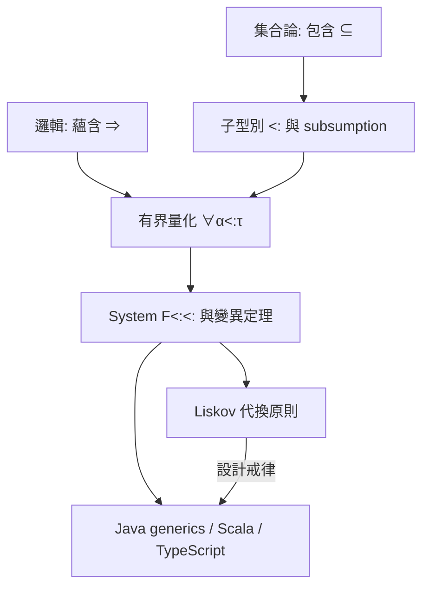

# 06.2 子型別與集合的包含關係

## 引言

上一節的全稱量化說「對所有型別一視同仁」；本節的子型別說「有些型別本來就是別的型別的一部分」。`Dog` 的每個值都是 `Animal` 的值——這正是集合論的包含 $\mathrm{Dog} \subseteq \mathrm{Animal}$ 。子型別把 $\subseteq$ 寫進型別規則，也帶來了它標誌性的代價：**動態分派**（呼叫哪個方法要執行期決定），以及**變異（variance）**的微妙陷阱。

本章主線：**子型別是集合包含的程式化身，而變異規則是「函數型別的單調性」**——定義域反變、對應域共變，這條規則其實是集合論與範疇論共同的必然。

---

## 1. 定義：子型別

**定義 1.1（子型別關係）.** $\tau_1 <: \tau_2$ （讀「 $\tau_1$ 是 $\tau_2$ 的子型別」）表示：任何 $\tau_1$ 型別的值都可以安全地當作 $\tau_2$ 型別的值使用。核心規則（subsumption）：

$$
\frac{\Gamma \vdash e : \tau_1 \quad \tau_1 <: \tau_2}{\Gamma \vdash e : \tau_2}
$$

**定義 1.2（子型別的兩種語意）.**

| | 集合包含 | 介面實現 |
|---|---|---|
| 語意 | 子型別的值集 ⊆ 父型別的值集 | 子型別**至少**提供父型別的介面 |
| 代表 | Java 的繼承、數值提升 | Go interface、Java interface、TypeScript |
| 同構要求 | 是（Liskov 代換） | 行為契約（僅方法簽名） |

**Liskov 代換原則（1987）**正是「集合包含」語意的行為版：子型別物件在父型別的任何使用情境下，行為不應使呼叫者驚訝。這條原則原本是 Hoare 邏輯式規格的定理要求，後來成為 OOP 的設計戒律——理論再次先行於工程。

---

## 2. 定理：變異規則——函數型別的單調性

**定理 2.1（變異/variance）.** 若 $A_1 <: A_2$ 且 $B_1 <: B_2$ ，則函數型別的包含方向是：

$$
A_2 \to B_1 \;<<:\; A_1 \to B_2
$$

即：**定義域反變（contravariant）、對應域共變（covariant）**。

**證明.** 設 $f : A_2 \to B_1$ 。要證 $f$ 可視為 $A_1 \to B_2$ ：給定 $a : A_1$ ，由 $A_1 <: A_2$ 知 $a$ 亦可作為 $A_2$ 輸入，得 $f(a) : B_1 <: B_2$ 。 $\blacksquare$

**記憶法**：函數是「消費者 vs 生產者」——消費者要更寬鬆（接受父類），生產者要更精確（產出子類）。這條規則在所有含子型別的語言中反覆出現，違反它的 API 遲早出事。

### 2.1 陷阱：可變容器的雙重身分

```python
# Python 的 list 是「不變（invariant）」的，這是正確的設計：
from typing import List

def feed(cats: List["Cat"]) -> None: ...

dogs: List["Dog"] = []
# feed(dogs)   # 型別檢查器拒絕！
# 若允許：feed 內部可能 append 一隻 Cat，污染了 List[Dog] —— 
# 因為 list 既能讀（產出，共變）也能寫（消費，反變），
# 同時要求共變與反變 ⇒ 只能不變。
```

```java
// Java 陣列是共變的 —— 這是歷史公認的設計錯誤：
Object[] objs = new String[1];  // 合法！String[] <: Object[]
objs[0] = 42;                    // 編譯通過，執行期 ArrayStoreException！
// 陣列「可寫」卻共變 ⇒ 違反定理 2.1 ⇒ 執行期才能補檢查（型別安全網破洞）
// Java 泛型改用 use-site variance（? extends / ? super）補救
```

```rust
// Rust 沒有繼承，但 lifetime 有變異；Box<T> 共變、&mut T 不變
// let o: Box<dyn Any> 之類的上轉是安全的，因為 Box 只能經引用讀寫且型別系統強制不變性
fn take_any(a: &dyn std::any::Any) { /* 動態分派 */ }
```

**教訓**：變異規則不是風格偏好，而是定理 2.1 的推論；繞過它的設計（Java 陣列）必然把錯誤推回執行期——回到 04.1 的老問題。

---

## 3. 範例：兩個世界觀的對照

**全稱量化 vs 子型別**，兩種「一般化」的方式：

```java
// 世界觀一：子型別（Java）
// 「任何 Animal 都行」—— 呼叫時依實際型別動態分派
interface Animal { String speak(); }
class Dog implements Animal { public String speak() { return "汪"; } }
class Cat implements Animal { public String speak() { return "喵"; } }

String chorus(List<Animal> zoo) {
    StringBuilder s = new StringBuilder();
    for (Animal a : zoo) s.append(a.speak());  // 執行期查虛擬表
    return s.toString();
}
```

```haskell
-- 世界觀二：全稱量化 + 特設多型（Haskell）
class Animal a where speak :: a -> String
data Dog = Dog; data Cat = Cat
instance Animal Dog where speak _ = "汪"
instance Animal Cat where speak _ = "喵"

chorus :: Animal a => [a] -> String     -- 這是「受約束的 ∀」，06.1 的特設多型
chorus = concatMap speak
-- 分派在編譯期解決（字典傳遞），無虛擬表
```

| | 子型別 | 型別類（∀ + 約束） |
|---|---|---|
| 分派時機 | 執行期（vtable） | 編譯期（字典）或執行期（dynamic） |
| 集合論形象 | $\subseteq$ 包含層級 | $\Rightarrow$ 邏輯蘊含 |
| 可表達 | 開放類別層級 | 任意型別實例化（包括 Int、Tuple） |
| 多型回傳值 | 難（需协變回傳或泛型） | 自然（`mempty :: a` 型別類） |

兩種世界觀在 Scala、TypeScript、Rust（trait 物件）中混合，混合處正是複雜度與 bug 的溫床——**變異標記（`? extends`、`in`/`out`、`+T`/`-T`）就是兩套理論妥協的疤痕**。

---

## 4. 範例：Python 的結構化子型別（Protocol）

```python
from typing import Protocol, runtime_checkable

@runtime_checkable
class Speaker(Protocol):
    """結構化子型別：不需要宣告繼承，形狀對上就行 —— 
    這是「集合包含」語意的回歸：值集由行為定義，而非族譜"""
    def speak(self) -> str: ...

class Dog:
    def speak(self) -> str: return "汪"     # 沒有繼承 Speaker！

def chorus(ss: list[Speaker]) -> str:
    return " ".join(s.speak() for s in ss)

assert isinstance(Dog(), Speaker)   # 結構相容即成立
print(chorus([Dog()]))
# TypeScript 的 interface、Go 的 implicit interface 都屬此派：
# 「子型別 = 集合包含」而非「子型別 = 宣告關係」
```

---

## 5. 定理：子型別與泛型的公理體系

**定義 5.1（記錄子型別的公理）.**（Cardelli–Wegner 1985 的骨架）

1. **自反**： $\tau <: \tau$
2. **傳遞**： $\tau_1 <: \tau_2,\; \tau_2 <: \tau_3 \Rightarrow \tau_1 <: \tau_3$
3. **深度子型別**： $\tau_1 <: \tau_2 \Rightarrow \{\ell : \tau_1\} <: \{\ell : \tau_2\}$ （record 欄位共變）
4. **寬度子型別**： $\{\ell_1:\tau_1,\; \ell_2:\tau_2\} <: \{\ell_1:\tau_1\}$ （多欄位 ⊆ 少欄位）
5. **函數反變/共變**（定理 2.1）

**定理 5.2（型別安全仍成立）.** 加入子型別與 subsumption 後，04.1 定理 3.1（Progress + Preservation）依然可證——**前提是**變異標記正確。這就是為什麼變異是「定理」不是「選項」。

Cardelli–Wegner 的統合稱為 **bounded quantification（有界量化）**：

$$
\forall \alpha <: \tau.\; \sigma
$$

「對所有 $\tau$ 的子型別 $\alpha$ 」。它把 06.1 的 $\forall$ 與本節的 $<:$ 統一在一個系統裡（System $F_{<:}$ ），是 Java generics 與 Scala 的理論基礎。



---

## 6. 互相驅動的迴圈與代價

子型別的**代價**值得直言：

1. **型別推導變難**：subsumption 打破「唯一最一般型別」，ML 的 Hindley–Milner 因此**放棄子型別**（用型別類替代）。
2. **分派變動態**：虛擬表、dynamic dispatch 的效能與優化困難。
3. **變異腦力稅**：每個泛型介面都要回答 in/out/invariant。
4. **row polymorphism**（record 子型別的替代品）成為新研究方向——「多欄位 ⊆ 少欄位」其實可以不用 $<:$ 而用量化表達。

這些代價推動了**混合設計**：Rust 選擇「無繼承 + trait + 泛型」，Go 選擇「結構化介面」，ML/Haskell 選擇「無子型別 + 型別類」。**沒有免費的 $\subseteq$ **——每個語言都在集合包含的表達力與推導可判定性之間定價。

---

## 7. 章末小結

- 子型別 $<:$ 是集合包含的程式化，核心規則是 subsumption。
- **變異定理**：函數型別定義域反變、對應域共變；可變容器被迫不變；Java 陣列是反例教訓。
- Liskov 代換原則是包含語意的行為化。
- 有界量化 $F_{<:}$ 統一了 $\forall$ 與 $<:$ ，是主流泛型的理論基礎。
- 子型別的代價：推導複雜、動態分派、變異標記；各語言用不同方式「繞開或馴服」它。

## 下一步

我們的一般化還停留在「對所有型別」： $\forall$ 與 $<:$ 都量化**型別**。但有些規格要談**值**：「長度為 $n$ 的向量」「質數型別」「 $\mathrm{vec}$ 的長度必須等於矩陣的行數」。這需要讓型別**依賴於值**——依賴型別（dependent type）。下一節 06.3 是全書這條線的頂點：型別不再是標籤，而是完整的數學命題；程式檢查升格為定理證明。
